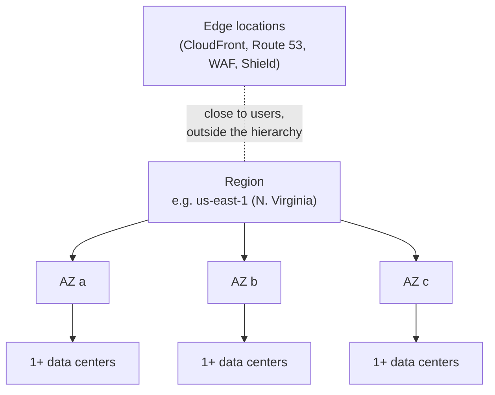
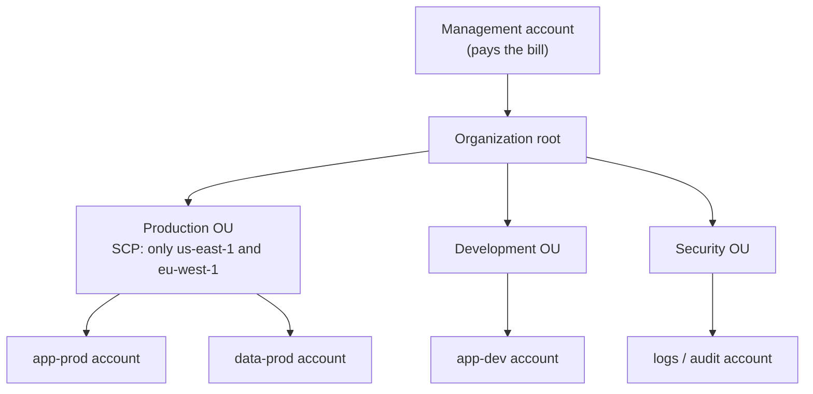
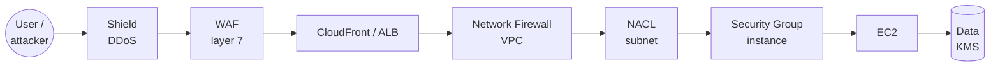
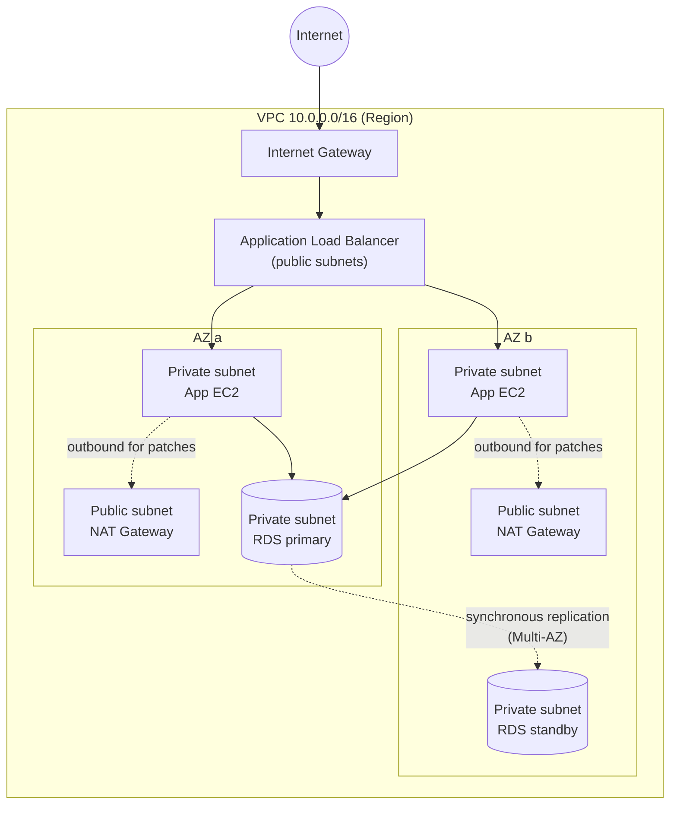
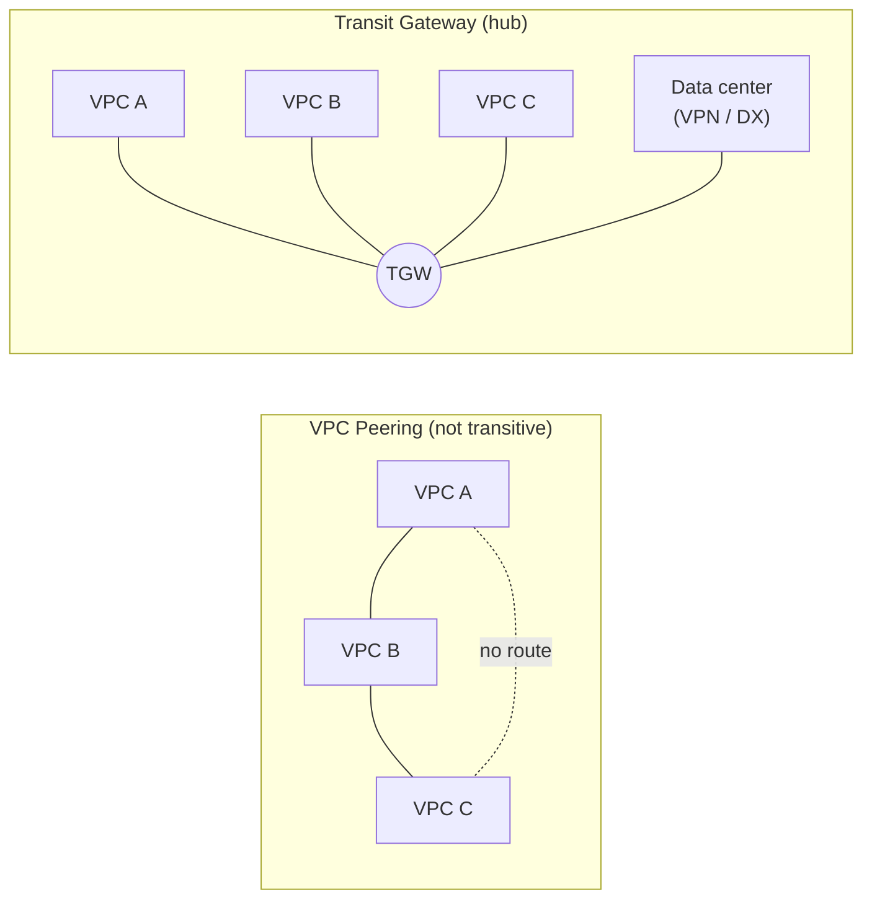
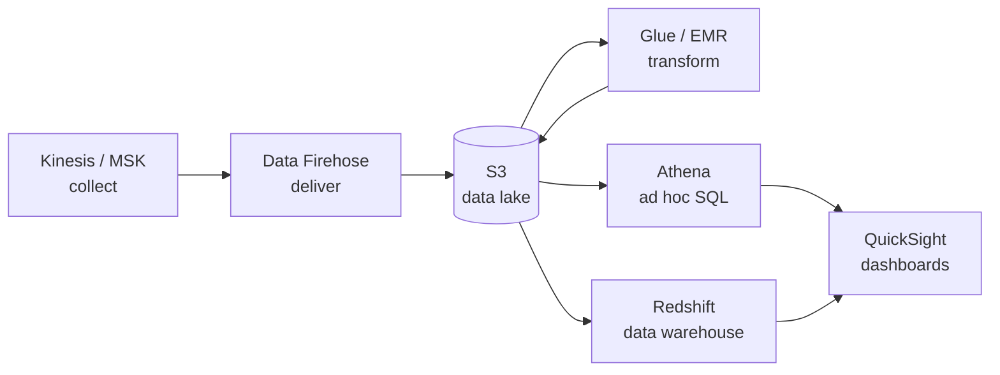
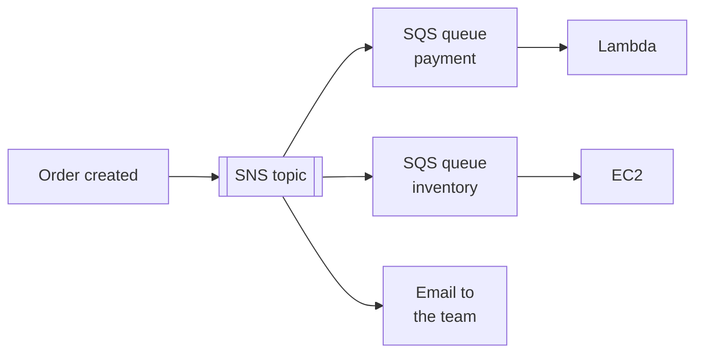

# AWS Certified Cloud Practitioner (CLF-C02) Study Guide

> Pre-exam review, organized by the 4 domains of the official exam guide.
> Last reviewed: October 2026 · [Versão em português](../pt-br/resumo-clf-c02.md)

**How to use it:** read it in order once, then on the day before the exam review only the **Trap** boxes and [section 26](#26-exam-traps-pairs-the-exam-swaps).

## Contents

| # | Section | Domain |
|---|---|---|
| 0 | [How the exam works](#0-how-the-exam-works) | |
| 1 | [Cloud concepts](#1-cloud-concepts) | 1 |
| 2 | [Well-Architected Framework](#2-well-architected-framework) | 1 |
| 3 | [Cloud adoption and migration](#3-cloud-adoption-and-migration) | 1 |
| 4 | [Global infrastructure](#4-global-infrastructure) | 1 and 3 |
| 5 | [Shared responsibility model](#5-shared-responsibility-model) | 2 |
| 6 | [IAM: identity, access and keys](#6-iam-identity-access-and-keys) | 2 |
| 7 | [Multi-account organization](#7-multi-account-organization) | 2 |
| 8 | [Encryption, keys and secrets](#8-encryption-keys-and-secrets) | 2 |
| 9 | [Layers of protection](#9-layers-of-protection) | 2 |
| 10 | [Investigation, audit trail and compliance](#10-investigation-audit-trail-and-compliance) | 2 |
| 11 | [Amazon EC2](#11-amazon-ec2) | 3 |
| 12 | [Other compute services](#12-other-compute-services) | 3 |
| 13 | [Containers](#13-containers) | 3 |
| 14 | [Scaling and load balancers](#14-scaling-and-load-balancers) | 3 |
| 15 | [Storage](#15-storage) | 3 |
| 16 | [Networking: VPC, gateways and firewalls](#16-networking-vpc-gateways-and-firewalls) | 3 |
| 17 | [Connectivity and content delivery](#17-connectivity-and-content-delivery) | 3 |
| 18 | [Databases and caching](#18-databases-and-caching) | 3 |
| 19 | [Analytics and data services](#19-analytics-and-data-services) | 3 |
| 20 | [AI and machine learning services](#20-ai-and-machine-learning-services) | 3 |
| 21 | [Messaging, email and integration](#21-messaging-email-and-integration) | 3 |
| 22 | [Monitoring and observability](#22-monitoring-and-observability) | 3 |
| 23 | [Costs: pricing and tools](#23-costs-pricing-and-tools) | 4 |
| 24 | [Support plans](#24-support-plans) | 4 |
| 25 | [Other services that show up](#25-other-services-that-show-up) | 3 |
| 26 | [Exam traps: pairs the exam swaps](#26-exam-traps-pairs-the-exam-swaps) | All |
| | [Sources](#sources) | |

---

## 0. How the exam works

CLF-C02 tests **recognition**: given a scenario, which service or concept solves it. It does not test configuration or commands.

| Item | Value |
|---|---|
| Questions | 65 total: 50 scored, 15 unscored and unidentified |
| Time | 90 minutes |
| Passing score | 700 on a scale of 100 to 1000 |
| Format | Multiple choice (1 correct out of 4) and multiple response (2 or more correct out of 5 or more) |
| Penalty for guessing | None. Never leave a question blank |

| Domain | Weight | Where it is in this guide |
|---|---|---|
| 1. Cloud Concepts | 24% | Sections 1 to 4 |
| 2. Security and Compliance | 30% | Sections 5 to 10 |
| 3. Cloud Technology and Services | 34% | Sections 11 to 22 and 25 |
| 4. Billing, Pricing and Support | 12% | Sections 23 and 24 |

> [!TIP]
> **How to read the questions**
> - Find the keyword. "Cheapest", "least operational overhead", "managed", "serverless", "can tolerate interruption" and "audit" almost always point to a single service.
> - When two answers both work, AWS prefers the more managed one, the one that needs less work from the customer.
> - In multiple response questions, the prompt tells you how many to pick. Pick exactly that many.
> - The **Trap** boxes throughout this guide mark where the answer options tend to look alike. [Section 26](#26-exam-traps-pairs-the-exam-swaps) collects every confusing pair.

---

## 1. Cloud concepts

Cloud computing is the on-demand delivery of IT resources over the internet with pay-as-you-go pricing.

### The 6 advantages of cloud computing

The exam uses the official list and asks you to match a scenario to one of them.

1. **Trade fixed expense for variable expense.** CapEx (buying servers) becomes OpEx (paying for what you use).
2. **Benefit from massive economies of scale.** AWS buys in volume and passes lower prices on.
3. **Stop guessing capacity.** Scale up and down with demand.
4. **Increase speed and agility.** New resources in minutes, not weeks.
5. **Stop spending money running and maintaining data centers.** Focus on the product, not racks, power and cooling.
6. **Go global in minutes.** Deploy to multiple Regions in a few clicks.

### Terms that get confused

| Term | Meaning | Clue in the question |
|---|---|---|
| Scalability | Ability to grow to handle more load | "support growth" |
| Elasticity | Grow and shrink automatically with demand | "pay only at peak", "scale down when idle" |
| High availability | Stay up even when a component fails | "multiple AZs", "no single point of failure" |
| Fault tolerance | Keep running with no degradation at all during a failure | "zero interruption" |
| Agility | Speed to experiment and deliver | "test ideas quickly" |
| Durability | Not losing data over time | S3's "11 nines" |
| Disaster recovery | Coming back after a major event | "another Region", RTO and RPO |

> [!WARNING]
> **Trap:** availability means the service responds; durability means the data is not lost. S3 Standard has 99.99% availability and 99.999999999% durability.

### Service types: IaaS, PaaS, SaaS

| Model | You manage | AWS manages | Examples |
|---|---|---|---|
| IaaS | OS, patches, runtime, application, data | Hardware, network, virtualization | EC2, EBS, VPC |
| PaaS | Application and data | OS, runtime, capacity, patches | Elastic Beanstalk, RDS, Lightsail |
| SaaS | Just usage and data | Everything | Amazon Connect, Amazon WorkMail, and third-party products like Gmail and Salesforce |

Variants that show up as answer options: **FaaS** (Lambda) and **CaaS** (ECS and EKS). The higher up the model, the less control and the less operational work.

### Deployment models

- **Cloud (public cloud):** everything runs on AWS.
- **On-premises (private cloud):** everything in your own data center, with virtualization. Fewer cloud benefits.
- **Hybrid:** part on AWS and part on-premises, connected by VPN or Direct Connect. Outposts and Storage Gateway are typical hybrid services.

Multi-cloud only shows up as a distractor: it means using more than one provider.

### Cloud economics

- **CapEx vs. OpEx:** on-premises requires upfront investment; cloud is a variable cost.
- **TCO (total cost of ownership):** compares the real cost of on-premises (hardware, power, space, staff, licenses) with AWS. The tool to build that case is **Migration Evaluator**.
- **Rightsizing:** choosing the smallest resource size that handles the workload. It is the first step in cost optimization.
- **Managed services** cut operational cost, even when the hourly price is higher.
- **Licenses:** License Included (built into the price) or BYOL (bring the license you already own). BYOL for per-socket or per-core licenses requires **Dedicated Hosts**. **AWS License Manager** tracks usage.
- **Automation** (CloudFormation, Systems Manager) cuts labor cost and human error.

---

## 2. Well-Architected Framework

Six pillars of best practices for designing and running workloads on AWS. The exam describes a practice and asks for the pillar.

| Pillar | Focus | Principles and clues | Related services |
|---|---|---|---|
| Operational excellence | Running and monitoring systems, improving processes | Operations as code, small reversible changes, learn from failures | CloudFormation, CloudWatch, Systems Manager, Config |
| Security | Protecting data, systems and assets | Least privilege, traceability, security at every layer, encryption in transit and at rest, keep people away from data | IAM, KMS, CloudTrail, GuardDuty, WAF, Shield |
| Reliability | Recovering from failure and meeting demand | Automatic recovery, horizontal scaling, test recovery, stop guessing capacity | Multi-AZ, Auto Scaling, Backup, Route 53 |
| Performance efficiency | Using resources efficiently | Serverless, advanced technology as a service, go global in minutes, experiment more | Lambda, CloudFront, right instance types, Auto Scaling |
| Cost optimization | Delivering value at the lowest price | Pay only for consumption, measure efficiency, attribute spend, rightsizing | Cost Explorer, Budgets, Savings Plans, Spot, Compute Optimizer |
| Sustainability | Reducing environmental impact | Maximize utilization, use managed services, reduce idle resources | Graviton, Auto Scaling, Customer Carbon Footprint Tool |

- **AWS Well-Architected Tool:** free console service that reviews your workload against the pillars and produces an improvement plan.
- **General design principles:** design for failure, decouple components (SQS, SNS), prefer elasticity over fixed capacity, think parallel, automate.

> [!WARNING]
> **Trap:** "recover from failure automatically" is **Reliability**. "Perform operations as code" is **Operational excellence**. "Choose the right instance type" can be **Performance** (if the focus is speed) or **Cost** (if the focus is spend).

---

## 3. Cloud adoption and migration

The **AWS Cloud Adoption Framework (CAF)** organizes the adoption journey into 6 perspectives. The exam asks for the right perspective for a role or activity.

### The 6 CAF perspectives

| Perspective | Group | Focus | Typical stakeholders |
|---|---|---|---|
| Business | Business capabilities | Make sure cloud investment accelerates business outcomes | CEO, CFO, COO, CIO |
| People | Business capabilities | Culture, organizational structure, leadership, workforce skills | HR, CIO, functional leaders |
| Governance | Business capabilities | Orchestrate initiatives, risk management, portfolio, cloud financial management | CTO, CFO, CDO, CRO |
| Platform | Technical capabilities | Build a scalable hybrid platform, modernize workloads | CTO, architects, engineers |
| Security | Technical capabilities | Confidentiality, integrity and availability of data and workloads | CISO, audit, compliance |
| Operations | Technical capabilities | Deliver services at the level agreed with the business | Infrastructure leaders, SREs |

- **CAF benefits:** reduced business risk, improved ESG performance, increased revenue, increased operational efficiency.
- **Transformation phases:** Envision, Align, Launch, Scale.
- **Transformation domains:** technology, process, organization and product.

> [!WARNING]
> **Trap:** training and upskilling teams is **People**, not Governance. Cloud financial management (FinOps) is **Governance**, not Business.

### The 7 Rs of migration

| Strategy | What it is | Example |
|---|---|---|
| Retire | Shut down what is no longer used | Legacy system with no users |
| Retain | Keep it where it is, for now | App with a regulatory constraint or a recent upgrade |
| Rehost | Lift and shift: move without changes | On-premises VM becomes EC2 via Application Migration Service |
| Relocate | Move the whole hypervisor without buying new hardware | On-premises VMware to VMware on AWS |
| Repurchase | Switch to a different product, usually SaaS | In-house CRM becomes Salesforce |
| Replatform | Lift, tinker and shift: small optimizations without changing architecture | Database on a VM becomes RDS |
| Refactor / Re-architect | Rewrite to be cloud native | Monolith becomes serverless microservices |

**Rehost** is the fastest. **Refactor** is the most expensive and brings the most cloud benefit.

### Migration best practices

- Start with an inventory: **Application Discovery Service** collects data about on-premises servers.
- Build the business case with TCO (**Migration Evaluator**).
- Migrate in waves, starting with simple workloads, not everything at once.
- After migrating, modernize: rightsizing, managed services, automation.
- Design for failure from day one: multiple AZs, backups, infrastructure as code.

### Migration services

| Service | What it is for |
|---|---|
| AWS Application Migration Service (MGN) | Rehost servers to EC2 with continuous replication |
| AWS Database Migration Service (DMS) | Migrate databases while the source stays online. Homogeneous or heterogeneous |
| AWS Schema Conversion Tool (SCT) | Convert schemas between engines, for example Oracle to Aurora |
| AWS Application Discovery Service | Inventory and dependencies of the on-premises environment |
| AWS Migration Hub | Single dashboard to track migrations |
| AWS DataSync | Online, automated file transfer to S3, EFS or FSx |
| AWS Transfer Family | Managed SFTP, FTPS and FTP writing to S3 or EFS |
| AWS Snow Family | Offline transfer of large volumes on a physical device, plus edge computing |

> [!NOTE]
> **Snow Family:** the exam may mention **Snowcone** (small, portable, about 8 TB), **Snowball Edge** (tens to hundreds of TB, in Storage Optimized and Compute Optimized versions) and **Snowmobile** (a truck, up to 100 PB). Snowcone and Snowmobile have been discontinued in real life but still appear in practice exams. The logic tested: lots of data plus a slow or expensive link calls for offline transfer.

> [!WARNING]
> **Trap:** DMS moves the **data**; SCT converts the **schema**. Heterogeneous migrations use both. DataSync is **online**; Snow is **offline**.

---

## 4. Global infrastructure

The hierarchy is **Region → Availability Zone → data center**. Edge locations sit outside that hierarchy, close to end users.



| Component | What it is | What it is for |
|---|---|---|
| Region | Geographic area with at least 3 AZs, isolated from other Regions | Data sovereignty, latency, disaster recovery |
| Availability Zone (AZ) | One or more data centers with independent power, networking and cooling, linked by a private low-latency network | High availability within a Region |
| Edge location / point of presence | Cache site and entry point to the AWS network. There are many more edge locations than Regions | CloudFront, Route 53, Global Accelerator, WAF, Shield |
| Regional edge cache | Intermediate cache between the origin and edge locations | Less popular content in CloudFront |
| Local Zone | Extension of a Region into a large city | Single-digit millisecond latency for users in that city |
| Wavelength Zone | AWS infrastructure inside carriers' 5G networks | Ultra-low latency mobile apps |
| AWS Outposts | AWS rack installed in your data center, managed by AWS | Hybrid, local data residency, low local latency |

### How to choose a Region

The exam tests these 4 criteria:

1. **Compliance and data residency:** laws requiring data to stay in a country. This one beats the others.
2. **Latency:** proximity to users.
3. **Service availability:** not every service exists in every Region.
4. **Pricing:** varies by Region.

### Service scope

| Scope | Examples |
|---|---|
| Global | IAM, Organizations, Route 53, CloudFront, WAF (when attached to CloudFront), Shield, Billing |
| Regional | S3 (bucket names are global, data lives in a Region), DynamoDB, Lambda, VPC, ELB, EFS |
| Per AZ | EC2 instance, EBS volume, subnet, RDS instance |

### Availability patterns

- **Multi-AZ:** high availability. Protects against losing a data center.
- **Multi-Region:** disaster recovery, global latency and data residency. Protects against losing an entire Region.
- Data never leaves a Region on its own. Cross-Region replication is always the customer's decision.

> [!WARNING]
> **Trap:** edge locations do not run EC2 or host your database. They are for caching and network entry. "Reduce latency for users worldwide with static content" is **CloudFront**, not more Regions.

---

## 5. Shared responsibility model

AWS is responsible for security **of** the cloud; the customer is responsible for security **in** the cloud. This is the most tested topic in the security domain.

| AWS responsibility | Customer responsibility |
|---|---|
| Physical security of data centers | Customer data and its classification |
| Hardware, physical network, power, cooling | Identity and access management (IAM, MFA, passwords) |
| Hypervisor and virtualization layer | Security Group, NACL and OS firewall configuration |
| Global infrastructure (Regions, AZs, edge) | Client-side, at-rest and in-transit encryption |
| Software of managed services | Guest OS and application patches (on EC2) |
| Secure disk disposal | Service configuration, for example a public or private bucket |

### The line moves with the service

| Service type | Example | Who handles the OS and patches | What is left for the customer |
|---|---|---|---|
| Infrastructure | EC2 | Customer | OS, patches, application, firewall, data, IAM |
| Managed / container | RDS, Fargate, Elastic Beanstalk | AWS | Configuration, network rules, database users, data, IAM |
| Abstracted / serverless | S3, DynamoDB, Lambda | AWS | Data, permissions, encryption, code (in Lambda) |

### Controls

- **Inherited** (AWS only): physical and environmental controls.
- **Shared** (both, each at its own layer): patch management, configuration management, awareness and training.
- **Customer specific:** data protection and zoning within applications.

### Lines that answer questions

- The customer is **always** responsible for: data, IAM and configuration of what they use.
- AWS is **always** responsible for: physical, hardware, hypervisor, global network.
- Patching the OS on EC2 is the customer's job. Patching the OS on RDS and Lambda is AWS's.
- Patching the database engine on RDS is AWS's job, but the customer picks the maintenance window.
- Encrypting data is the customer's decision. AWS provides the tools.
- Training employees is shared: AWS trains its staff and the customer trains theirs.

> [!WARNING]
> **Trap:** "configure the Security Group" is always the **customer**, even on RDS. "Protect the hypervisor" is always **AWS**. In Lambda, the security of the function's code and permissions is still the customer's.

---

## 6. IAM: identity, access and keys

IAM controls **who** (authentication) can do **what** (authorization) in the account. It is global and free.

### Components

| Component | What it is | When to use |
|---|---|---|
| Root user | Account owner, created with the email address. Full access that cannot be restricted by IAM policies | Only for the few tasks that require root |
| IAM user | Long-lived identity for a person or application | When there is no federation. Today the recommendation is to prefer Identity Center and roles |
| Group | Collection of users. Gets policies attached. Cannot contain other groups | Giving the same permissions to many users |
| Role | Identity with no password or long-term keys, assumed temporarily | An AWS service accessing another, cross-account access, federation |
| Policy | JSON document that allows or denies actions on resources | Always. It is where permissions actually live |

### How policies work

- Elements: `Effect` (Allow or Deny), `Action`, `Resource`, and optionally `Principal` and `Condition`.
- Everything is denied by default (**implicit deny**).
- An **explicit deny** overrides any allow.
- **Identity-based:** attached to a user, group or role.
- **Resource-based:** attached to the resource, like an S3 bucket policy. Enables cross-account access.
- AWS managed, customer managed, or inline (embedded in a single identity).

```json
{
  "Version": "2012-10-17",
  "Statement": [
    {
      "Effect": "Allow",
      "Action": "s3:GetObject",
      "Resource": "arn:aws:s3:::my-bucket/*"
    }
  ]
}
```

### Access methods and credentials

| Access method | Credential |
|---|---|
| Console (browser) | Username, password and MFA |
| AWS CLI, SDKs and API calls | Access keys: Access Key ID and Secret Access Key |
| Service to service | Role with temporary credentials |
| CloudShell | Browser-based terminal that inherits the console credentials |

About access keys:

- They are long-term credentials. The Secret Access Key is shown only once, at creation.
- Never create keys for root. Never put keys in code or in a repository.
- Rotate them regularly and delete unused ones.
- On EC2, Lambda and ECS, use a **role** instead of keys. **AWS STS** issues the temporary credentials behind roles.
- Do not confuse them with **EC2 key pairs** (SSH login to an instance) or **KMS keys** (encryption).

### Tested best practices

1. Protect root with MFA and don't use it day to day.
2. Least privilege: grant only the permissions needed.
3. MFA for every human user.
4. Permissions through groups or roles, not individual users.
5. Roles and temporary credentials instead of long-term keys.
6. Strong password policy and credential rotation.
7. One user per person. Never share credentials.
8. Review access with the tools below.

### Tasks only root can do

- Change the root email, account name and root password.
- Close the account.
- Change or cancel the support plan.
- Restore permissions for the last IAM administrator.
- Enable MFA Delete on an S3 bucket.
- Register as a seller in the Reserved Instance Marketplace.

### Review tools

| Tool | What it gives you |
|---|---|
| IAM Credential Report | Spreadsheet of all users and their credential status: password, MFA, key age |
| IAM Access Advisor (last accessed) | Which services each identity actually used. The basis for trimming unused permissions |
| IAM Access Analyzer | Finds resources shared outside the account or organization |

### Neighboring identity services

| Service | For whom |
|---|---|
| AWS IAM Identity Center (formerly AWS SSO) | Employees: single sign-on to multiple AWS accounts and applications |
| Amazon Cognito | End users of web and mobile apps. Sign-up, sign-in and social login |
| AWS Directory Service | Managed Microsoft Active Directory on AWS |
| AWS STS | Temporary credentials |

> [!WARNING]
> **Trap:** roles are for anything without long-term credentials (a service, another account, a federated user). "An EC2 instance needs to read from S3" is a **role**, never an access key. "Customer sign-in to my app" is **Cognito**, not IAM.

---

## 7. Multi-account organization

**AWS Organizations** groups multiple accounts under a management account, with a single bill and central policies. It is free.



### Organizations building blocks

| Piece | What it is |
|---|---|
| Management account | Creates the organization, pays the bill for every account |
| Member accounts | All other accounts |
| Organizational unit (OU) | Group of accounts, for example Production, Development, Security. Can be nested |
| Service Control Policy (SCP) | Maximum permission boundary for an account or OU |
| Consolidated billing | A single bill, with usage combined |

### SCPs: what the exam tests

- An SCP **does not grant** permissions. It only sets the ceiling of what can be allowed.
- Effective permission is the **intersection** of the SCP and the IAM policy.
- SCPs affect everyone in a member account, **including that account's root user**.
- SCPs **do not affect** the management account.
- Typical use: block unapproved Regions, prevent anyone from turning off CloudTrail.

### Consolidated billing

- One bill and one payment method.
- Usage across all accounts is combined, which reaches volume discount tiers (S3, data transfer).
- Unused Reserved Instances and Savings Plans in one account apply to others, if sharing is enabled.
- No extra cost.

### Why use multiple accounts

Isolate environments (production, test), limit the blast radius of an incident, separate costs by team, meet compliance requirements.

### Related governance services

| Service | What it does |
|---|---|
| AWS Control Tower | Sets up and governs a ready-made multi-account environment (landing zone) with best practices. Uses Organizations underneath. Comes with preventive and detective controls (guardrails) and Account Factory to create standardized accounts |
| AWS IAM Identity Center | Employee single sign-on across every account in the organization |
| AWS Resource Access Manager (RAM) | Share resources across accounts, such as subnets and Transit Gateways |
| AWS Service Catalog | Catalog of approved products (CloudFormation templates) that teams launch themselves |
| AWS License Manager | Central tracking of software licenses |
| Tag policies and cost allocation tags | Standardize tags and split costs by project or team |

> [!WARNING]
> **Trap:** "restrict what accounts can do" is an **SCP** in Organizations. "Quickly set up a secure multi-account environment following best practices" is **Control Tower**. "Get volume discounts by combining accounts" is **consolidated billing**.

---

## 8. Encryption, keys and secrets

Two states to protect: **at rest** (data written to disk) and **in transit** (data on the move, protected with TLS/HTTPS).

### Services and differences

| Service | Stores what | What sets it apart | Clue in the question |
|---|---|---|---|
| AWS KMS | Encryption keys | Managed, multi-tenant, integrated with almost every service, key usage audited in CloudTrail | "create and control keys", "encrypt EBS, S3, RDS" |
| AWS CloudHSM | Encryption keys | Dedicated hardware just for you (single-tenant), FIPS 140-2 Level 3. AWS has no access to the keys | "dedicated hardware", "full control of keys", "regulatory requirement" |
| AWS Certificate Manager (ACM) | SSL/TLS certificates | Free public certificates, automatic renewal, used on ELB, CloudFront and API Gateway | "HTTPS on the site", "encryption in transit" |
| AWS Secrets Manager | Secrets: database passwords, API keys, tokens | Automatic rotation, native RDS integration. Paid per secret | "rotate database credentials automatically" |
| SSM Parameter Store | Configuration parameters and simple secrets | Free on the standard tier, no native automatic rotation | "store configuration", "no-cost option" |

### KMS key types

| Type | Who creates and manages it | Visible in your account | Rotation |
|---|---|---|---|
| AWS owned key | AWS | No | AWS decides |
| AWS managed key (`aws/s3`, `aws/ebs`) | AWS, on your behalf | Yes, read only | Automatic, yearly |
| Customer managed key | You | Yes, full control of the key policy | Optional automatic or manual |

### Encryption in the most tested services

- **S3:** every new object is encrypted by default with SSE-S3. Other options: SSE-KMS (key in KMS, with auditing), SSE-C (you supply the key), and client-side encryption.
- **EBS:** encryption with KMS. Covers the volume, its snapshots and the traffic between instance and volume.
- **RDS:** encryption at rest with KMS, chosen at creation. In transit with TLS.
- **DynamoDB:** always encrypted at rest.
- **CloudTrail** logs every use of a KMS key.

> [!WARNING]
> **Trap:** KMS is for **keys**; Secrets Manager is for **secrets** (passwords). Between Secrets Manager and Parameter Store, "automatic rotation" points to **Secrets Manager**. Between KMS and CloudHSM, "dedicated" or "single-tenant" points to **CloudHSM**. ACM does not encrypt data at rest.

---

## 9. Layers of protection

Defense is layered: edge, network, host, data and identity. Each service below covers one layer, and the exam swaps them in the answer options.



### Edge and network protection

| Service | Protects against | Layer | Tested details |
|---|---|---|---|
| AWS Shield Standard | Common DDoS | 3 and 4 (network and transport) | Free and automatic for every customer |
| AWS Shield Advanced | Large, sophisticated DDoS | 3, 4 and 7 | Paid (high monthly subscription). 24/7 access to the Shield Response Team, cost protection against attack-driven scaling, reports, WAF included for protected resources |
| AWS WAF | Web attacks: SQL injection, XSS, bots, request floods | 7 (application) | Rules by IP, country, rate, request pattern. Attaches to CloudFront, ALB, API Gateway and AppSync |
| AWS Firewall Manager | Inconsistent rules across accounts | Management | Manages WAF, Shield Advanced, Security Group and Network Firewall rules across the organization |
| AWS Network Firewall | Malicious traffic entering or leaving the VPC | 3 to 7 | Managed stateful firewall for the whole VPC, with filtering and intrusion prevention |
| Security Group | Unwanted access to the instance | Instance | Stateful, allow rules only ([section 16](#16-networking-vpc-gateways-and-firewalls)) |
| Network ACL | Unwanted access to the subnet | Subnet | Stateless, allow and deny ([section 16](#16-networking-vpc-gateways-and-firewalls)) |

### Detection and assessment

| Service | Question it answers | How it works |
|---|---|---|
| Amazon GuardDuty | Is there an active threat in my account? | Intelligent threat detection with machine learning over CloudTrail logs, VPC Flow Logs and DNS. Agentless. Finds crypto mining, compromised credentials, communication with malicious IPs |
| Amazon Inspector | Do my workloads have known vulnerabilities? | Automated scanning of EC2, container images in ECR and Lambda functions. Looks for CVEs and unintended network exposure |
| Amazon Macie | Do I have sensitive data exposed in S3? | Machine learning to discover and classify personal data (PII) in buckets |
| Amazon Detective | What is the root cause of this alert? | Builds a graph from logs to investigate an incident that was already detected |
| AWS Security Hub | What is my overall security posture? | Single dashboard that aggregates findings from GuardDuty, Inspector, Macie and partners, and checks standards like CIS and PCI DSS |
| IAM Access Analyzer | Is any resource shared externally? | Analyzes resource policies |
| AWS Trusted Advisor | Am I following best practices? | Basic security checks: open buckets, open ports, MFA on root |

### Other tested security points

- **Penetration testing:** customers can test their own resources on a list of common services without asking for permission. Simulated DDoS has its own rules.
- **Reporting abuse:** AWS resources used for spam, attacks or illegal content are reported to the **AWS Trust & Safety** team (abuse).
- **AWS Marketplace:** source of third-party security products (firewalls, antivirus, SIEM).
- **Where to find security information:** AWS Security Center, Security Blog, security bulletins, Knowledge Center and documentation.
- **AWS Security Incident Response:** support service for incident response. Included with Enterprise Support.

> [!WARNING]
> **Classic trap, one line each:**
> - DDoS: **Shield**.
> - SQL injection and XSS: **WAF**.
> - Threats and anomalous behavior in the account: **GuardDuty**.
> - Software vulnerabilities in EC2 and containers: **Inspector**.
> - Personal data in S3: **Macie**.
> - Investigate root cause: **Detective**.
> - Consolidated view of findings: **Security Hub**.

---

## 10. Investigation, audit trail and compliance

Three services answer three different questions: **CloudTrail** tells you who did it, **Config** tells you what the resource looked like and how it changed, **CloudWatch** tells you how the resource is performing.

| Service | Records | Clue in the question |
|---|---|---|
| AWS CloudTrail | Every API call in the account: who, what, when, from which IP. Covers console, CLI and SDK | "audit", "who deleted the instance", "track user activity" |
| AWS Config | Resource inventory and configuration history, with rules that evaluate compliance | "the Security Group was changed", "non-compliant resources", "configuration history" |
| Amazon CloudWatch | Performance metrics, logs and alarms ([section 22](#22-monitoring-and-observability)) | "CPU usage", "alarm", "dashboard" |
| VPC Flow Logs | Metadata of IP traffic on VPC network interfaces | "accepted or rejected traffic", "troubleshoot connectivity" |
| AWS Artifact | AWS compliance reports (SOC, PCI, ISO) and agreements such as the BAA | "download a SOC report", "prove to the auditor that AWS is certified" |
| AWS Audit Manager | Continuous collection of evidence about your AWS usage for audits | "automate evidence collection", "prepare for an audit" |
| Amazon Detective | Root cause analysis of security incidents | "investigate", "root cause" |
| AWS Health Dashboard | AWS events and maintenance affecting your resources | "is AWS having an issue in my Region?" |

### CloudTrail in detail

- On by default. **Event history** keeps 90 days of management events at no cost.
- To keep more, create a **trail** that delivers logs to an S3 bucket, and optionally to CloudWatch Logs.
- **Management events:** operations on resources (create, delete, modify).
- **Data events:** operations inside a resource, like reading an S3 object. Optional and paid.
- **CloudTrail Insights:** detects unusual API activity.
- A single trail can cover every Region and every account in the organization.

### Compliance

- AWS maintains certifications and programs such as SOC 1, 2 and 3, PCI DSS, ISO 27001, HIPAA, FedRAMP and GDPR.
- Customers inherit AWS's physical controls but remain responsible for the compliance of what they build.
- Requirements vary by service and Region. Not every service is in scope for every program.
- **AWS Artifact** is where you get the documents. It is free and self-service.

> [!WARNING]
> **Trap:** Artifact gives you reports **about AWS**. Audit Manager collects evidence **about you**. CloudTrail is about **actions** (API); Config is about **state** (configuration). "Who changed it" is CloudTrail; "what changed and what it looked like before" is Config.

---

## 11. Amazon EC2

EC2 is an on-demand virtual server: IaaS, with full control of the operating system and full responsibility for it.

### Instance families

| Family | Common letters | Use |
|---|---|---|
| General purpose | T, M | Balance of CPU, memory and network. Web servers, development environments |
| Compute optimized | C | CPU heavy: batch processing, media encoding, game servers, HPC |
| Memory optimized | R, X | Large in-memory data: in-memory databases, caches, real-time analytics |
| Storage optimized | I, D, H | Heavy local disk I/O: data warehousing, NoSQL databases, distributed file systems |
| Accelerated computing | P, G | GPU: machine learning, graphics rendering |

The exam asks for the family from the scenario, not the exact instance name. **Graviton** instances (AWS's ARM processor) show up as the best price-performance option.

### Pricing models

| Model | Commitment | Approximate discount | When to use |
|---|---|---|---|
| On-Demand | None. Pay per second or hour | None | Short, unpredictable workloads, tests, running an app for the first time |
| Reserved Instances (RI) | 1 or 3 years, tied to family and Region | Up to 72% (Standard), up to 66% (Convertible) | Steady, predictable workloads, like an always-on database |
| Savings Plans | 1 or 3 years of a dollar-per-hour amount | Up to 72% (EC2 Instance), up to 66% (Compute) | Steady workloads with flexibility to change family or Region, or use Fargate and Lambda |
| Spot | None. AWS can reclaim with a 2-minute warning | Up to 90% | Interruption-tolerant workloads: batch, data analysis, CI, image processing |
| Dedicated Instances | Hardware not shared with other customers | More expensive | Isolation requirement, with no control over the physical server |
| Dedicated Hosts | A whole physical server for you, with socket and core visibility | The most expensive | BYOL with per-socket or per-core licenses, strict compliance |
| Capacity Reservations | Reserves capacity in an AZ, no discount | None | Making sure capacity exists for a critical event |

**Reserved Instances:**

- **Standard:** biggest discount, cannot change family. Can be sold on the Reserved Instance Marketplace.
- **Convertible:** smaller discount, lets you change family, OS and size.
- Payment: All Upfront (biggest discount), Partial Upfront or No Upfront (smallest discount).
- 3 years gives a bigger discount than 1 year.

**Savings Plans:**

- **Compute Savings Plans:** the most flexible. Apply to EC2 in any family and Region, Fargate and Lambda.
- **EC2 Instance Savings Plans:** bigger discount, tied to one family in one Region.

> [!WARNING]
> **Trap:** "cannot be interrupted" rules out **Spot**. "Constant usage for 1 to 3 years" calls for **RIs or a Savings Plan**. "Flexibility to change instance type and service" calls for a **Compute Savings Plan**. "Per-core license" calls for a **Dedicated Host**, not a Dedicated Instance.

### Pieces around EC2

| Piece | What it is |
|---|---|
| AMI (Amazon Machine Image) | Instance template with OS and software. Can come from AWS, the Marketplace, the community or you. Regional |
| EC2 Image Builder | Automates building, testing and updating AMIs |
| User data | Script that runs at first boot |
| Key pair | SSH login (Linux) or password retrieval (Windows) |
| Security Group | The instance's virtual firewall |
| Elastic IP | Static public IPv4. Since February 2024 every public IPv4 address is billed, in use or not |
| EBS and instance store | The instance's disks ([section 15](#15-storage)) |
| Placement groups | Control over where instances physically sit: cluster, spread, partition |
| Launch template | Instance recipe used by Auto Scaling |
| EC2 Instance Connect and Session Manager | Instance access without managing SSH keys or opening ports |
| Elastic Load Balancing and Auto Scaling | Traffic distribution and scaling ([section 14](#14-scaling-and-load-balancers)) |
| AWS Compute Optimizer | Recommends the right instance size based on usage |
| AWS Systems Manager | Patching, remote commands and inventory across a fleet |

> [!NOTE]
> **Elastic IP:** many practice exams still use the old rule, "an Elastic IP is only billed when it is not associated with a running instance". If a question asks how to avoid unnecessary cost, the answer is still to release unused Elastic IPs.

**Billing:** a **stopped** instance pays no compute but still pays for EBS (and for the public IPv4, if it has an Elastic IP). A **terminated** instance pays nothing and, by default, deletes its root volume.

---

## 12. Other compute services

The choice is always control vs. operational effort. EC2 gives the most control; Lambda gives the least work.

| Service | What it is | Clue in the question |
|---|---|---|
| AWS Lambda | Serverless functions triggered by events. Pay per request and execution time. 15-minute limit per execution. Scales on its own | "no servers to manage", "run code in response to an event", "pay only when it runs" |
| AWS Elastic Beanstalk | PaaS: you upload code and it creates EC2, load balancer, Auto Scaling and monitoring. You still see and control the resources. The service itself is free | "deploy a web app quickly without handling infrastructure", "developer just wants to upload code" |
| Amazon Lightsail | Simple virtual server with a fixed, predictable monthly price, with disk, DNS and IP included | "simple website", "WordPress", "little cloud experience", "predictable price" |
| AWS Batch | Runs batch jobs, provisioning the right compute automatically | "thousands of batch jobs", "heavy scheduled processing" |
| AWS Fargate | Serverless engine for containers ([section 13](#13-containers)) | "containers without managing servers" |
| AWS Outposts | AWS infrastructure in your data center | "hybrid", "data must stay on-premises" |
| AWS Wavelength | Compute at the edge of 5G networks | "5G", "ultra-low latency for mobile" |
| AWS Local Zones | Compute close to large cities | "low latency in a specific city" |
| Amazon API Gateway | Create, publish and secure REST, HTTP and WebSocket APIs. Common partner of Lambda | "expose an API", "front door for a serverless backend" |

### What serverless means on the exam

- No servers to provision, patch or scale.
- Pay for usage; idle costs zero or close to zero.
- High availability and scaling are built in.
- Classic serverless services: Lambda, Fargate, S3, DynamoDB, SQS, SNS, API Gateway, Step Functions, EventBridge, Aurora Serverless, Athena.

> [!WARNING]
> **Trap:** Lambda does not fit processes that run for hours (15-minute limit); use **Batch, Fargate or EC2** instead. Elastic Beanstalk is **not serverless**, since it creates EC2 underneath. Lightsail is for simple cases, not architectures that need to scale a lot.

---

## 13. Containers

There are two separate decisions: **who orchestrates** (ECS or EKS) and **where the containers run** (EC2 or Fargate).

| Service | Role | Clue in the question |
|---|---|---|
| Amazon ECS | AWS's own orchestrator. Simpler, integrated with the rest of AWS | "run Docker containers", "AWS-native orchestrator" |
| Amazon EKS | Managed Kubernetes | "Kubernetes", "already uses Kubernetes on-premises", "portability" |
| AWS Fargate | Serverless compute for ECS and EKS. You set CPU and memory per task and never see a server | "without managing instances", "without provisioning a cluster" |
| Amazon ECR | Private container image registry | "store Docker images" |
| ECS Anywhere and EKS Anywhere | Run the orchestrators on your own infrastructure | "on-premises containers with the same tools" |

### Launch types

| Option | Who manages the servers | Billing |
|---|---|---|
| EC2 | You: patches, cluster scaling, capacity | For the EC2 instances, used or not |
| Fargate | AWS | Per vCPU and memory each task consumes |

> [!WARNING]
> **Trap:** Fargate is **not an orchestrator**; it needs ECS or EKS. ECR is an image registry; it runs nothing. If the question says "Kubernetes", the answer is **EKS**, even if ECS would also work.

---

## 14. Scaling and load balancers

The standard high-availability pair is a load balancer spreading traffic across instances in an Auto Scaling group that spans multiple AZs.

### Types of scaling

| Type | What it is | Example |
|---|---|---|
| Vertical (scale up/down) | Make the resource bigger or smaller | Swap `t3.medium` for `t3.xlarge`. Requires a stop, has a ceiling |
| Horizontal (scale out/in) | Add or remove resources | Go from 2 to 6 instances. This is what gives elasticity and high availability |

### Amazon EC2 Auto Scaling

- An **Auto Scaling group** sets **minimum, desired and maximum** capacity.
- It automatically replaces failed instances, which keeps availability up.
- The service is free. You pay only for the instances.

| Policy | How it decides | When to use |
|---|---|---|
| Dynamic: target tracking | Keeps a metric at a target, for example CPU at 50% | General case |
| Dynamic: step and simple | Reacts to CloudWatch alarms with defined steps | Finer control |
| Scheduled | Changes capacity at set dates and times | Known peaks, like business hours or Black Friday |
| Predictive | Uses machine learning on history to scale ahead of time | Cyclical traffic patterns |

**AWS Auto Scaling** (without "EC2") is the service that manages scaling for several resources in one place: EC2, ECS, DynamoDB and Aurora.

### Elastic Load Balancing (ELB)

| Type | OSI layer | Protocols | Characteristics | When to use |
|---|---|---|---|---|
| Application Load Balancer (ALB) | 7 | HTTP, HTTPS | Routing by path, host, header. Good for microservices and containers. Supports WAF | Web applications |
| Network Load Balancer (NLB) | 4 | TCP, UDP, TLS | Extreme performance, very low latency, millions of requests per second, static IP per AZ | Non-HTTP traffic, gaming, IoT, need for a fixed IP |
| Gateway Load Balancer (GWLB) | 3 | IP | Distributes traffic to third-party virtual appliances | Third-party firewalls and inspection systems |
| Classic Load Balancer (CLB) | 4 and 7 | HTTP, HTTPS, TCP | Previous generation | Legacy only. Rarely the answer |

What every ELB does:

- Distributes traffic across targets in multiple AZs.
- Runs **health checks** and stops sending traffic to unhealthy targets.
- Is managed and scales on its own.
- Is **regional**. To distribute across Regions, use Route 53 or Global Accelerator.

> [!WARNING]
> **Trap:** scalability is being able to grow; elasticity is growing and shrinking on its own. "Routing by URL" is **ALB**. "Static IP" or "very high performance TCP/UDP" is **NLB**. "Third-party security appliance" is **GWLB**. The load balancer **distributes**; Auto Scaling **adds instances**.

---

## 15. Storage

There are three types: **object** (S3), **block** (EBS and instance store) and **file** (EFS and FSx). The first decision in any question is which of the three the scenario needs.

| Type | Service | How it is accessed | Typical use |
|---|---|---|---|
| Object | Amazon S3 | HTTP API, by key | Static files, backups, data lake, media |
| Block | Amazon EBS, instance store | Disk mounted on one instance | OS disk, database on EC2 |
| File | Amazon EFS, Amazon FSx | Shared network file system | Many servers reading and writing the same files |

### Amazon S3: concepts

- Objects live in **buckets**. Bucket names are globally unique, but the bucket lives in one Region.
- Unlimited capacity. The classic tested limit is **5 TB per object**.
- **99.999999999% (11 nines)** durability across all classes.
- Data is replicated across at least 3 AZs, except in One Zone classes.
- Private by default. **Block Public Access** is on.

### S3 storage classes

From hottest to coldest:

| Class | Access | Retrieval | Minimum storage duration | When to use |
|---|---|---|---|---|
| S3 Express One Zone | Very frequent | Single-digit milliseconds | None | High performance in a single AZ |
| S3 Standard | Frequent | Immediate | None | Active data, websites, applications |
| S3 Intelligent-Tiering | Unknown or changing | Immediate | None | Unpredictable access patterns. Moves objects between tiers on its own, for a small monitoring fee |
| S3 Standard-IA | Infrequent | Immediate | 30 days | Backups and rarely accessed data that must be at hand. Charges a retrieval fee |
| S3 One Zone-IA | Infrequent | Immediate | 30 days | Infrequent, re-creatable data. Stored in a single AZ, about 20% cheaper than Standard-IA |
| S3 Glacier Instant Retrieval | Rare, about once a quarter | Milliseconds | 90 days | Archives that need immediate access when requested, like medical images |
| S3 Glacier Flexible Retrieval | Rare, 1 to 2 times a year | Minutes to hours (1 to 5 min expedited, 3 to 5 h standard, 5 to 12 h bulk) | 90 days | Archives and backups that can wait |
| S3 Glacier Deep Archive | Very rare | 12 hours (standard) to 48 hours (bulk) | 180 days | Regulatory retention of 7 to 10 years. The cheapest class |
| S3 on Outposts | Local | Immediate | None | Objects in your data center, on Outposts |

> [!WARNING]
> **Trap:** "unknown or changing access pattern" is **Intelligent-Tiering**. "Cheapest of all" and "can wait 12 hours" is **Deep Archive**. "Archive with millisecond access" is **Glacier Instant Retrieval**. "Infrequent and can be lost because it can be re-created" is **One Zone-IA**.

### S3 features

| Feature | What it is for |
|---|---|
| Versioning | Keeps every version of an object. Protects against accidental deletes and overwrites |
| Lifecycle policies | Move objects between classes or expire them automatically over time |
| Replication (CRR and SRR) | Copy objects to a bucket in another Region (CRR) or the same Region (SRR). Requires versioning |
| Bucket policy | Resource-based policy that controls access to the bucket |
| Block Public Access | Account- or bucket-level guard against public exposure |
| Encryption | SSE-S3 by default; SSE-KMS; SSE-C; client-side |
| Static website hosting | Serves HTML, CSS and JS straight from the bucket |
| Transfer Acceleration | Speeds up long-distance uploads using edge locations |
| Object Lock | WORM model: prevents deletion or changes for a period |
| Presigned URL | Temporary link to a private object |
| S3 Storage Lens | Organization-wide view of storage usage and activity |
| Event notifications | Trigger Lambda, SQS or SNS when an object arrives |

**S3 billing:** GB stored, number of requests, retrieval in cold classes, and data transferred out. Data transferred in is free.

### Block storage

| Characteristic | Amazon EBS | Instance store |
|---|---|---|
| Persistence | Data survives stopping and starting the instance | Ephemeral: data is lost when the instance stops, terminates or the host fails |
| Location | Network volume in the same AZ as the instance | Physical disk on the host itself |
| Performance | High and configurable | Very high, with minimal latency |
| Backup | Incremental snapshots stored in S3 | None |
| Use | OS disk, databases | Cache, buffers, temporary data |

**EBS volume types:**

| Type | Media | Use |
|---|---|---|
| gp3 and gp2 (General Purpose SSD) | SSD | Default for almost everything: boot, development, common apps |
| io2 and io1 (Provisioned IOPS SSD) | SSD | Critical databases needing high, consistent IOPS |
| st1 (Throughput Optimized HDD) | HDD | Big data, logs, large sequential reads. Cannot be a boot volume |
| sc1 (Cold HDD) | HDD | Rarely accessed data, lowest cost. Cannot be a boot volume |

About EBS:

- A volume is **locked to one AZ**. To move it to another AZ or Region, use a snapshot.
- Usually a volume is attached to one instance at a time.
- Snapshots are incremental and can be copied across Regions.
- Billed by **provisioned size**, even if empty.
- **Amazon Data Lifecycle Manager** automates snapshot creation and retention.

### File storage

| Service | Protocol | OS | Clue in the question |
|---|---|---|---|
| Amazon EFS | NFS | Linux | "shared file system across many Linux instances", "grows and shrinks on its own", "multiple AZs" |
| Amazon FSx for Windows File Server | SMB | Windows | "Windows", "Active Directory", "SMB" |
| Amazon FSx for Lustre | Lustre | Linux | "HPC", "machine learning", "high performance", integrates with S3 |
| Amazon FSx for NetApp ONTAP | NFS, SMB, iSCSI | Both | "migrate NetApp without changing the application" |
| Amazon FSx for OpenZFS | NFS | Linux | "migrate ZFS" |

About EFS:

- Elastic: pay for what you store, no size to provision.
- Regional: can be mounted by thousands of instances across multiple AZs at once.
- Classes: Standard, Infrequent Access and Archive, with lifecycle between them. There is also a One Zone option.
- Costs more per GB than EBS and S3.

> [!WARNING]
> **Trap:** EBS belongs to **one instance, in one AZ**. EFS serves **many instances, across many AZs**. Linux calls for **EFS**; Windows calls for **FSx for Windows**. Data that must survive a shutdown never goes on instance store.

### Hybrid, transfer and backup

**AWS Storage Gateway** connects on-premises applications to AWS storage using standard protocols. It comes in three types:

| Type | On-premises protocol | Where the data lives | Use |
|---|---|---|---|
| S3 File Gateway | NFS, SMB | Objects in S3 | Local file shares with data in the cloud |
| Volume Gateway | iSCSI | Volumes backed up as EBS snapshots. Cached mode (primary in S3) or stored mode (primary on-premises) | Local block disks backed up to the cloud |
| Tape Gateway | iSCSI VTL | Virtual tapes in S3 and Glacier | Replace physical tapes without changing backup software |

| Service | What it does |
|---|---|
| AWS Backup | Centralizes and automates backup policies for EBS, RDS, DynamoDB, EFS, FSx, S3 and more, including across accounts and Regions |
| AWS DataSync | Copies large volumes of files over the network between on-premises and AWS |
| AWS Snow Family | Offline physical transfer ([section 3](#3-cloud-adoption-and-migration)) |
| AWS Elastic Disaster Recovery | Replicates servers for fast recovery on AWS |

---

## 16. Networking: VPC, gateways and firewalls

A **VPC** is your private, isolated network inside a Region. You define the IP range, split it into subnets and control routes and firewalls.

The diagram shows the three-tier pattern across two AZs: web tier in public subnets, application and database in private subnets.



### VPC building blocks

| Piece | Scope | What it does |
|---|---|---|
| VPC | Region | Isolated network with a CIDR block, for example `10.0.0.0/16`. Every account has a default VPC per Region |
| Subnet | One AZ | Slice of the VPC. For high availability, create subnets in more than one AZ |
| Public subnet | One AZ | Has a route to the Internet Gateway. Hosts load balancers, bastion hosts, NAT Gateway |
| Private subnet | One AZ | No direct route to the internet. Hosts databases and application servers |
| Route table | Subnet | Defines where traffic for each destination goes |
| Elastic IP | Region | Static public IPv4 |
| VPC Flow Logs | VPC, subnet or interface | Records metadata of accepted and rejected traffic |

### Gateway types

Almost everything that connects networks on AWS is called a *gateway*. The exam takes advantage of that.

| Gateway | Connects what | Tested details |
|---|---|---|
| Internet Gateway (IGW) | VPC and the internet, both directions | One per VPC. Free, scales on its own. It is what makes a subnet public |
| NAT Gateway | Private subnet to the internet, outbound only | Lives in a public subnet. Managed and paid. Typical use: downloading updates |
| Egress-only Internet Gateway | Same idea as NAT, for IPv6 | Outbound only |
| Virtual Private Gateway (VGW) | AWS side of a VPN or Direct Connect, attached to one VPC | Pairs with the Customer Gateway |
| Customer Gateway (CGW) | Customer side of the VPN | Represents the on-premises router |
| Transit Gateway (TGW) | Many VPCs and on-premises networks through a central hub | Replaces a mesh of peerings |
| Direct Connect Gateway | One Direct Connect to VPCs in multiple Regions | Rarely tested |
| Gateway VPC endpoint | VPC to S3 and DynamoDB without going through the internet | Free. Only those two services |
| Interface VPC endpoint (PrivateLink) | VPC to other AWS services, privately | Paid. Uses a network interface with a private IP |
| Storage Gateway | On-premises storage to S3, EBS and Glacier | A hybrid storage service, not networking ([section 15](#15-storage)) |
| API Gateway | Clients to your APIs | An application service, not networking ([section 12](#12-other-compute-services)) |
| Gateway Load Balancer | Traffic to third-party appliances | A load balancer ([section 14](#14-scaling-and-load-balancers)) |

> [!WARNING]
> **Trap:** "an instance in a private subnet needs to download patches" is a **NAT Gateway**. "Access S3 from inside the VPC without the internet" is a **Gateway VPC endpoint**. An Internet Gateway allows inbound and outbound; NAT is outbound only.

### Security Group vs. Network ACL

| Characteristic | Security Group | Network ACL (NACL) |
|---|---|---|
| Where it acts | On the instance (network interface) | On the subnet |
| State | **Stateful:** return traffic for allowed traffic is automatically allowed | **Stateless:** inbound and outbound each need their own rule |
| Rule types | Allow only | Allow and deny |
| Evaluation | All rules are evaluated together | Numbered rules evaluated in order; the first match decides |
| Default when created | Denies all inbound, allows all outbound | The VPC's default NACL allows everything. A NACL you create denies everything |
| Applies to | Only the associated instances | Everything in the subnet |
| Can reference | IPs and other Security Groups | IPs only |
| Responsible | Customer | Customer |

> [!WARNING]
> **Trap:** "block a specific IP" is a **NACL**, because Security Groups have no deny rules. "Instance-level firewall" is a **Security Group**. "Subnet-level firewall" is a **NACL**. The Security Group is the stateful one.

---

## 17. Connectivity and content delivery

The question is always **what is being connected to what**: VPC to VPC, VPC to an AWS service, or AWS to the on-premises data center.

### VPC to VPC

| Service | How it works | When to use |
|---|---|---|
| VPC Peering | Private one-to-one link between two VPCs, including across accounts and Regions. **Not transitive**: if A talks to B and B to C, A does not talk to C | Few VPCs |
| AWS Transit Gateway | Central hub where VPCs, VPNs and Direct Connect attach. Transitive routing | Many VPCs, hub-and-spoke topology |
| AWS PrivateLink | Exposes a specific service privately to other VPCs, without opening the whole network | Consume or offer a service without peering |



### VPC to AWS services, without the internet

| Service | Reaches |
|---|---|
| Gateway VPC endpoint | S3 and DynamoDB. Free |
| Interface VPC endpoint (PrivateLink) | Most other AWS services and partner services |

### AWS to on-premises

| Service | Medium | Encryption | Time to set up | Clue in the question |
|---|---|---|---|---|
| AWS Site-to-Site VPN | IPsec tunnel over the public internet | Yes, by default | Minutes | "quick to set up", "low cost", "encrypted connection over the internet" |
| AWS Direct Connect (DX) | Dedicated private fiber, off the internet | Not by default | Weeks to months | "dedicated connection", "consistent performance", "high bandwidth", "does not traverse the internet" |
| AWS Client VPN | Managed VPN for individual users (laptops) | Yes | Minutes | "remote employees accessing the VPC" |
| Direct Connect with VPN on top | Dedicated fiber with an IPsec tunnel | Yes | Weeks | "dedicated and encrypted" |

A Site-to-Site VPN uses a **Virtual Private Gateway** (or Transit Gateway) on the AWS side and a **Customer Gateway** on the customer side. A common design is Direct Connect as primary and VPN as backup.

> [!WARNING]
> **Trap:** Direct Connect is **private but not encrypted** by default. VPN is **encrypted but goes over the internet** with variable performance. "Needs to work today" rules out Direct Connect.

### DNS, CDN and acceleration

| Service | What it is | Clue in the question |
|---|---|---|
| Amazon Route 53 | Managed, highly available DNS, domain registration and health checks | "register a domain", "translate a name into an IP", "route users to the nearest Region" |
| Amazon CloudFront | CDN: caches content at edge locations. Static and dynamic. Integrates with S3, ALB, WAF, Shield and ACM | "reduce latency for global users", "cache", "deliver video and images" |
| AWS Global Accelerator | Two static anycast IPs that carry traffic over the AWS global network to the nearest healthy endpoint. No caching | "static global IP", "TCP or UDP", "fast failover between Regions", gaming, VoIP |
| S3 Transfer Acceleration | Uses edge locations to speed up uploads to a bucket | "slow uploads to S3 from distant users" |

**Route 53 routing policies:**

| Policy | What it does |
|---|---|
| Simple | One record, one destination |
| Weighted | Splits traffic by weight, for example 90% and 10%. Useful for testing |
| Latency | Sends users to the Region with the lowest latency for them |
| Failover | Active-passive: switches to the secondary if the health check fails |
| Geolocation | Decides by the user's country or continent. Useful for localized content and legal restrictions |
| Geoproximity | Decides by distance, with an adjustable bias |
| Multivalue answer | Returns several healthy IPs |

> [!WARNING]
> **Trap:** CloudFront **caches** content (HTTP). Global Accelerator **does not cache**; it optimizes the network path and gives a fixed IP. Route 53 is DNS: it decides where a name points, but traffic does not flow through it.

---

## 18. Databases and caching

AWS has a database for each data model (*purpose-built*). The exam gives the data type or access pattern and asks for the service.

### Map by type

| Type | Service | Why use it | Clue in the question |
|---|---|---|---|
| Managed relational | Amazon RDS | SQL, ACID transactions, joins, fixed schema. Engines: MySQL, PostgreSQL, MariaDB, Oracle, SQL Server, Db2 | "managed relational database", "migrate MySQL without managing servers" |
| Cloud-native relational | Amazon Aurora | MySQL and PostgreSQL compatible. Up to 5x MySQL throughput and 3x PostgreSQL. 6 copies across 3 AZs, storage that grows on its own | "high-performance relational", "MySQL or PostgreSQL compatible", "high availability" |
| Key-value (NoSQL) | Amazon DynamoDB | Serverless, single-digit millisecond latency at any scale, flexible schema | "NoSQL", "serverless", "massive scale", "shopping cart", "sessions", "gaming" |
| Document | Amazon DocumentDB | MongoDB compatible. JSON documents | "MongoDB", "catalog", "user profiles" |
| In-memory | Amazon ElastiCache, Amazon MemoryDB | Microsecond latency | "cache", "sessions", "real-time leaderboard" |
| Graph | Amazon Neptune | Highly connected data | "social network", "recommendations", "fraud detection", "knowledge graph" |
| Wide column | Amazon Keyspaces | Apache Cassandra compatible | "Cassandra" |
| Time series | Amazon Timestream | Timestamped data | "IoT", "metrics over time", "telemetry" |
| Ledger | Amazon QLDB | Immutable, cryptographically verifiable log with a central authority | "immutable history", "audit financial transactions" |
| Data warehouse | Amazon Redshift | Analytics (OLAP) at petabyte scale, columnar storage | "data warehouse", "analytical reports", "BI" ([section 19](#19-analytics-and-data-services)) |

> [!NOTE]
> **QLDB** was discontinued in July 2025 but may still show up in study material. A database on EC2 is still an option when you need full OS control or an engine RDS doesn't offer, at the cost of managing everything yourself.

### Amazon RDS in detail

What AWS does for you: provisioning, OS and engine patching, automated backups, failure detection and recovery.

| Feature | Purpose | How it works |
|---|---|---|
| Multi-AZ | High availability and failover | **Synchronous** standby replica in another AZ. Automatic failover. In the classic model the standby does not serve reads |
| Read Replicas | Read scaling and performance | **Asynchronous** replicas that serve queries. Can be in another Region |
| Automated backups | Point-in-time recovery | Retention up to 35 days, restore to a specific moment |
| Manual snapshots | On-demand backup | Kept until you delete them |
| Encryption | Security | At rest with KMS, in transit with TLS |

> [!WARNING]
> **Trap:** Multi-AZ is for **availability** (disaster). Read Replicas are for **read performance**. The exam swaps them all the time.

### Aurora

- **Aurora Serverless:** adjusts capacity on its own. Good for intermittent or unpredictable workloads.
- **Aurora Global Database:** cross-Region replication with low-latency local reads and disaster recovery.
- Up to 15 read replicas.
- Costs more than standard RDS and delivers more performance and availability.

### DynamoDB

- Fully managed and serverless. No instances to choose.
- Data replicated across 3 AZs by default.
- Capacity modes: **on-demand** (pay per request) or **provisioned** (set reads and writes, with auto scaling).
- **Global Tables:** multi-Region, active-active.
- **DAX (DynamoDB Accelerator):** in-memory cache specific to DynamoDB, with microsecond latency.
- On-demand backups and point-in-time recovery.

### Database licensing

| Model | How it works | Where it appears |
|---|---|---|
| License Included | The license is part of the hourly price | RDS for SQL Server and Oracle (some editions) |
| BYOL (Bring Your Own License) | You use a license you already bought | RDS for Oracle and Db2; databases on EC2 and Dedicated Hosts |
| Open source | No license cost | MySQL, PostgreSQL, MariaDB, Aurora |

- Moving from commercial engines to Aurora or PostgreSQL is a classic way to cut license costs. The **DMS and SCT** pair handles that migration.
- **AWS License Manager** tracks license consumption.

### Caching

A cache keeps the results of frequent queries in memory, which lowers latency and takes load off the database.

| Service | Type | Advantage | When to use |
|---|---|---|---|
| ElastiCache for Redis or Valkey | In-memory, with rich data structures | Persistence, replication, Multi-AZ with failover, pub/sub, sorted sets | Sessions, leaderboards, caches that need high availability |
| ElastiCache for Memcached | In-memory, simple | Multithreaded, easy to scale horizontally, no persistence | Simple object caching |
| Amazon MemoryDB | Durable in-memory database, Redis compatible | Multi-AZ durability, can be the primary database | When you want memory speed with durability |
| DynamoDB Accelerator (DAX) | Cache in front of DynamoDB | No changes to application logic | DynamoDB only |
| Amazon CloudFront | Content cache at the edge | Close to the user | Web content, static or dynamic |

> [!WARNING]
> **Trap:** "reduce read load on a relational database" can be Read Replicas or ElastiCache. If the question says "in-memory" or "microseconds", it is **ElastiCache**. If it mentions DynamoDB, it is **DAX**. Redshift is analytics (**OLAP**); RDS and Aurora are transactional (**OLTP**).

---

## 19. Analytics and data services

The flow is **collect → store → transform → query → visualize**. Each service owns one step.



| Service | Step | What it is | Clue in the question |
|---|---|---|---|
| Amazon Kinesis Data Streams | Collect | Real-time streaming data ingestion, with retention and multiple consumers | "real time", "clickstream", "telemetry", "thousands of sources" |
| Amazon Data Firehose (formerly Kinesis Data Firehose) | Collect and deliver | Loads streaming data into S3, Redshift and OpenSearch in near real time, no code | "deliver streaming data to S3", "simplest way to load" |
| Amazon MSK | Collect | Managed Apache Kafka | "Kafka" |
| Amazon S3 | Store | Foundation of the data lake | "data lake" |
| AWS Lake Formation | Store and govern | Builds and secures a data lake in days, with centralized permissions | "build a data lake quickly", "fine-grained access control" |
| AWS Glue | Transform | Serverless ETL and data catalog (Glue Data Catalog), with crawlers that discover schemas | "ETL", "prepare data", "metadata catalog" |
| Amazon EMR | Process | Managed Hadoop, Spark, Hive and Presto clusters | "big data", "Spark", "Hadoop" |
| Amazon Athena | Query | Serverless SQL directly over files in S3. Pay per data scanned | "query S3 with SQL", "no infrastructure", "log analysis" |
| Amazon Redshift | Query | Petabyte-scale columnar data warehouse. Redshift Spectrum queries S3 | "data warehouse", "OLAP", "complex analytical queries" |
| Amazon OpenSearch Service | Search | Full-text search and log analytics, with dashboards | "search", "log analytics", "Elasticsearch" |
| Amazon QuickSight | Visualize | Serverless BI: dashboards, reports, natural language questions | "dashboards", "business intelligence", "visualize data" |
| Amazon Managed Service for Apache Flink | Process | Real-time stream analytics with Flink | "analyze streaming data in real time" |
| AWS Data Exchange | Acquire | Subscribe to third-party data sets | "third-party data" |

> [!NOTE]
> **New names vs. exam names:** Kinesis Data Firehose became **Amazon Data Firehose** in 2024, and QuickSight was folded into the **Amazon Quick** brand in 2025. The exam and practice tests still use the old names.

> [!WARNING]
> **Trap, one line each:**
> - Serverless SQL over S3: **Athena**.
> - Data warehouse: **Redshift**.
> - ETL: **Glue**.
> - Hadoop and Spark: **EMR**.
> - Real-time streaming: **Kinesis**.
> - Dashboards: **QuickSight**.
> - Kinesis is data streaming; SQS is a message queue between components. They are not interchangeable in the answer options.

---

## 20. AI and machine learning services

There are three levels: **ready-made AI services** (API, no ML knowledge needed), **ML platform** (SageMaker) and **generative AI** (Bedrock and Amazon Q). The exam gives the task and asks for the service.

### Ready-made AI services

| Service | Input | Output | Clue in the question |
|---|---|---|---|
| Amazon Rekognition | Images and video | Objects, faces, text in images, content moderation | "facial recognition", "detect objects in photos", "inappropriate content" |
| Amazon Textract | Scanned documents, PDFs | Extracted text, tables and form fields | "extract data from forms", "OCR", "invoices" |
| Amazon Comprehend | Text | Sentiment, entities, language, topics, PII | "sentiment analysis", "customer reviews", "NLP" |
| Amazon Transcribe | Audio | Text (speech to text) | "subtitles", "transcribe calls" |
| Amazon Polly | Text | Audio (text to speech) | "natural voice", "read articles aloud" |
| Amazon Translate | Text | Text in another language | "translation", "localize content" |
| Amazon Lex | User voice or text | Conversation with identified intent | "chatbot", "voice assistant", "same technology as Alexa" |
| Amazon Kendra | Company documents | Intelligent search with natural language questions | "enterprise search", "find answers in internal documents" |
| Amazon Personalize | Interaction history | Personalized recommendations | "product recommendations" |
| Amazon Forecast | Historical time series | Demand forecasts | "forecast sales" |
| Amazon Fraud Detector | Transaction events | Fraud risk score | "online payment fraud" |

### Platform and generative AI

| Service | What it is | Clue in the question |
|---|---|---|
| Amazon SageMaker AI | Platform to build, train and deploy your own ML models | "data scientists", "train a custom model", "full ML lifecycle" |
| Amazon Bedrock | API access to foundation models from multiple providers, with no infrastructure to manage | "generative AI", "foundation models", "build an app with an LLM" |
| Amazon Q Business | Generative assistant connected to company data | "assistant for employees", "answer based on internal data" |
| Amazon Q Developer | Generative assistant to write and review code (successor to CodeWhisperer) | "code suggestions", "assistant in the IDE" |

> [!WARNING]
> **Trap:** **Transcribe** is speech → text; **Polly** is text → speech. **Textract** pulls text from documents; **Rekognition** analyzes images and video; **Comprehend** understands the meaning of text. **Lex** holds a conversation; Polly only speaks. If the customer wants to train their own model, it is **SageMaker**; if they want something ready-made via API, it is one of the AI services.

---

## 21. Messaging, email and integration

These services exist to **decouple** components: if one fails or slows down, the other keeps going. The exam separates queues, publish/subscribe, events, streaming and customer communication.

### Integration between components

| Service | Model | What it is | Clue in the question |
|---|---|---|---|
| Amazon SQS | Queue (pull) | A producer writes, a consumer fetches and deletes. The message is stored until processed, for up to 14 days | "decouple", "queue", "process later", "absorb spikes", "don't lose orders if the backend goes down" |
| Amazon SNS | Publish/subscribe (push) | A message sent to a topic goes to every subscriber: email, SMS, push, HTTP, Lambda, SQS | "notify", "send to multiple destinations", "fan-out", "email or SMS alert" |
| Amazon EventBridge | Event bus | Routes events from AWS services, SaaS and your apps by rules. Also schedules tasks | "react to events", "event-driven", "schedule", "integrate with SaaS" |
| AWS Step Functions | Orchestration | Coordinates multiple steps and services in a visual workflow, with error handling | "workflow", "orchestrate several Lambda functions", "sequence of steps" |
| Amazon MQ | Managed broker | Managed ActiveMQ and RabbitMQ, with standard protocols (JMS, AMQP, MQTT) | "migrate an app that already uses a broker without rewriting", "RabbitMQ", "ActiveMQ" |
| Amazon MSK | Streaming | Managed Apache Kafka. AWS's Kafka | "Kafka" |
| Amazon Kinesis | Streaming | Real-time data ingestion and analytics ([section 19](#19-analytics-and-data-services)) | "real-time streaming" |
| Amazon AppFlow | SaaS integration | Moves data between SaaS (Salesforce, Slack) and AWS with no code | "sync Salesforce data" |

**SQS queue types:**

| Type | Ordering | Delivery | Throughput |
|---|---|---|---|
| Standard | Best effort | At least once, may duplicate | Nearly unlimited |
| FIFO | Guaranteed | Exactly once | Limited |

**Fan-out** is the pattern of SNS in front of several SQS queues: one publish feeds several independent consumers.



### Customer communication

| Service | What it is | Clue in the question |
|---|---|---|
| Amazon SES | Sending and receiving email at scale: transactional and marketing | "send bulk email", "order confirmation email" |
| Amazon SNS | Simple notifications via SMS, email and push | "alert", "notification" |
| Amazon Pinpoint | Multichannel marketing campaigns with segmentation and metrics | "targeted campaign", "user engagement", "segment the audience" |
| AWS End User Messaging | SMS, push and voice for applications | "send SMS from the application" |
| Amazon Connect | Cloud contact center | "call center", "customer service" |

> [!NOTE]
> AWS ends support for **Amazon Pinpoint** on October 30, 2026, and the SMS and push channels moved to **AWS End User Messaging**. Practice exams still cite Pinpoint as the answer for marketing campaigns.

> [!WARNING]
> **Trap:**
> - **SQS** stores the message until someone fetches it (pull, one consumer). **SNS** pushes immediately to everyone (push, many subscribers) and does not store it.
> - **SES** is bulk email to customers. SNS sends email only as a simple notification.
> - **Amazon MQ** is for migrating something that already uses a standard broker. For new cloud apps, AWS recommends SQS and SNS.
> - **EventBridge** reacts to events; **Step Functions** coordinates steps in order.

---

## 22. Monitoring and observability

Each tool looks at something different: performance, actions, configuration, AWS health or best practices.

| Service | Looks at | Clue in the question |
|---|---|---|
| Amazon CloudWatch | Performance and health of your resources and apps | "metrics", "CPU alarm", "dashboard", "centralize logs" |
| AWS CloudTrail | Actions: API calls in the account | "who did it", "audit" |
| AWS Config | Resource configuration over time | "what changed", "configuration compliance" |
| AWS X-Ray | Request tracing across microservices | "trace requests end to end", "find the bottleneck", "debug a distributed app" |
| AWS Health Dashboard | Health of AWS services and events affecting your account | "scheduled maintenance", "AWS incident affecting my resources" |
| AWS Trusted Advisor | Adherence to best practices | "recommendations", "service limits", "idle resources" |
| AWS Compute Optimizer | Sizing of EC2, EBS, Lambda and Auto Scaling | "oversized instance", "rightsizing" |
| AWS Systems Manager | Fleet operations: patches, commands, inventory, session access | "patch hundreds of instances", "access an instance without SSH" |
| Amazon Managed Grafana and Managed Service for Prometheus | Managed open-source dashboards and metrics | "Grafana", "Prometheus", "container metrics" |

### Inside CloudWatch

| Component | What it does |
|---|---|
| Metrics | Numeric time series from services: CPU, network, requests. Custom metrics are possible |
| Alarms | Trigger an action when a metric crosses a threshold: notify via SNS, trigger Auto Scaling, stop or reboot an EC2 instance |
| Logs | Collect, store and query logs from apps and services. Logs Insights runs the queries |
| Dashboards | Custom dashboards, including across Regions and accounts |
| Events (now EventBridge) | React to state changes and schedule tasks |
| Billing alarms | Alarm on the estimated bill amount |

Tested details:

- Basic EC2 metrics come every **5 minutes**, free. Detailed monitoring, every **1 minute**, is paid.
- **Memory and disk usage are not default EC2 metrics.** They require the **CloudWatch Agent**.
- CloudWatch is regional, but dashboards can combine several Regions.

### Trusted Advisor

Check categories: **cost optimization, performance, security, fault tolerance, service limits and operational excellence**.

- On Basic support, only a core set of checks (essential security and service limits).
- The full set and API access require Business Support+, Enterprise or Unified Operations (Business or higher in the legacy model).
- Example findings: open S3 bucket, Security Group with a port open to the world, root without MFA, idle instance, unused Elastic IP, EBS volume without snapshots.

### AWS Health Dashboard

- **Service health:** public status of every service in every Region.
- **Your account health:** personalized view, with events and maintenance affecting your resources, plus remediation guidance.
- The **AWS Health API** requires a paid support plan, Business Support+ or higher.

> [!WARNING]
> **Trap:** CloudWatch monitors **performance**; CloudTrail logs **actions**; Config records **configuration**; X-Ray traces **requests**. "Is AWS down?" is the **Health Dashboard**, not CloudWatch. "Alert when the bill passes an amount" can be a CloudWatch billing alarm or AWS Budgets; **Budgets** is the preferred answer when both appear.

---

## 23. Costs: pricing and tools

This is 12% of the exam, and most of it is knowing which tool answers which money question.

### AWS pricing principles

1. **Pay as you go**, with no required long-term contract.
2. **Pay less when you commit** (Reserved Instances, Savings Plans).
3. **Pay less as you use more** (volume tiers, as in S3 and data transfer).

The three cost drivers are **compute, storage and outbound data transfer**.

### Data transfer

| Traffic | Cost |
|---|---|
| Data into AWS | Free |
| Out to the internet | Paid per GB |
| Between Regions | Paid |
| Between AZs in the same Region | Paid, at a lower rate |
| Within the same AZ over private IP | Free |

### Free Tier

| Model | How it works |
|---|---|
| Always free | Never expires. Examples: 1 million Lambda requests per month, 25 GB in DynamoDB |
| 12 months free | From account creation. Examples: 750 hours per month of EC2 t2.micro or t3.micro, 5 GB in S3 Standard |
| Short-term trials | Start when you activate the service. Examples: Inspector, SageMaker |

> [!NOTE]
> This is the classic model, which the exam and practice tests use. Accounts created from July 2025 onward get a new credit-based model with a free plan of up to 6 months. If it comes up, the logic is the same: try things at no cost within limits.

### Cost tools and how they differ

| Tool | Question it answers | Looks at | Tested details |
|---|---|---|---|
| AWS Pricing Calculator | How much will what I haven't built yet cost? | Future, estimate | Free, no account needed. Builds estimates per architecture |
| AWS Cost Explorer | Where did my money go, and where is it going? | Past and forecast | Charts and filters by service, account and tag. 12+ months of history and forecasts up to 12 months. Recommends Reserved Instances and Savings Plans |
| AWS Budgets | Am I going over budget? | Limits and alerts | Cost, usage, and RI and Savings Plans coverage and utilization budgets. Alerts on actual or forecasted amounts. Can run automatic actions |
| AWS Cost and Usage Report (CUR) | What is the most detailed view of my spend? | Raw data | The most granular report, by hour and by resource. Delivered to S3, analyzable with Athena, Redshift and QuickSight |
| AWS Cost Anomaly Detection | Is there unusual spend? | Anomalies | Machine learning that detects and alerts on unusual spend |
| Cost allocation tags | Who spent what? | Attribution | Tags activated for billing split costs by project, team or environment |
| AWS Billing Conductor | How do I present costs internally or to customers? | Allocation | Customizes how pricing is presented for showback and chargeback |
| AWS Compute Optimizer | Are my resources the right size? | Rightsizing | Recommends type and size based on usage metrics |
| AWS Trusted Advisor | Are there idle or wasted resources? | Best practices | Cost optimization checks |
| Billing dashboard (Bills) | What is my bill this month? | Invoice | Amounts by service, payments, credits |
| Migration Evaluator | Is migrating worth it? | TCO | Business case for migration |

> [!WARNING]
> **Trap:**
> - Estimate before building: **Pricing Calculator**.
> - Analyze and visualize past spend, and forecast: **Cost Explorer**.
> - Alert when crossing a limit: **Budgets**.
> - Most detailed report: **Cost and Usage Report**.
> - Split costs by department: **cost allocation tags**, or separate accounts in Organizations.
> - Cost Explorer **shows**; Budgets **warns**. It is the pair the exam swaps most.

### Other ways to cut cost

- Reserved Instances and Savings Plans for steady workloads; Spot for interruptible ones.
- Rightsizing and turning off what is idle.
- Auto Scaling to follow demand.
- S3 storage classes and lifecycle rules.
- Consolidated billing in Organizations for volume discounts.
- Managed and serverless services, which cut operational cost.
- Reserved capacity also exists for RDS, Redshift, ElastiCache, DynamoDB and OpenSearch.

### AWS Marketplace

Digital catalog of third-party software that runs on AWS: AMIs, SaaS, containers, ML models and data. Charges show up on your AWS bill, with pay-as-you-go, subscription and BYOL options.

---

## 24. Support plans

AWS now sells four tiers: **Basic** (free), **Business Support+**, **Enterprise Support** and **Unified Operations**. Developer, Business and Enterprise On-Ramp go away on January 1, 2027.

> [!IMPORTANT]
> The change was announced in December 2025. There is no way to know which version each question in the exam pool uses, so study both tables. The logic is the same in both: the more critical the environment, the faster the response time and the closer the engagement.

### Current plans (2026)

Source: AWS support plan comparison page, checked on October 7, 2026.

| Item | Basic | Business Support+ | Enterprise Support | Unified Operations |
|---|---|---|---|---|
| Best for | Experimenting | Recommended minimum for production | Business-critical workloads, with expert guidance | Mission-critical workloads, with specialists in your application |
| Minimum monthly price | Free | US$ 29 | US$ 5,000 | US$ 50,000 |
| Technical support | None. Account and billing support only | 24/7 by phone, web, chat and email | 24/7 | 24/7 |
| Business-critical system down | — | < 30 min | < 15 min | < 5 min |
| Production system down | — | < 1 h | < 1 h | < 1 h |
| Production system impaired | — | < 4 h | < 4 h | < 4 h |
| System impaired | — | < 12 h | < 12 h | < 12 h |
| General guidance | — | < 24 h | < 24 h | < 24 h |
| Designated Technical Account Manager (TAM) | No | No | Yes | Yes, with domain specialist engineers |
| Trusted Advisor | Core checks | Full set | Full, with Trusted Advisor Priority | Full, with Trusted Advisor Priority |
| AWS Health API and AWS Support API | No | Yes | Yes | Yes |
| Third-party software support | No | Yes | Yes | Yes |
| Well-Architected and security reviews | No | Contextual guidance | Consultative reviews | Continuous reviews |
| AWS Security Incident Response | No | Additional fee | Included | Included |
| AWS Incident Detection and Response | No | No | Additional fee | Included |
| 24/7 workload monitoring | No | No | No | Yes |
| Billing and account | 24/7 customer service | 24/7 billing support | Billing concierge | Designated senior specialist |

**What every customer gets, Basic included:** 24/7 customer service for account and billing, documentation, whitepapers, AWS re:Post, core Trusted Advisor checks and the AWS Health Dashboard.

### Legacy plans (until January 1, 2027)

Source for the end date: AWS Support documentation.

| Item | Developer | Business | Enterprise On-Ramp | Enterprise (legacy) |
|---|---|---|---|---|
| Best for | Testing and development | Production workloads | Business-critical production workloads | Mission critical |
| Technical support access | Email, business hours | 24/7 by phone, chat and email | 24/7 | 24/7 |
| Fastest response time | 12 h (system impaired) | 1 h (production system down) | 30 min (business-critical system down) | 15 min (business-critical system down) |
| Trusted Advisor | Core | Full | Full | Full |
| TAM | No | No | Pool of TAMs | Designated TAM |
| Billing concierge | No | No | Yes | Yes |
| Infrastructure Event Management | No | Additional fee | One per year | Included |
| Replaced by | Business Support+ | Business Support+ | Enterprise Support | Enterprise Support |

### What to memorize

- **Designated TAM:** only Enterprise Support and Unified Operations. In the legacy model, only Enterprise.
- **Full Trusted Advisor:** from Business Support+ up. In the legacy model, from Business up.
- **24/7 phone technical support:** from Business Support+ up. In the legacy model, from Business up.
- **15-minute response:** Enterprise. 30 minutes: Business Support+ today, Enterprise On-Ramp in the legacy model.
- **Cheapest plan with technical support:** Business Support+ today, Developer in the legacy model.
- **Changing the support plan** is a root-only task.

> [!WARNING]
> **Trap:** if the options include both "Business" and "Business Support+", read carefully: they are different plans. If the question mentions Developer or Enterprise On-Ramp, it is from the legacy model; answer using the legacy table.

### Other help resources

| Resource | What it is |
|---|---|
| AWS re:Post | Q&A community |
| AWS Knowledge Center | Answers to the most common customer questions |
| Documentation and whitepapers | Official technical reference |
| AWS Prescriptive Guidance | Strategies and patterns for migration and modernization |
| AWS Solutions Library and Architecture Center | Ready-made reference architectures |
| AWS Skill Builder | Online training |
| AWS Partner Network (APN) | Consulting partners (implement and migrate) and technology partners (sell software and hardware) |
| AWS Professional Services | AWS's own consultants, for large projects |
| AWS Managed Services (AMS) | AWS operates your infrastructure for you |
| AWS Activate | Credits and support for startups |
| AWS Trust & Safety | Channel to report abuse of AWS resources |
| AWS Support Center | Where you open and track support cases |

---

## 25. Other services that show up

These services get one or two questions each. You just need to recognize the name and the use.

### Ways to access and deploy

| Resource | What it is |
|---|---|
| AWS Management Console | Web interface |
| AWS CLI | Command line, good for scripts |
| AWS SDKs | Libraries to call AWS from code (Java, Python, JavaScript and more) |
| AWS CloudShell | Browser-based terminal, already authenticated |
| Infrastructure as code (IaC) | Describing infrastructure in files, with versioning and repeatability |

### Infrastructure as code and management

| Service | What it is | Clue in the question |
|---|---|---|
| AWS CloudFormation | IaC with JSON or YAML templates. Creates and updates stacks of resources repeatably. The service is free | "provision the same infrastructure in several Regions", "template", "repeatable" |
| AWS CDK | Defines infrastructure in a programming language and generates CloudFormation | "infrastructure in Python or TypeScript" |
| AWS Systems Manager | Centralized operations: Patch Manager, Run Command, Session Manager, Parameter Store | "manage a fleet", "patches" |
| AWS Service Catalog | Portfolio of approved products for self-service | "only IT-approved resources" |
| AWS Config | Configuration history and compliance | [Section 10](#10-investigation-audit-trail-and-compliance) |
| AWS Control Tower and Organizations | Multi-account governance | [Section 7](#7-multi-account-organization) |
| AWS Resource Groups and Tag Editor | Group and tag resources | "organize resources by project" |
| AWS Launch Wizard | Guided deployment of enterprise apps like SAP and SQL Server | "deploy SAP following best practices" |

### Developer tools

| Service | What it is |
|---|---|
| AWS CodeCommit | Private Git repositories |
| AWS CodeBuild | Compiles and tests code. Serverless |
| AWS CodeDeploy | Automates deployments to EC2, Lambda, ECS and on-premises servers |
| AWS CodePipeline | Orchestrates the CI/CD flow end to end |
| AWS CodeArtifact | Package repository (Maven, npm, pip) |
| AWS Cloud9 | Browser-based IDE |
| AWS X-Ray | Tracing and debugging of distributed applications |
| AWS AppConfig | Manages configuration and feature flags |

> [!NOTE]
> **CodeCommit** and **Cloud9** stopped accepting new customers in July 2024, but they are still in the exam guide and practice tests. Recognize the name and the use.

### Frontend, web and mobile

| Service | What it is |
|---|---|
| AWS Amplify | Build and host full-stack web and mobile apps |
| AWS AppSync | Managed GraphQL APIs, with real-time data |
| AWS Device Farm | Test apps on real phones and browsers |
| Amazon API Gateway | Publish and secure APIs |

### End-user computing

| Service | What it is | Clue in the question |
|---|---|---|
| Amazon WorkSpaces | Full virtual desktop (Windows or Linux) in the cloud | "virtual desktop", "remote employees", "VDI" |
| Amazon AppStream 2.0 | Streams desktop applications to a browser, without the full desktop | "deliver one specific application" |
| Amazon WorkSpaces Secure Browser | Secure browser to reach internal websites and SaaS | "secure access to internal web apps" |

### IoT

| Service | What it is |
|---|---|
| AWS IoT Core | Securely connects millions of devices to the cloud |
| AWS IoT Greengrass | Brings AWS compute and logic to devices at the edge |

### Business and other

| Service | What it is |
|---|---|
| Amazon Connect | Cloud contact center |
| Amazon SES | Email at scale |
| AWS Elastic Disaster Recovery | Server disaster recovery |
| AWS Ground Station, robotics, blockchain, games and media | Out of scope for the exam. When they appear, they are usually distractors |

### Disaster recovery strategies

From cheapest and slowest to most expensive and fastest:

| Strategy | What stays running | Recovery |
|---|---|---|
| 1. Backup and restore | Backups only | Hours |
| 2. Pilot light | The minimal core (replicated database); the rest starts during the disaster | Tens of minutes |
| 3. Warm standby | A scaled-down but working copy of the environment | Minutes |
| 4. Multi-site active-active | Full environment in two Regions | Near instant |

**RTO** is how long you can accept being down. **RPO** is how much data you can accept losing, measured in time.

---

## 26. Exam traps: pairs the exam swaps

Read this section last, the day before. Each row is a pair where both options look right.

### Security and audit

| Pair | How to tell them apart |
|---|---|
| CloudTrail vs. CloudWatch vs. Config | API actions vs. performance and logs vs. configuration state |
| GuardDuty vs. Inspector vs. Macie | Active threat in the account vs. software vulnerability vs. sensitive data in S3 |
| GuardDuty vs. Detective | Detects vs. investigates root cause |
| Shield vs. WAF | DDoS (layers 3 and 4) vs. web attacks (layer 7) |
| WAF vs. Network Firewall vs. Firewall Manager | Web application vs. whole VPC vs. central rule management |
| Security Group vs. NACL | Instance, stateful, allow only vs. subnet, stateless, allow and deny |
| KMS vs. CloudHSM | Managed multi-tenant vs. dedicated hardware |
| Secrets Manager vs. Parameter Store | Automatic rotation, paid vs. simple configuration, free |
| Artifact vs. Audit Manager | AWS compliance reports vs. evidence from your account |
| IAM vs. Cognito vs. IAM Identity Center | Access to the AWS account vs. sign-in for your app's users vs. employee single sign-on |
| IAM user vs. Role | Long-term credential vs. assumed temporary credential |
| SCP vs. IAM policy | Account ceiling, grants nothing vs. grants permissions to an identity |
| Organizations vs. Control Tower | Groups accounts and applies SCPs vs. sets up a ready multi-account environment |
| Security Hub vs. Trusted Advisor | Aggregates security findings vs. recommends best practices in 6 categories |

### Compute and networking

| Pair | How to tell them apart |
|---|---|
| Reserved Instances vs. Savings Plans | Tied to instance type vs. dollar-per-hour commitment, more flexible |
| Spot vs. On-Demand | Interruptible, up to 90% cheaper vs. no interruption, no commitment |
| Dedicated Host vs. Dedicated Instance | Visible physical server, per-core BYOL vs. hardware isolation only |
| Elastic Beanstalk vs. CloudFormation | Deploys a web app vs. provisions any infrastructure from a template |
| Lambda vs. Fargate vs. EC2 | Short event-driven function vs. serverless container vs. full server |
| ECS vs. EKS | AWS's orchestrator vs. Kubernetes |
| ALB vs. NLB vs. GWLB | HTTP layer 7 vs. TCP/UDP layer 4 with fixed IP vs. third-party appliances |
| Auto Scaling vs. ELB | Changes the number of instances vs. spreads traffic across them |
| Internet Gateway vs. NAT Gateway | In and out for public subnets vs. outbound only for private subnets |
| VPC Peering vs. Transit Gateway | One to one, not transitive vs. hub for many VPCs |
| VPN vs. Direct Connect | Internet, encrypted, quick to set up vs. dedicated fiber, stable, slow to provision |
| Gateway endpoint vs. Interface endpoint | S3 and DynamoDB, free vs. other services, via PrivateLink |
| CloudFront vs. Global Accelerator | Content caching at the edge vs. fixed IP and optimized path, no caching |
| Region vs. AZ vs. edge location | Geographic area vs. isolated data centers vs. cache point |
| Local Zone vs. Outposts vs. Wavelength | Near a city vs. inside your data center vs. inside the 5G network |

### Storage and data

| Pair | How to tell them apart |
|---|---|
| S3 vs. EBS vs. EFS | Object vs. block for one instance vs. shared file |
| EBS vs. instance store | Persistent vs. ephemeral |
| EFS vs. FSx for Windows | Linux, NFS vs. Windows, SMB |
| Standard-IA vs. One Zone-IA | Multiple AZs vs. one AZ, for re-creatable data |
| Glacier Instant vs. Flexible vs. Deep Archive | Milliseconds vs. minutes to hours vs. 12 to 48 hours |
| Intelligent-Tiering vs. Lifecycle | Unknown access pattern vs. rule you define |
| Storage Gateway vs. DataSync vs. Snow | Ongoing hybrid access vs. online copy vs. offline copy |
| RDS Multi-AZ vs. Read Replica | Availability vs. read performance |
| RDS vs. Aurora vs. DynamoDB | Known relational engine vs. high-performance relational vs. serverless NoSQL |
| RDS vs. Redshift | Transactions (OLTP) vs. analytics (OLAP) |
| Athena vs. Redshift | Ad hoc SQL over S3 vs. dedicated data warehouse |
| ElastiCache vs. DAX | General cache vs. DynamoDB-only cache |
| DMS vs. SCT | Moves the data vs. converts the schema |
| Glue vs. EMR | Serverless ETL vs. Hadoop and Spark cluster |

### Integration, AI and operations

| Pair | How to tell them apart |
|---|---|
| SQS vs. SNS | Queue, pull, stores the message vs. topic, push, many subscribers |
| SQS vs. Kinesis | Messages between components vs. real-time data streaming |
| SQS vs. Amazon MQ | Cloud native vs. standard broker for migrations |
| SNS vs. SES | Notifications vs. email at scale |
| EventBridge vs. Step Functions | Routes events vs. orchestrates steps |
| Transcribe vs. Polly | Speech to text vs. text to speech |
| Textract vs. Rekognition vs. Comprehend | Text from documents vs. images and video vs. meaning of text |
| Lex vs. Kendra | Chatbot vs. enterprise search |
| SageMaker vs. Bedrock | Train your own model vs. use a ready foundation model |
| WorkSpaces vs. AppStream 2.0 | Full desktop vs. just the application |

### Costs and support

| Pair | How to tell them apart |
|---|---|
| Pricing Calculator vs. Cost Explorer | Estimate before vs. analyze after |
| Cost Explorer vs. Budgets | Visualizes and forecasts vs. alerts when crossing a limit |
| Cost Explorer vs. Cost and Usage Report | Ready-made charts vs. most detailed raw data |
| Compute Optimizer vs. Trusted Advisor | Metrics-based rightsizing vs. general best practice checks |
| Business Support+ vs. Enterprise Support | 30 minutes and no TAM vs. 15 minutes and a designated TAM |
| CapEx vs. OpEx | Upfront investment vs. variable cost for usage |
| Scalability vs. elasticity | Able to grow vs. grows and shrinks on its own |
| High availability vs. fault tolerance | Recovers quickly vs. doesn't notice the failure |

### Trigger words

| If the question says | Think of |
|---|---|
| "Least operational overhead", "no servers to manage" | Serverless and managed: Lambda, Fargate, DynamoDB, S3, Aurora Serverless |
| "Decouple" | SQS, SNS, EventBridge |
| "Audit", "who did it" | CloudTrail |
| "Least privilege" | IAM policies |
| "Temporary credentials" | Roles and STS |
| "Unknown access pattern" | S3 Intelligent-Tiering |
| "Can tolerate interruption" | Spot |
| "Steady workload for 1 or 3 years" | Reserved Instances or Savings Plans |
| "Global content latency" | CloudFront |
| "Dedicated private connection" | Direct Connect |
| "Data residency", "legal requirement" | Region choice |
| "High availability" | Multiple AZs |
| "Disaster recovery" | Multiple Regions |
| "Repeatable", "template" | CloudFormation |
| "AWS compliance report" | Artifact |
| "Personal data in S3" | Macie |
| "Lift and shift" | Rehost, Application Migration Service |

---

## Sources

- [AWS Certified Cloud Practitioner (CLF-C02) official exam guide](https://docs.aws.amazon.com/aws-certification/latest/cloud-practitioner-02/cloud-practitioner-02.html)
- [AWS Support plan comparison](https://aws.amazon.com/premiumsupport/plans/): current plans, response times and features.
- [AWS Support documentation](https://docs.aws.amazon.com/awssupport/latest/user/aws-support-plans.html): end of Developer, Business and Enterprise On-Ramp on January 1, 2027.
- [AWS Well-Architected Framework](https://docs.aws.amazon.com/wellarchitected/latest/framework/welcome.html) and [AWS Cloud Adoption Framework](https://docs.aws.amazon.com/whitepapers/latest/overview-aws-cloud-adoption-framework/welcome.html).
- Everything else comes from the CLF-C02 exam guide and service documentation. Prices, discounts and numeric limits are approximate and change; the exam tests orders of magnitude and comparisons, not exact numbers.
