# Resumo AWS Certified Cloud Practitioner (CLF-C02)

> Revisão pré-prova, organizada pelos 4 domínios do guia oficial.
> Última revisão: outubro de 2026 · [English version](../en/clf-c02-study-guide.md)

**Como usar:** leia na ordem uma vez, depois revise só as caixas de **Pegadinha**, a [seção 26](#26-pegadinhas-pares-que-a-prova-troca) e a [seção 27](#27-revisão-do-simulado) na véspera.

## Sumário

| # | Seção | Domínio |
|---|---|---|
| 0 | [Como a prova funciona](#0-como-a-prova-funciona) | |
| 1 | [Conceitos de nuvem](#1-conceitos-de-nuvem) | 1 |
| 2 | [Well-Architected Framework](#2-well-architected-framework) | 1 |
| 3 | [Adoção da nuvem e migração](#3-adoção-da-nuvem-e-migração) | 1 |
| 4 | [Infraestrutura global](#4-infraestrutura-global) | 1 e 3 |
| 5 | [Modelo de responsabilidade compartilhada](#5-modelo-de-responsabilidade-compartilhada) | 2 |
| 6 | [IAM: identidade, acesso e chaves](#6-iam-identidade-acesso-e-chaves) | 2 |
| 7 | [Organização multi-contas](#7-organização-multi-contas) | 2 |
| 8 | [Criptografia, chaves e segredos](#8-criptografia-chaves-e-segredos) | 2 |
| 9 | [Camadas de proteção](#9-camadas-de-proteção) | 2 |
| 10 | [Investigação, rastro e conformidade](#10-investigação-rastro-e-conformidade) | 2 |
| 11 | [Amazon EC2](#11-amazon-ec2) | 3 |
| 12 | [Outros serviços de computação](#12-outros-serviços-de-computação) | 3 |
| 13 | [Contêineres](#13-contêineres) | 3 |
| 14 | [Escalamento e load balancers](#14-escalamento-e-load-balancers) | 3 |
| 15 | [Armazenamento](#15-armazenamento) | 3 |
| 16 | [Rede: VPC, gateways e firewalls](#16-rede-vpc-gateways-e-firewalls) | 3 |
| 17 | [Conectividade e entrega de conteúdo](#17-conectividade-e-entrega-de-conteúdo) | 3 |
| 18 | [Bancos de dados e cache](#18-bancos-de-dados-e-cache) | 3 |
| 19 | [Analytics e serviços de dados](#19-analytics-e-serviços-de-dados) | 3 |
| 20 | [Serviços de IA e machine learning](#20-serviços-de-ia-e-machine-learning) | 3 |
| 21 | [Mensageria, e-mail e integração](#21-mensageria-e-mail-e-integração) | 3 |
| 22 | [Monitoramento e observabilidade](#22-monitoramento-e-observabilidade) | 3 |
| 23 | [Custos: preços e ferramentas](#23-custos-preços-e-ferramentas) | 4 |
| 24 | [Planos de suporte](#24-planos-de-suporte) | 4 |
| 25 | [Outros serviços que aparecem](#25-outros-serviços-que-aparecem) | 3 |
| 26 | [Pegadinhas: pares que a prova troca](#26-pegadinhas-pares-que-a-prova-troca) | Todos |
| 27 | [Revisão do simulado](#27-revisão-do-simulado) | Todos |
| | [Fontes](#fontes) | |

---

## 0. Como a prova funciona

A CLF-C02 cobra **reconhecimento**: dado um cenário, qual serviço ou conceito resolve. Não cobra configuração nem comandos.

| Item | Valor |
|---|---|
| Questões | 65 no total: 50 valem nota, 15 são experimentais e não identificadas |
| Tempo | 90 minutos |
| Nota de corte | 700 em uma escala de 100 a 1000 |
| Formato | Múltipla escolha (1 certa em 4) e múltipla resposta (2 ou mais certas em 5 ou mais) |
| Penalidade | Não existe. Nunca deixe em branco |

| Domínio | Peso | Onde está neste resumo |
|---|---|---|
| 1. Conceitos de nuvem | 24% | Seções 1 a 4 |
| 2. Segurança e conformidade | 30% | Seções 5 a 10 |
| 3. Tecnologia e serviços | 34% | Seções 11 a 22 e 25 |
| 4. Cobrança, preços e suporte | 12% | Seções 23 e 24 |

> [!TIP]
> **Como ler as questões**
> - Ache a palavra-chave do enunciado. "Mais barato", "menor esforço operacional", "gerenciado", "serverless", "tolerante a interrupção" e "auditoria" quase sempre apontam para um serviço só.
> - Entre duas respostas que funcionam, a AWS prefere a mais gerenciada e a que exige menos trabalho do cliente.
> - Em múltipla resposta, o enunciado diz quantas marcar. Marque exatamente esse número.
> - As caixas **Pegadinha** ao longo do resumo marcam os pontos onde as alternativas costumam se parecer. A [seção 26](#26-pegadinhas-pares-que-a-prova-troca) junta todos os pares que confundem.

---

## 1. Conceitos de nuvem

Nuvem é a entrega de recursos de TI sob demanda, pela internet, com pagamento pelo uso.

### As 6 vantagens da nuvem

A prova cobra a lista oficial e pede para casar um cenário com uma delas.

1. **Trocar despesa fixa por variável.** Sai o CapEx (comprar servidor), entra o OpEx (pagar pelo que usa).
2. **Economia de escala massiva.** A AWS compra em volume e repassa preço menor.
3. **Parar de adivinhar capacidade.** Escala para cima e para baixo conforme a demanda.
4. **Mais velocidade e agilidade.** Recursos novos em minutos, não em semanas.
5. **Parar de gastar com data center.** Foco no produto, não em rack, energia e refrigeração.
6. **Ser global em minutos.** Implantar em várias Regions com poucos cliques.

### Termos que se confundem

| Termo | Significado | Pista no enunciado |
|---|---|---|
| Escalabilidade | Capacidade de crescer para atender mais carga | "suportar crescimento" |
| Elasticidade | Crescer e encolher automaticamente conforme a demanda | "pagar só no pico", "reduzir quando ocioso" |
| Alta disponibilidade | Continuar no ar mesmo com falha de um componente | "várias AZs", "sem ponto único de falha" |
| Tolerância a falhas | Continuar sem degradação nenhuma durante a falha | "zero interrupção" |
| Agilidade | Velocidade para experimentar e entregar | "testar ideias rápido" |
| Durabilidade | Não perder o dado ao longo do tempo | "11 noves" do S3 |
| Recuperação de desastre | Voltar depois de um evento grande | "outra Region", RTO e RPO |

> [!WARNING]
> **Pegadinha:** disponibilidade é o serviço responder; durabilidade é o dado não se perder. S3 Standard tem 99,99% de disponibilidade e 99,999999999% de durabilidade.

### Tipos de serviço: IaaS, PaaS, SaaS

| Modelo | Você gerencia | A AWS gerencia | Exemplos |
|---|---|---|---|
| IaaS | SO, patches, runtime, aplicação, dados | Hardware, rede, virtualização | EC2, EBS, VPC |
| PaaS | Aplicação e dados | SO, runtime, capacidade, patches | Elastic Beanstalk, RDS, Lightsail |
| SaaS | Só o uso e os dados | Tudo | Amazon Connect, Amazon WorkMail, e produtos de terceiros como Gmail e Salesforce |

Variações que aparecem como alternativa: **FaaS** (Lambda) e **CaaS** (ECS e EKS). Quanto mais alto no modelo, menos controle e menos trabalho operacional.

### Modelos de implantação

- **Cloud (nuvem pública):** tudo roda na AWS.
- **On-premises (nuvem privada):** tudo no data center próprio, com virtualização. Menos benefícios de nuvem.
- **Híbrido:** parte na AWS e parte local, conectados por VPN ou Direct Connect. Outposts e Storage Gateway são serviços híbridos típicos.

Multi-cloud aparece só como distrator: é usar mais de um provedor.

### Economia da nuvem

- **CapEx x OpEx:** on-premises exige investimento adiantado; nuvem é custo variável.
- **TCO (custo total de propriedade):** compara o custo real do on-premises (hardware, energia, espaço, equipe, licenças) com o da AWS. A ferramenta para montar esse caso é o **Migration Evaluator**.
- **Rightsizing:** escolher o menor tamanho de recurso que atende a carga. É o primeiro passo de otimização de custo.
- **Serviços gerenciados** reduzem custo de operação, mesmo quando o preço por hora é maior.
- **Licenças:** License Included (paga embutido no preço) ou BYOL (traz a licença que já tem). BYOL de licença por soquete ou núcleo exige **Dedicated Hosts**. O **AWS License Manager** controla o uso.
- **Automação** (CloudFormation, Systems Manager) reduz custo de mão de obra e erro humano.

---

## 2. Well-Architected Framework

São 6 pilares de boas práticas para desenhar e operar cargas na AWS. A prova descreve uma prática e pede o pilar.

| Pilar | Foco | Princípios e pistas | Serviços associados |
|---|---|---|---|
| Excelência operacional | Rodar e monitorar sistemas, melhorar processos | Operações como código, mudanças pequenas e reversíveis, aprender com falhas | CloudFormation, CloudWatch, Systems Manager, Config |
| Segurança | Proteger dados, sistemas e ativos | Menor privilégio, rastreabilidade, segurança em todas as camadas, criptografia em trânsito e em repouso, afastar pessoas dos dados | IAM, KMS, CloudTrail, GuardDuty, WAF, Shield |
| Confiabilidade | Recuperar de falhas e atender a demanda | Recuperação automática, escala horizontal, testar recuperação, parar de adivinhar capacidade | Multi-AZ, Auto Scaling, Backup, Route 53 |
| Eficiência de performance | Usar recursos de forma eficiente | Serverless, tecnologia avançada como serviço, global em minutos, experimentar mais | Lambda, CloudFront, tipos de instância certos, Auto Scaling |
| Otimização de custos | Entregar valor pelo menor preço | Pagar só pelo consumo, medir eficiência, atribuir gastos, rightsizing | Cost Explorer, Budgets, Savings Plans, Spot, Compute Optimizer |
| Sustentabilidade | Reduzir impacto ambiental | Maximizar utilização, usar serviços gerenciados, reduzir recursos ociosos | Graviton, Auto Scaling, Customer Carbon Footprint Tool |

- **AWS Well-Architected Tool:** serviço gratuito no console que avalia sua carga contra os pilares e gera um plano de melhoria.
- **Princípios gerais de design:** desenhar para a falha, desacoplar componentes (SQS, SNS), preferir elasticidade a capacidade fixa, pensar em paralelo, automatizar.

> [!TIP]
> **Mnemônico dos pilares:** **O**pera, **S**egura, **C**onfia, **P**erforma, **C**usta, **S**ustenta.

> [!WARNING]
> **Pegadinha:** "recuperar de falha automaticamente" é **Confiabilidade**. "Executar operações como código" é **Excelência operacional**. "Escolher o tipo de instância certo" pode ser **Performance** (se o foco é desempenho) ou **Custos** (se o foco é gasto).

---

## 3. Adoção da nuvem e migração

O **AWS Cloud Adoption Framework (CAF)** organiza a jornada de adoção em 6 perspectivas. A prova pede a perspectiva certa para um papel ou uma atividade.

### As 6 perspectivas do CAF

| Perspectiva | Grupo | Foco | Quem costuma aparecer |
|---|---|---|---|
| Negócio (Business) | Capacidades de negócio | Garantir que o investimento em nuvem acelere os resultados do negócio | CEO, CFO, COO, CIO |
| Pessoas (People) | Capacidades de negócio | Cultura, estrutura organizacional, liderança, capacitação | RH, CIO, líderes funcionais |
| Governança (Governance) | Capacidades de negócio | Orquestrar iniciativas, gestão de risco, portfólio, finanças da nuvem | CTO, CFO, CDO, CRO |
| Plataforma (Platform) | Capacidades técnicas | Construir plataforma escalável e híbrida, modernizar cargas | CTO, arquitetos, engenheiros |
| Segurança (Security) | Capacidades técnicas | Confidencialidade, integridade e disponibilidade de dados e cargas | CISO, auditoria, conformidade |
| Operações (Operations) | Capacidades técnicas | Entregar os serviços no nível combinado com o negócio | Líderes de infraestrutura, SREs |

- **Benefícios do CAF:** menor risco de negócio, melhor desempenho ESG, mais receita, mais eficiência operacional.
- **Fases de transformação:** Envision, Align, Launch e Scale, detalhadas logo abaixo.
- **Domínios de transformação:** tecnologia, processo, organização e produto.

> [!WARNING]
> **Pegadinha:** capacitar e treinar equipes é **Pessoas**, não Governança. Gestão financeira da nuvem (FinOps) é **Governança**, não Negócio.

### As 4 fases da jornada de transformação

As fases são iterativas: depois de Scale, o ciclo recomeça com novas oportunidades. A prova descreve a atividade e pede a fase.

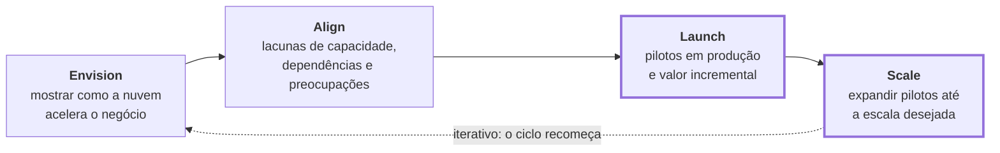

| Fase | Foco | Pista no enunciado |
|---|---|---|
| Envision | Mostrar como a nuvem vai acelerar os resultados do negócio e priorizar oportunidades | "visão", "oportunidades de transformação" |
| Align | Identificar lacunas de capacidade nas perspectivas do CAF, dependências entre áreas e preocupações dos stakeholders | "lacunas", "dependências", "preocupações" |
| Launch | Entregar pilotos em produção, demonstrar valor incremental e aprender antes de escalar | "pilotos em produção", "valor incremental", "insights para escalar" |
| Scale | Expandir os pilotos e o valor de negócio até a escala desejada e garantir que os benefícios se sustentem | "expandir", "escala desejada", "benefícios sustentados" |

> [!WARNING]
> **Pegadinha:** Launch e Scale falam de pilotos e de valor. **Launch** coloca o piloto em produção e prova valor incremental; **Scale** pega o que deu certo e expande. "Coletar insights para escalar no futuro" ainda é **Launch**.

### Os 7 Rs de migração

| Estratégia | O que é | Exemplo |
|---|---|---|
| Retire | Desligar o que não é mais usado | Sistema legado sem usuários |
| Retain | Manter onde está, por enquanto | Aplicação com restrição regulatória ou recém-atualizada |
| Rehost | Lift and shift: mover sem alterar | VM local vira EC2 com o Application Migration Service |
| Relocate | Mover o hipervisor inteiro sem comprar hardware novo | VMware local para VMware na AWS |
| Repurchase | Trocar por um produto diferente, em geral SaaS | CRM próprio vira Salesforce |
| Replatform | Lift, tinker and shift: pequenas otimizações sem mudar a arquitetura | Banco em VM vira RDS |
| Refactor / Re-architect | Reescrever para ser nativo de nuvem | Monolito vira microsserviços serverless |

**Rehost** é o mais rápido. **Refactor** é o mais caro e o que traz mais benefício de nuvem.

### Boas práticas ao migrar

- Comece por um inventário: o **Application Discovery Service** coleta dados dos servidores locais.
- Monte o caso de negócio com TCO (**Migration Evaluator**).
- Migre em ondas, começando por cargas simples, e não tudo de uma vez.
- Depois de migrar, modernize: rightsizing, serviços gerenciados, automação.
- Desenhe para a falha desde o início: várias AZs, backups, infraestrutura como código.

### Serviços de migração

| Serviço | Para que serve |
|---|---|
| AWS Application Migration Service (MGN) | Rehost de servidores para EC2 com replicação contínua |
| AWS Database Migration Service (DMS) | Migrar bancos com o banco de origem no ar. Homogêneo ou heterogêneo |
| AWS Schema Conversion Tool (SCT) | Converter schema entre engines diferentes, por exemplo Oracle para Aurora |
| AWS Application Discovery Service | Inventário e dependências do ambiente local |
| AWS Migration Hub | Painel único para acompanhar migrações |
| AWS DataSync | Transferência online e automatizada de arquivos para S3, EFS ou FSx |
| AWS Transfer Family | SFTP, FTPS e FTP gerenciados gravando em S3 ou EFS |
| AWS Snow Family | Transferência offline de grandes volumes em dispositivo físico, e computação na borda |

> [!NOTE]
> **Snow Family:** a prova pode citar **Snowcone** (pequeno, portátil, cerca de 8 TB), **Snowball Edge** (dezenas a centenas de TB, com versões Storage Optimized e Compute Optimized) e **Snowmobile** (caminhão, até 100 PB). Snowcone e Snowmobile foram descontinuados na vida real, mas ainda aparecem em simulados. A lógica cobrada é: muito dado e link lento ou caro pede transferência offline.

> [!WARNING]
> **Pegadinha:** DMS migra os **dados**; SCT converte o **schema**. Migração heterogênea usa os dois. DataSync é **online**; Snow é **offline**.

---

## 4. Infraestrutura global

A hierarquia é **Region → Availability Zone → data center**. As edge locations ficam fora dessa hierarquia, perto do usuário final.

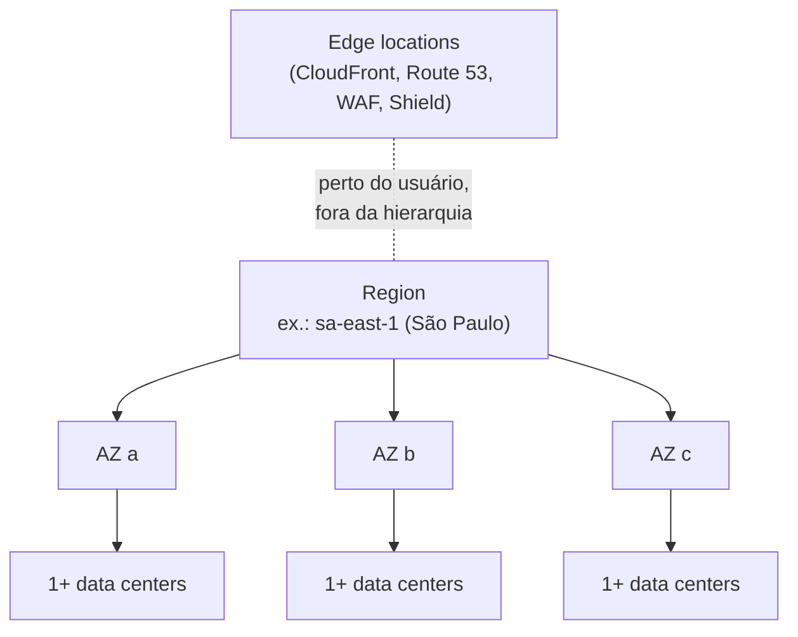

| Componente | O que é | Para que serve |
|---|---|---|
| Region | Área geográfica com no mínimo 3 AZs, isolada das outras Regions | Soberania de dados, latência, recuperação de desastre |
| Availability Zone (AZ) | Um ou mais data centers com energia, rede e refrigeração independentes, ligados por rede privada de baixa latência | Alta disponibilidade dentro da Region |
| Edge location / ponto de presença | Local de cache e entrada na rede da AWS. Existem muito mais edge locations do que Regions | CloudFront, Route 53, Global Accelerator, WAF, Shield |
| Regional edge cache | Cache intermediário entre a origem e as edge locations | Conteúdo menos acessado no CloudFront |
| Local Zone | Extensão de uma Region em uma cidade grande | Latência de um dígito de milissegundo para usuários daquela cidade |
| Wavelength Zone | Infraestrutura AWS dentro da rede 5G de operadoras | Aplicações móveis de latência ultrabaixa |
| AWS Outposts | Rack da AWS instalado no seu data center, gerenciado pela AWS | Híbrido, residência de dados local, baixa latência local |

### Como escolher uma Region

A prova cobra estes 4 critérios:

1. **Conformidade e residência de dados:** leis que exigem o dado em um país. É o critério que vence os outros.
2. **Latência:** proximidade dos usuários.
3. **Disponibilidade de serviços:** nem todo serviço existe em toda Region.
4. **Preço:** varia por Region.

### Escopo dos serviços

| Escopo | Exemplos |
|---|---|
| Global | IAM, Organizations, Route 53, CloudFront, WAF (quando ligado ao CloudFront), Shield, Billing |
| Regional | S3 (o nome do bucket é global, o dado fica na Region), DynamoDB, Lambda, VPC, ELB, EFS |
| Por AZ | Instância EC2, volume EBS, sub-rede, instância RDS |

### Padrões de disponibilidade

- **Multi-AZ:** alta disponibilidade. Protege contra a queda de um data center.
- **Multi-Region:** recuperação de desastre, latência global e residência de dados. Protege contra a queda de uma Region inteira.
- Os dados não saem da Region sozinhos. A replicação entre Regions é sempre uma decisão do cliente.

> [!WARNING]
> **Pegadinha:** edge location não roda EC2 nem guarda seu banco. Serve para cache e entrada na rede. "Reduzir latência para usuários no mundo todo com conteúdo estático" é **CloudFront**, não mais Regions.

---

## 5. Modelo de responsabilidade compartilhada

A AWS responde pela segurança **da** nuvem; o cliente responde pela segurança **na** nuvem. É o tema mais cobrado do domínio de segurança.

| Responsabilidade da AWS | Responsabilidade do cliente |
|---|---|
| Segurança física dos data centers | Dados do cliente e sua classificação |
| Hardware, rede física, energia, refrigeração | Gestão de identidade e acesso (IAM, MFA, senhas) |
| Hipervisor e camada de virtualização | Configuração de Security Groups, NACLs e firewall do SO |
| Infraestrutura global (Regions, AZs, edge) | Criptografia no cliente, em repouso e em trânsito |
| Software dos serviços gerenciados | Patches do SO convidado e das aplicações (no EC2) |
| Descarte seguro de discos | Configuração dos serviços, por exemplo bucket público ou privado |

### A linha muda conforme o serviço

Quanto mais gerenciado o serviço, menos camadas sobram para o cliente:

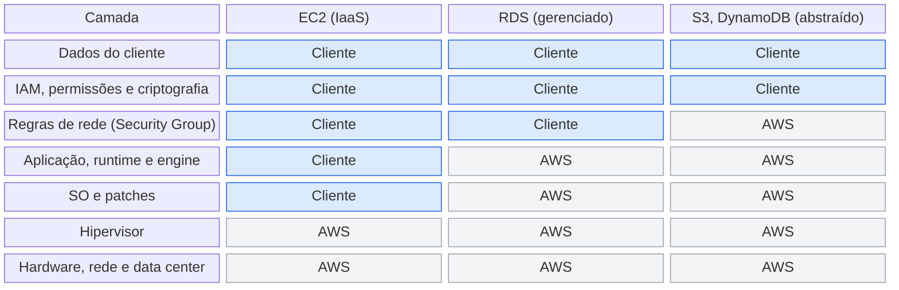

Segurança **na** nuvem é do cliente; segurança **da** nuvem é da AWS. Dados e IAM nunca saem da mão do cliente. Lambda segue a coluna do S3, mas o código da função continua sendo do cliente.

| Tipo de serviço | Exemplo | Quem cuida do SO e dos patches | O que sobra para o cliente |
|---|---|---|---|
| Infraestrutura | EC2 | Cliente | SO, patches, aplicação, firewall, dados, IAM |
| Gerenciado / contêiner | RDS, Fargate, Elastic Beanstalk | AWS | Configuração, regras de rede, usuários do banco, dados, IAM |
| Abstraído / serverless | S3, DynamoDB, Lambda | AWS | Dados, permissões, criptografia, código (no Lambda) |

### Controles

- **Herdados** (só AWS): controles físicos e ambientais.
- **Compartilhados** (os dois, cada um na sua camada): gestão de patches, gestão de configuração, treinamento e conscientização.
- **Específicos do cliente:** proteção e zoneamento dos dados dentro das aplicações.

### Frases que resolvem questões

- O cliente **sempre** responde por: dados, IAM e configuração do que usa.
- A AWS **sempre** responde por: físico, hardware, hipervisor, rede global.
- Patch do SO no EC2 é do cliente. Patch do SO no RDS e no Lambda é da AWS.
- Patch do banco no RDS é da AWS, mas o cliente escolhe a janela de manutenção.
- Criptografar o dado é decisão do cliente. A AWS fornece a ferramenta.
- Treinar funcionários é compartilhado: a AWS treina os dela e o cliente os dele.

> [!WARNING]
> **Pegadinha:** "configurar o Security Group" é sempre **cliente**, mesmo no RDS. "Proteger o hipervisor" é sempre **AWS**. No Lambda, a segurança do código e das permissões da função continua sendo do cliente.

---

## 6. IAM: identidade, acesso e chaves

O IAM controla **quem** (autenticação) pode fazer **o quê** (autorização) na conta. É global e gratuito.

### Componentes

| Componente | O que é | Quando usar |
|---|---|---|
| Usuário root | Dono da conta, criado com o e-mail. Acesso total que não pode ser restringido por policy IAM | Só nas poucas tarefas que exigem root |
| Usuário IAM | Identidade de longa duração para uma pessoa ou aplicação | Quando não há federação. Hoje a recomendação é preferir Identity Center e roles |
| Grupo | Conjunto de usuários. Recebe policies. Não pode conter outro grupo | Dar a mesma permissão a vários usuários |
| Role | Identidade sem senha nem chave fixa, assumida temporariamente | Serviço AWS acessando outro, acesso entre contas, federação |
| Policy | Documento JSON que permite ou nega ações em recursos | Sempre. É onde a permissão realmente vive |

### Como as policies funcionam

- Elementos: `Effect` (Allow ou Deny), `Action`, `Resource`, e opcionalmente `Principal` e `Condition`.
- Tudo é negado por padrão (**negação implícita**).
- Uma **negação explícita** vence qualquer permissão.
- **Baseada em identidade:** anexada a usuário, grupo ou role.
- **Baseada em recurso:** anexada ao recurso, como a bucket policy do S3. Permite acesso entre contas.
- Gerenciada pela AWS, gerenciada pelo cliente ou inline (embutida em uma única identidade).

```json
{
  "Version": "2012-10-17",
  "Statement": [
    {
      "Effect": "Allow",
      "Action": "s3:GetObject",
      "Resource": "arn:aws:s3:::meu-bucket/*"
    }
  ]
}
```

### Formas de acesso e credenciais

| Forma de acesso | Credencial |
|---|---|
| Console (navegador) | Usuário, senha e MFA |
| AWS CLI, SDKs e chamadas de API | Chaves de acesso: Access Key ID e Secret Access Key |
| Serviço para serviço | Role com credenciais temporárias |
| CloudShell | Terminal no navegador que herda as credenciais do console |

Sobre as chaves de acesso:

- São credenciais de longa duração. A Secret Access Key só aparece uma vez, na criação.
- Nunca crie chave para o root. Nunca coloque chave no código nem em repositório.
- Faça rotação periódica e apague as que não são usadas.
- Em EC2, Lambda e ECS, use **role** em vez de chave. O **AWS STS** entrega credenciais temporárias por trás das roles.
- Não confunda com **par de chaves do EC2** (login SSH na instância) nem com **chaves do KMS** (criptografia).

### Duas portas: API da AWS x dentro da instância

Access keys e key pair abrem portas diferentes. A access key autentica chamadas à API da AWS; o key pair do EC2 só serve para entrar no sistema operacional da instância.

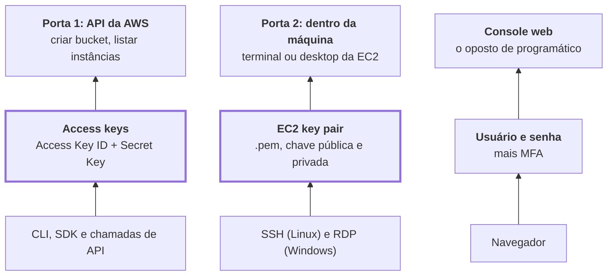

Leia de baixo para cima: quem usa, a credencial que apresenta e a porta que ela abre. Código rodando dentro da AWS (EC2, Lambda) deve usar IAM role, com credenciais temporárias, no lugar de access keys.

| Credencial | Abre | Usada por | Não serve para |
|---|---|---|---|
| Access keys (Access Key ID + Secret Access Key) | API da AWS | AWS CLI, SDKs (boto3, SDK para Java) e chamadas diretas à API | Entrar na instância por SSH ou RDP |
| EC2 key pair (.pem) | Sistema operacional da instância | SSH no Linux; descriptografar a senha do RDP no Windows | Autenticar chamadas à API da AWS |
| SSH keys em geral | Servidores | SSH. Na AWS, aparecem em casos pontuais, como acessar o CodeCommit por SSH | Acesso programático aos serviços |
| Usuário, senha e MFA | AWS Management Console | Navegador | Acesso programático |

Como decidir na prova:

| A pergunta fala de | Resposta |
|---|---|
| Automatizar, script, código, CLI, API | Access keys (+ SDK ou CLI) |
| Entrar na instância EC2, conectar por SSH ou RDP | Key pair |
| Interface web, login com usuário, senha e MFA | Console |
| Código rodando em EC2 ou Lambda que precisa chamar a AWS | IAM role |

> [!TIP]
> **Regra mnemônica:** access key acessa a API da AWS; key pair abre a porta da máquina.

- As boas práticas das access keys estão logo acima: nunca no código, nunca do root, rotação e preferência por roles.
- O AWS CLI também usa access keys. Se ele aparecer como opção de acesso programático, está correto.
- Session Manager e EC2 Instance Connect entram na instância sem gerenciar key pair nem abrir a porta 22 (seção 11).

#### Questão no estilo da prova

**Quais dois itens são necessários para acessar os serviços da AWS de forma programática, por código? (Escolha dois.)**

- A) Access keys
- B) AWS SDK
- C) AWS Management Console
- D) EC2 key pairs
- E) SSH keys

<details>
<summary>Resposta</summary>

**A e B.**

- **Access keys:** são a credencial para chamar a API por código ou linha de comando. Obrigatórias no acesso programático.
- **AWS SDK:** é a biblioteca que usa a AWS dentro do código. Obrigatório, porque a pergunta fala em código.
- **Management Console:** é a interface web, o oposto de programático.
- **EC2 key pairs:** servem para entrar na instância. Não autenticam chamadas à API.
- **SSH keys:** mesmo conceito da porta 2, acesso a servidores. É a alternativa que mais engana.

</details>

### Boas práticas cobradas

1. Proteger o root com MFA e não usá-lo no dia a dia.
2. Menor privilégio: dar só a permissão necessária.
3. MFA para todos os usuários humanos.
4. Permissões por grupo ou role, não por usuário individual.
5. Roles e credenciais temporárias em vez de chaves fixas.
6. Política de senha forte e rotação de credenciais.
7. Um usuário por pessoa. Nunca compartilhar credenciais.
8. Revisar acessos com as ferramentas abaixo.

### Tarefas que só o root faz

- Alterar e-mail, nome e senha do root.
- Fechar a conta.
- Mudar ou cancelar o plano de suporte.
- Restaurar as permissões do último administrador IAM.
- Ativar MFA Delete em bucket S3.
- Registrar-se como vendedor no Reserved Instance Marketplace.

### Ferramentas de revisão

| Ferramenta | O que entrega |
|---|---|
| IAM Credential Report | Planilha com todos os usuários e o estado das credenciais: senha, MFA, idade das chaves |
| IAM Access Advisor (último acesso) | Quais serviços cada identidade realmente usou. Base para cortar permissão sobrando |
| IAM Access Analyzer | Encontra recursos compartilhados com fora da conta ou da organização |

### Serviços de identidade vizinhos

| Serviço | Para quem |
|---|---|
| AWS IAM Identity Center (antigo AWS SSO) | Funcionários: login único para várias contas AWS e aplicações |
| Amazon Cognito | Usuários finais de aplicativos web e mobile. Cadastro, login e login social |
| AWS Directory Service | Microsoft Active Directory gerenciado na AWS |
| AWS STS | Credenciais temporárias |

> [!WARNING]
> **Pegadinha:** role é para quem não tem credencial fixa (serviço, outra conta, usuário federado). "Uma instância EC2 precisa ler do S3" é **role**, nunca chave de acesso. "Login de clientes no meu app" é **Cognito**, não IAM.

---

## 7. Organização multi-contas

O **AWS Organizations** agrupa várias contas sob uma conta de gerenciamento, com cobrança única e políticas centrais. É gratuito.

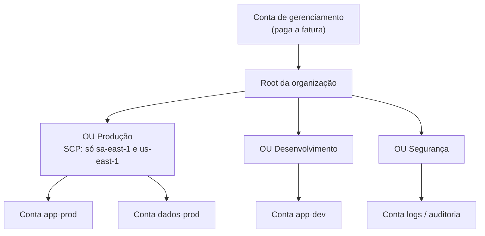

### Peças do Organizations

| Peça | O que é |
|---|---|
| Conta de gerenciamento (management) | Cria a organização, paga a fatura de todas as contas |
| Contas-membro | As demais contas |
| Unidade organizacional (OU) | Agrupamento de contas, por exemplo Produção, Desenvolvimento, Segurança. Pode ser aninhada |
| Service Control Policy (SCP) | Limite máximo de permissão para uma conta ou OU |
| Faturamento consolidado | Uma fatura só, com uso somado |

### SCP: o que a prova cobra

- SCP **não concede** permissão. Só define o teto do que pode ser permitido.
- A permissão efetiva é a **interseção** entre a SCP e a policy IAM.
- SCP atinge todos na conta-membro, **inclusive o root** daquela conta.
- SCP **não afeta** a conta de gerenciamento.
- Uso típico: proibir Regions não aprovadas, impedir que desliguem o CloudTrail.

### Faturamento consolidado

- Uma única fatura e um único meio de pagamento.
- O uso de todas as contas é somado, o que alcança faixas de desconto por volume (S3, transferência de dados).
- Reserved Instances e Savings Plans não usados em uma conta se aplicam às outras, se o compartilhamento estiver ligado.
- Não tem custo adicional.

### Por que usar várias contas

Isolar ambientes (produção, teste), limitar o raio de impacto de um incidente, separar custos por equipe, atender requisitos de conformidade.

### Serviços de governança relacionados

| Serviço | O que faz |
|---|---|
| AWS Control Tower | Monta e governa um ambiente multi-contas pronto (landing zone) com boas práticas. Usa Organizations por baixo. Traz controles (guardrails) preventivos e detectivos e a Account Factory para criar contas padronizadas |
| AWS IAM Identity Center | Login único dos funcionários em todas as contas da organização |
| AWS Resource Access Manager (RAM) | Compartilhar recursos entre contas, como sub-redes e Transit Gateway |
| AWS Service Catalog | Catálogo de produtos aprovados (templates CloudFormation) para as equipes lançarem sozinhas |
| AWS License Manager | Controle central de licenças de software |
| Tag policies e cost allocation tags | Padronizar tags e separar custo por projeto ou equipe |

> [!WARNING]
> **Pegadinha:** "restringir o que as contas podem fazer" é **SCP** no Organizations. "Configurar rapidamente um ambiente multi-contas seguro seguindo boas práticas" é **Control Tower**. "Obter desconto por volume somando contas" é **faturamento consolidado**.

---

## 8. Criptografia, chaves e segredos

Dois estados para proteger: **em repouso** (dado gravado em disco) e **em trânsito** (dado trafegando, protegido com TLS/HTTPS).

### Serviços e diferenças

| Serviço | Guarda o quê | Diferencial | Pista no enunciado |
|---|---|---|---|
| AWS KMS | Chaves de criptografia | Gerenciado, multi-inquilino, integrado a quase todos os serviços, uso auditado no CloudTrail | "criar e controlar chaves", "criptografar EBS, S3, RDS" |
| AWS CloudHSM | Chaves de criptografia | Hardware dedicado só para você (single-tenant), FIPS 140-2 nível 3. A AWS não tem acesso às chaves | "hardware dedicado", "controle total das chaves", "requisito regulatório" |
| AWS Certificate Manager (ACM) | Certificados SSL/TLS | Certificados públicos gratuitos, renovação automática, usados em ELB, CloudFront e API Gateway | "HTTPS no site", "criptografia em trânsito" |
| AWS Secrets Manager | Segredos: senhas de banco, chaves de API, tokens | Rotação automática, integração nativa com RDS. Pago por segredo | "rotacionar credenciais do banco automaticamente" |
| SSM Parameter Store | Parâmetros de configuração e segredos simples | Gratuito no nível padrão, sem rotação automática nativa | "guardar configuração", "opção sem custo" |

### Tipos de chave no KMS

| Tipo | Quem cria e gerencia | Visível na sua conta | Rotação |
|---|---|---|---|
| Chave de propriedade da AWS | AWS | Não | AWS decide |
| Chave gerenciada pela AWS (`aws/s3`, `aws/ebs`) | AWS, em seu nome | Sim, só leitura | Automática, anual |
| Chave gerenciada pelo cliente | Você | Sim, controle total da policy | Automática opcional ou manual |

### Criptografia nos serviços mais cobrados

- **S3:** todo objeto novo já é criptografado por padrão com SSE-S3. Outras opções: SSE-KMS (chave no KMS, com auditoria), SSE-C (você fornece a chave), e criptografia no lado do cliente.
- **EBS:** criptografia com KMS. Cobre o volume, os snapshots e o tráfego entre instância e volume.
- **RDS:** criptografia em repouso com KMS, definida na criação. Em trânsito com TLS.
- **DynamoDB:** sempre criptografado em repouso.
- **CloudTrail** registra cada uso de chave do KMS.

> [!WARNING]
> **Pegadinha:** KMS é **chave**; Secrets Manager é **segredo** (senha). Entre Secrets Manager e Parameter Store, a palavra "rotação automática" decide por **Secrets Manager**. Entre KMS e CloudHSM, "dedicado" ou "single-tenant" decide por **CloudHSM**. ACM não criptografa dado em repouso.

**Onde guardar certificados SSL/TLS:** o **ACM** é o padrão: emite certificados públicos e importa os de terceiros. O **IAM** também guarda certificados de servidor, para Regions em que o ACM não está disponível. KMS guarda chaves, não certificados. Em "onde fazer upload de certificado SSL (escolha dois)", a resposta é **ACM e IAM**.

---

## 9. Camadas de proteção

A defesa é em camadas: borda, rede, host, dados e identidade. Cada serviço abaixo cobre uma camada, e a prova troca um pelo outro nas alternativas.

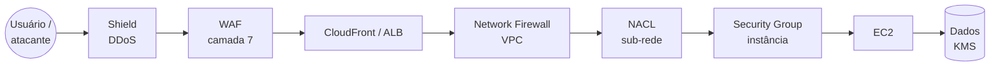

### Proteção de borda e rede

| Serviço | Protege contra | Camada | Detalhes cobrados |
|---|---|---|---|
| AWS Shield Standard | DDoS comum | 3 e 4 (rede e transporte) | Gratuito e automático para todos os clientes |
| AWS Shield Advanced | DDoS grande e sofisticado | 3, 4 e 7 | Pago (assinatura mensal alta). Acesso 24/7 ao Shield Response Team, proteção de custo contra picos causados pelo ataque, relatórios, WAF incluído nos recursos protegidos |
| AWS WAF | Ataques web: SQL injection, XSS, bots, excesso de requisições | 7 (aplicação) | Regras por IP, país, taxa, padrão de requisição. Liga em CloudFront, ALB, API Gateway e AppSync |
| AWS Firewall Manager | Falta de padrão entre contas | Gestão | Administra regras de WAF, Shield Advanced, Security Groups e Network Firewall em toda a organização |
| AWS Network Firewall | Tráfego malicioso entrando ou saindo da VPC | 3 a 7 | Firewall gerenciado e stateful para a VPC inteira, com filtragem e prevenção de intrusão |
| Security Group | Acesso indevido à instância | Instância | Stateful, só regras de permissão ([seção 16](#16-rede-vpc-gateways-e-firewalls)) |
| Network ACL | Acesso indevido à sub-rede | Sub-rede | Stateless, permite e nega ([seção 16](#16-rede-vpc-gateways-e-firewalls)) |

### Detecção e avaliação

| Serviço | Pergunta que responde | Como funciona |
|---|---|---|
| Amazon GuardDuty | Tem alguma ameaça ativa na minha conta? | Detecção inteligente de ameaças com machine learning sobre logs do CloudTrail, VPC Flow Logs e DNS. Sem agente. Acha mineração de cripto, credencial comprometida, comunicação com IP malicioso |
| Amazon Inspector | Minhas cargas têm vulnerabilidade conhecida? | Varredura automática de EC2, imagens de contêiner no ECR e funções Lambda. Procura CVEs e exposição de rede não intencional |
| Amazon Macie | Tenho dado sensível exposto no S3? | Machine learning para descobrir e classificar dados pessoais (PII) em buckets |
| Amazon Detective | Qual a causa raiz deste alerta? | Monta um grafo com os logs para investigar um incidente já detectado |
| AWS Security Hub | Qual meu estado geral de segurança? | Painel único que agrega achados do GuardDuty, Inspector, Macie e parceiros, e verifica padrões como CIS e PCI DSS |
| IAM Access Analyzer | Algum recurso está compartilhado com fora? | Analisa policies de recursos |
| AWS Trusted Advisor | Estou seguindo boas práticas? | Verificações de segurança básicas: buckets abertos, portas liberadas, MFA no root |

### Outros pontos de segurança cobrados

- **Teste de invasão:** o cliente pode testar seus próprios recursos em uma lista de serviços comuns sem pedir autorização. Simular DDoS tem regras próprias.
- **Reportar abuso:** recursos AWS usados para spam, ataque ou conteúdo ilegal são reportados ao time **AWS Trust & Safety** (abuse).
- **AWS Marketplace:** fonte de produtos de segurança de terceiros (firewalls, antivírus, SIEM).
- **Onde achar informação de segurança:** AWS Security Center, Security Blog, boletins de segurança, Knowledge Center e documentação.
- **AWS Security Incident Response:** serviço de apoio na resposta a incidentes. Vem incluído no suporte Enterprise.

> [!WARNING]
> **Pegadinha clássica, em uma linha cada:**
> - DDoS: **Shield**.
> - SQL injection e XSS: **WAF**.
> - Ameaça e comportamento anômalo na conta: **GuardDuty**.
> - Vulnerabilidade de software em EC2 e contêiner: **Inspector**.
> - Dado pessoal em S3: **Macie**.
> - Investigar causa raiz: **Detective**.
> - Visão consolidada de achados: **Security Hub**.

---

## 10. Investigação, rastro e conformidade

Três serviços respondem a três perguntas diferentes: **CloudTrail** diz quem fez, **Config** diz como o recurso estava e mudou, **CloudWatch** diz como o recurso está se comportando.

| Serviço | Registra | Pista no enunciado |
|---|---|---|
| AWS CloudTrail | Toda chamada de API na conta: quem, o quê, quando, de qual IP. Vale para console, CLI e SDK | "auditoria", "quem apagou a instância", "rastrear atividade do usuário" |
| AWS Config | Inventário e histórico de configuração dos recursos, com regras que avaliam conformidade | "o Security Group foi alterado", "recursos fora do padrão", "histórico de configuração" |
| Amazon CloudWatch | Métricas, logs e alarmes de desempenho ([seção 22](#22-monitoramento-e-observabilidade)) | "uso de CPU", "alarme", "painel" |
| VPC Flow Logs | Metadados do tráfego IP nas interfaces de rede da VPC | "tráfego aceito ou rejeitado", "investigar conectividade" |
| AWS Artifact | Relatórios de conformidade da AWS (SOC, PCI, ISO) e acordos como BAA | "baixar relatório SOC", "provar ao auditor que a AWS é certificada" |
| AWS Audit Manager | Coleta contínua de evidências do seu uso da AWS para auditorias | "automatizar coleta de evidência", "preparar auditoria" |
| Amazon Detective | Análise de causa raiz de incidentes de segurança | "investigar", "causa raiz" |
| AWS Health Dashboard | Eventos e manutenções da AWS que afetam os seus recursos | "a AWS está com problema na minha Region?" |

### CloudTrail em detalhe

- Já vem ligado. O **Event history** guarda 90 dias de eventos de gerenciamento, sem custo.
- Para guardar mais tempo, cria-se uma **trilha (trail)** que entrega os logs em um bucket S3, e opcionalmente no CloudWatch Logs.
- **Eventos de gerenciamento:** operações sobre os recursos (criar, apagar, alterar).
- **Eventos de dados:** operações dentro do recurso, como leitura de objeto no S3. São opcionais e pagos.
- **CloudTrail Insights:** detecta atividade incomum de API.
- Uma trilha pode cobrir todas as Regions e todas as contas da organização.

### Conformidade

- A AWS mantém certificações e programas como SOC 1, 2 e 3, PCI DSS, ISO 27001, HIPAA, FedRAMP e GDPR.
- O cliente herda os controles físicos da AWS, mas continua responsável pela conformidade do que constrói.
- Os requisitos variam por serviço e por Region. Nem todo serviço está no escopo de todo programa.
- **AWS Artifact** é o lugar para pegar os documentos. É gratuito e de autoatendimento.

> [!WARNING]
> **Pegadinha:** Artifact entrega relatórios **sobre a AWS**. Audit Manager coleta evidência **sobre você**. CloudTrail é sobre **ações** (API); Config é sobre **estado** (configuração). "Quem mudou" é CloudTrail, "o que mudou e como estava antes" é Config.

---

## 11. Amazon EC2

EC2 é servidor virtual sob demanda: IaaS, com controle total do sistema operacional e responsabilidade total por ele.

### Famílias de instância

| Família | Letras comuns | Uso |
|---|---|---|
| Uso geral | T, M | Equilíbrio de CPU, memória e rede. Servidores web, ambientes de desenvolvimento |
| Otimizada para computação | C | CPU intensiva: processamento em lote, codificação de mídia, servidores de jogos, HPC |
| Otimizada para memória | R, X | Grandes volumes em memória: bancos em memória, cache, análise em tempo real |
| Otimizada para armazenamento | I, D, H | Muita leitura e escrita em disco local: data warehouse, bancos NoSQL, sistemas de arquivos distribuídos |
| Computação acelerada | P, G | GPU: machine learning, renderização gráfica |

A prova pede a família pelo cenário, não o nome exato da instância. Instâncias **Graviton** (processador ARM da AWS) aparecem como opção de melhor custo-benefício.

### Modelos de cobrança

| Modelo | Compromisso | Desconto aproximado | Quando usar |
|---|---|---|---|
| On-Demand | Nenhum. Paga por segundo ou hora | Nenhum | Carga curta, imprevisível, testes, primeira vez rodando a aplicação |
| Reserved Instances (RI) | 1 ou 3 anos, preso a família e Region | Até 72% (Standard), até 66% (Convertible) | Carga estável e previsível, como banco de dados sempre ligado |
| Savings Plans | 1 ou 3 anos de um valor em dólar por hora | Até 72% (EC2 Instance), até 66% (Compute) | Carga estável com flexibilidade para mudar de família, Region, ou usar Fargate e Lambda |
| Spot | Nenhum. A AWS pode retomar com aviso de 2 minutos | Até 90% | Carga tolerante a interrupção: lote, análise de dados, CI, processamento de imagem |
| Dedicated Instances | Hardware não compartilhado com outros clientes | Mais caro | Requisito de isolamento, sem controle sobre o servidor físico |
| Dedicated Hosts | Servidor físico inteiro para você, com visibilidade de soquetes e núcleos | O mais caro | BYOL de licença por soquete ou núcleo, conformidade rígida |
| Capacity Reservations | Reserva capacidade em uma AZ, sem desconto | Nenhum | Garantir que haverá capacidade em um evento crítico |

**Reserved Instances:**

- **Standard:** maior desconto, não troca de família. Pode ser vendida no Reserved Instance Marketplace.
- **Convertible:** desconto menor, permite trocar família, SO e tamanho.
- Pagamento: All Upfront (maior desconto), Partial Upfront ou No Upfront (menor desconto).
- 3 anos dá mais desconto que 1 ano.

**Savings Plans:**

- **Compute Savings Plans:** o mais flexível. Vale para EC2 de qualquer família e Region, Fargate e Lambda.
- **EC2 Instance Savings Plans:** maior desconto, preso a uma família em uma Region.

> [!WARNING]
> **Pegadinha:** "não pode ser interrompida" elimina **Spot**. "Uso constante por 1 a 3 anos" pede **RI ou Savings Plan**. "Flexibilidade para mudar de tipo de instância e de serviço" pede **Compute Savings Plan**, assim como "desconto automático em qualquer Region, família, tamanho, SO ou tenancy". "Licença por núcleo" pede **Dedicated Host**, não Dedicated Instance.

### Peças ao redor do EC2

| Peça | O que é |
|---|---|
| AMI (Amazon Machine Image) | Modelo de instância com SO e software. Pode ser da AWS, do Marketplace, da comunidade ou sua. É regional |
| EC2 Image Builder | Automatiza criação, teste e atualização de AMIs |
| User data | Script que roda na primeira inicialização |
| Par de chaves | Login SSH (Linux) ou recuperação de senha (Windows) |
| Security Group | Firewall virtual da instância |
| Elastic IP | IPv4 público fixo. Desde fevereiro de 2024, todo IPv4 público é cobrado, em uso ou não |
| EBS e instance store | Discos da instância ([seção 15](#15-armazenamento)) |
| Placement groups | Controle de onde as instâncias ficam fisicamente: cluster, spread, partition |
| Launch template | Receita de instância usada pelo Auto Scaling |
| EC2 Instance Connect e Session Manager | Acesso à instância sem gerenciar chaves SSH nem abrir porta |
| Elastic Load Balancing e Auto Scaling | Distribuição de tráfego e escala ([seção 14](#14-escalamento-e-load-balancers)) |
| AWS Compute Optimizer | Recomenda o tamanho certo de instância com base no uso |
| AWS Systems Manager | Patches, comandos remotos e inventário em frota |

> [!NOTE]
> **Elastic IP:** muitos simulados ainda usam a regra antiga, "Elastic IP só é cobrado quando não está associado a uma instância em execução". Se a questão pedir para evitar custo desnecessário, a resposta continua sendo liberar Elastic IPs sem uso.

**Cobrança:** instância **parada** não paga computação, mas continua pagando o EBS (e o IPv4 público, se tiver Elastic IP). Instância **terminada** não paga nada, e por padrão apaga o volume raiz. Volumes EBS **adicionais** sobrevivem e continuam cobrando, a menos que o atributo `DeleteOnTermination` esteja ligado. **Running** cobra por segundo, com mínimo de 1 minuto; **pending** não cobra.

### Formas de lançar uma instância

A AMI não lança nada: ela é o molde e responde "com o quê?". Quem cria a instância é sempre o serviço EC2. CloudFormation, Launch Template, Auto Scaling e Beanstalk respondem "como e quando?" e fazem o pedido à API do EC2.

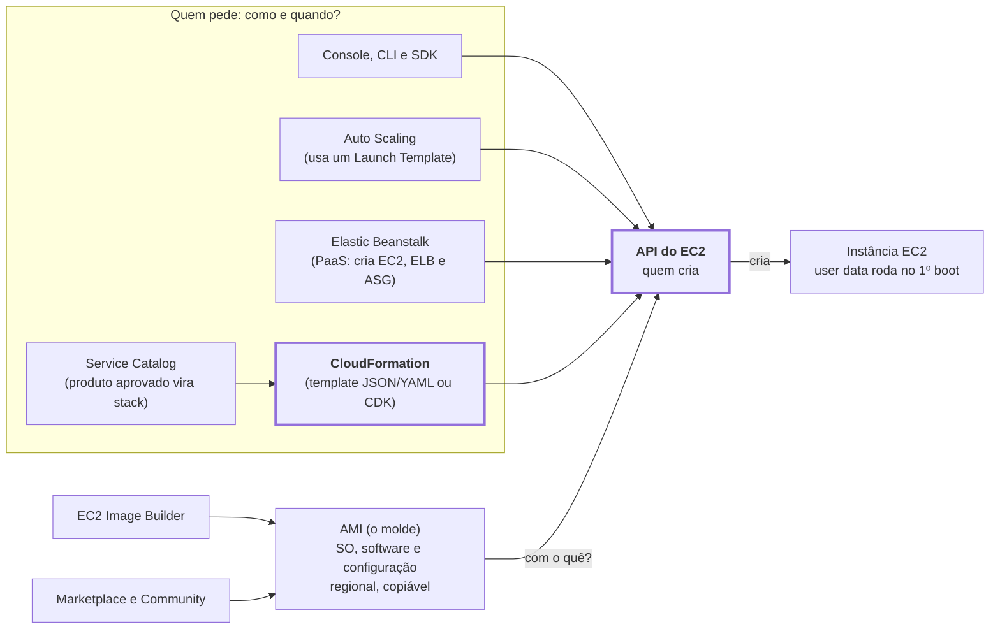

O caminho completo de um lançamento por código é: template do CloudFormation → CloudFormation (quem pede) → API do EC2 (quem cria) → AMI (o molde). O Lightsail fica fora desse fluxo: entrega um servidor simples, com preço fixo e console próprio.

| Mecanismo | Papel | O que a prova cobra |
|---|---|---|
| AMI | Molde: SO, software e configuração prontos | Tipos: da AWS, do Marketplace (pagas, de terceiros), Community e Custom (criada a partir de uma instância sua). É regional, mas pode ser copiada para outras Regions. Serve para vários servidores idênticos e boot mais rápido |
| Launch Template | Parâmetros de lançamento salvos: AMI, tipo de instância, key pair, Security Group, user data | Tem versões. É o que o Auto Scaling usa para saber o que lançar. O **Launch Configuration** é o antecessor, hoje legado |
| User data | Script que roda no primeiro boot | Exemplo clássico: instalar e iniciar o Apache |
| AWS CloudFormation | Infraestrutura como código: descreve EC2, VPC, RDS, S3 e o resto em template JSON ou YAML e cria tudo como uma **stack** | Repetível em várias contas e Regions, versionável, **rollback automático** se algo falhar, **drift detection** para achar mudanças manuais. O serviço é gratuito; paga-se só pelos recursos criados |
| AWS CDK | Infraestrutura escrita em Java, Python ou TypeScript | É convertido em template do CloudFormation |
| AWS Elastic Beanstalk | PaaS que provisiona EC2, load balancer, Auto Scaling e monitoramento a partir do código | Você mantém o controle dos recursos. Detalhes na [seção 12](#12-outros-serviços-de-computação) |
| Amazon Lightsail | VPS simples com preço mensal fixo | Inclui instância, armazenamento, rede, DNS e **blueprints** prontos, como WordPress e LAMP. Detalhes na [seção 12](#12-outros-serviços-de-computação) |
| EC2 Image Builder | Automatiza criação, teste e atualização de AMIs | "Manter imagens com patches em dia" |
| AWS Marketplace | Software e AMIs prontos de terceiros | Cobrança na fatura da AWS |
| AWS Service Catalog | Catálogo de produtos aprovados pela empresa | Os times lançam sozinhos só o que a TI liberou |
| Console, CLI e SDK | Formas de falar com a API | Manual, linha de comando ou código ([seção 25](#25-outros-serviços-que-aparecem)) |

> [!WARNING]
> **Pegadinha:** o Launch Template aponta para uma AMI e acrescenta tipo, rede e chaves; não são a mesma coisa. Auto Scaling não substitui o Launch Template, ele usa o template. User data instala software a cada nova instância, no boot; AMI customizada já vem com tudo instalado, por isso sobe mais rápido. CloudFormation provisiona qualquer infraestrutura; Beanstalk sobe uma aplicação.

#### Cola rápida

| Palavra-chave na prova | Serviço |
|---|---|
| Servidor pré-configurado e idêntico, replicar instância | AMI |
| Copiar a imagem para outra Region | Cópia de AMI |
| Salvar parâmetros de lançamento | Launch Template |
| Rodar script ao iniciar a instância | User data |
| Infraestrutura inteira como código, repetível | CloudFormation |
| Detectar alteração manual na infraestrutura | CloudFormation drift detection |
| Infraestrutura como código em linguagem de programação | CDK |
| Subir código sem gerenciar infraestrutura | Elastic Beanstalk |
| Servidor simples, barato, preço fixo | Lightsail |
| Lançar e derrubar instâncias conforme a demanda | Auto Scaling |
| Automatizar criação e atualização de imagens | EC2 Image Builder |
| Só produtos aprovados pela TI | Service Catalog |

#### Questões no estilo da prova

**1.** Uma empresa precisa lançar dezenas de servidores com o mesmo sistema operacional, patches e software já instalados, e quer que eles fiquem prontos o mais rápido possível. O que ela deve usar?

- A) User data que instala tudo no primeiro boot
- B) Uma AMI customizada
- C) Amazon Lightsail
- D) AWS Elastic Beanstalk

<details>
<summary>Resposta</summary>

**B.** A AMI já carrega o software instalado, então o boot é rápido e as instâncias saem idênticas. O user data reinstala tudo em cada instância nova, o que é mais lento.

</details>

**2.** Um time quer criar a mesma VPC, instâncias EC2 e banco RDS em três Regions, de forma automatizada, repetível e com controle de versão. Qual serviço atende?

- A) Launch Template
- B) AWS CloudFormation
- C) AWS Elastic Beanstalk
- D) EC2 Image Builder

<details>
<summary>Resposta</summary>

**B.** CloudFormation descreve a infraestrutura inteira em template e cria uma stack igual em cada Region. Launch Template cobre só a instância, não VPC nem RDS.

</details>

**3.** Um desenvolvedor quer publicar uma aplicação web Java enviando só o código. A AWS deve cuidar de servidores, load balancer e escala, mas ele quer poder acessar esses recursos se precisar. Qual serviço usar?

- A) Amazon Lightsail
- B) AWS CloudFormation
- C) AWS Elastic Beanstalk
- D) Amazon EC2 com Dedicated Hosts

<details>
<summary>Resposta</summary>

**C.** "Enviar o código e a AWS cuida do resto", mantendo o controle dos recursos, é a definição do Beanstalk.

</details>

**4.** Quais duas informações podem ser salvas em um Launch Template? (Escolha duas.)

- A) O ID da AMI
- B) A senha do usuário root da conta
- C) O script de user data
- D) Uma Service Control Policy
- E) Uma regra do AWS WAF

<details>
<summary>Resposta</summary>

**A e C.** O Launch Template guarda AMI, tipo de instância, key pair, Security Group e user data.

</details>

**5.** Uma pequena empresa, sem experiência em nuvem, quer hospedar um site WordPress com custo mensal previsível e o mínimo de configuração. Qual é a melhor opção?

- A) Amazon EC2 com Reserved Instances
- B) Amazon Lightsail
- C) AWS Elastic Beanstalk
- D) AWS CloudFormation

<details>
<summary>Resposta</summary>

**B.** Lightsail tem preço mensal fixo, console simplificado e blueprint pronto de WordPress.

</details>

---

## 12. Outros serviços de computação

A escolha é sempre entre controle e esforço operacional. EC2 dá mais controle; Lambda dá menos trabalho.

| Serviço | O que é | Pista no enunciado |
|---|---|---|
| AWS Lambda | Funções serverless disparadas por evento. Paga por requisição e por tempo de execução. Limite de 15 minutos por execução. Escala sozinha | "sem gerenciar servidor", "executar código em resposta a evento", "pagar só quando roda" |
| AWS Elastic Beanstalk | PaaS: você envia o código e ele cria EC2, load balancer, Auto Scaling e monitoramento. Você ainda enxerga e controla os recursos. O serviço em si é gratuito | "implantar aplicação web rápido sem cuidar da infraestrutura", "desenvolvedor só quer subir o código" |
| Amazon Lightsail | Servidor virtual simples com preço mensal fixo e previsível, com disco, DNS e IP inclusos | "site simples", "WordPress", "pouca experiência em nuvem", "preço previsível" |
| AWS Batch | Executa jobs em lote, provisionando a computação certa automaticamente | "milhares de jobs em lote", "processamento agendado pesado" |
| AWS Fargate | Motor serverless para contêineres ([seção 13](#13-contêineres)) | "contêiner sem gerenciar servidor" |
| AWS Outposts | Infraestrutura AWS no seu data center | "híbrido", "dados precisam ficar no local" |
| AWS Wavelength | Computação na borda das redes 5G | "5G", "latência ultrabaixa para mobile" |
| AWS Local Zones | Computação perto de grandes cidades | "latência baixa em uma cidade específica" |
| Amazon API Gateway | Cria, publica e protege APIs REST, HTTP e WebSocket. Par comum do Lambda | "expor API", "porta de entrada para o backend serverless" |

### O que significa serverless na prova

- Não há servidor para provisionar, corrigir ou escalar.
- Paga pelo uso, e ocioso custa zero ou quase zero.
- Alta disponibilidade e escala já vêm embutidas.
- Serviços serverless clássicos: Lambda, Fargate, S3, DynamoDB, SQS, SNS, API Gateway, Step Functions, EventBridge, Aurora Serverless, Athena.

> [!WARNING]
> **Pegadinha:** Lambda não serve para processo que roda horas seguidas (limite de 15 minutos); aí é **Batch, Fargate ou EC2**. Elastic Beanstalk **não é serverless**, pois cria EC2 por baixo. Lightsail é para caso simples, não para arquitetura que precisa escalar muito.

---

## 13. Contêineres

São duas decisões separadas: **quem orquestra** (ECS ou EKS) e **onde os contêineres rodam** (EC2 ou Fargate).

| Serviço | Papel | Pista no enunciado |
|---|---|---|
| Amazon ECS | Orquestrador próprio da AWS. Mais simples, integrado ao resto da AWS | "rodar contêineres Docker", "orquestrador nativo da AWS" |
| Amazon EKS | Kubernetes gerenciado | "Kubernetes", "já usa Kubernetes on-premises", "portabilidade" |
| AWS Fargate | Computação serverless para ECS e EKS. Você define CPU e memória por tarefa e não vê servidor | "sem gerenciar instâncias", "sem provisionar cluster" |
| Amazon ECR | Registro privado de imagens de contêiner | "armazenar imagens Docker" |
| ECS Anywhere e EKS Anywhere | Rodar os orquestradores na sua própria infraestrutura | "contêineres on-premises com as mesmas ferramentas" |

### Tipos de lançamento

| Opção | Quem cuida dos servidores | Cobrança |
|---|---|---|
| EC2 | Você: patches, escala do cluster, capacidade | Pelas instâncias EC2, usadas ou não |
| Fargate | AWS | Por vCPU e memória que cada tarefa consome |

> [!WARNING]
> **Pegadinha:** Fargate **não é orquestrador**; ele precisa do ECS ou do EKS. ECR é registro de imagem, não executa nada. Se o enunciado diz "Kubernetes", a resposta é **EKS**, mesmo que ECS também funcionasse.

---

## 14. Escalamento e load balancers

O par padrão de alta disponibilidade é um load balancer distribuindo tráfego entre instâncias de um Auto Scaling group espalhado por várias AZs.

### Tipos de escala

| Tipo | O que é | Exemplo |
|---|---|---|
| Vertical (scale up/down) | Aumentar ou reduzir o tamanho do recurso | Trocar `t3.medium` por `t3.xlarge`. Exige parada, tem teto |
| Horizontal (scale out/in) | Adicionar ou remover recursos | Ir de 2 para 6 instâncias. É o que dá elasticidade e alta disponibilidade |

### Amazon EC2 Auto Scaling

- Um **Auto Scaling group** define capacidade **mínima, desejada e máxima**.
- Repõe automaticamente instâncias com falha, o que mantém a disponibilidade.
- O serviço é gratuito. Você paga só as instâncias.

| Política | Como decide | Quando usar |
|---|---|---|
| Dinâmica: target tracking | Mantém uma métrica em um alvo, por exemplo CPU em 50% | Caso geral |
| Dinâmica: step e simple | Reage a alarmes do CloudWatch com passos definidos | Controle mais fino |
| Agendada | Muda a capacidade em data e hora marcadas | Pico conhecido, como horário comercial ou Black Friday |
| Preditiva | Usa machine learning sobre o histórico para se antecipar | Padrões cíclicos de tráfego |

**AWS Auto Scaling** (sem o "EC2") é o serviço que gerencia a escala de vários recursos em um lugar só: EC2, ECS, DynamoDB e Aurora.

### Elastic Load Balancing (ELB)

| Tipo | Camada OSI | Protocolos | Características | Quando usar |
|---|---|---|---|---|
| Application Load Balancer (ALB) | 7 | HTTP, HTTPS | Roteamento por caminho, host, cabeçalho. Bom para microsserviços e contêineres. Aceita WAF | Aplicações web |
| Network Load Balancer (NLB) | 4 | TCP, UDP, TLS | Desempenho extremo, latência muito baixa, milhões de requisições por segundo, IP estático por AZ | Tráfego não HTTP, jogos, IoT, necessidade de IP fixo |
| Gateway Load Balancer (GWLB) | 3 | IP | Distribui tráfego para appliances virtuais de terceiros | Firewalls e sistemas de inspeção de terceiros |
| Classic Load Balancer (CLB) | 4 e 7 | HTTP, HTTPS, TCP | Geração antiga | Só legado. Raramente é a resposta |

O que todo ELB faz:

- Distribui tráfego entre alvos em várias AZs.
- Faz **health check** e para de enviar tráfego para alvo doente.
- É gerenciado e escala sozinho.
- É **regional**. Para distribuir entre Regions, usa-se Route 53 ou Global Accelerator.

> [!WARNING]
> **Pegadinha:** escalabilidade é conseguir crescer; elasticidade é crescer e encolher sozinho. "Roteamento por URL" é **ALB**. "IP estático" ou "TCP/UDP de altíssimo desempenho" é **NLB**. "Appliance de segurança de terceiros" é **GWLB**. O load balancer **distribui**; quem **adiciona instâncias** é o Auto Scaling.

---

## 15. Armazenamento

São três tipos: **objeto** (S3), **bloco** (EBS e instance store) e **arquivo** (EFS e FSx). A primeira decisão em qualquer questão é qual dos três o cenário pede.

| Tipo | Serviço | Como é acessado | Uso típico |
|---|---|---|---|
| Objeto | Amazon S3 | API HTTP, por chave | Arquivos estáticos, backups, data lake, mídia |
| Bloco | Amazon EBS, instance store | Disco montado em uma instância | Disco de SO, banco de dados em EC2 |
| Arquivo | Amazon EFS, Amazon FSx | Sistema de arquivos compartilhado em rede | Vários servidores lendo e gravando os mesmos arquivos |

### Amazon S3: conceitos

- Objetos ficam em **buckets**. O nome do bucket é único no mundo, mas o bucket vive em uma Region.
- Capacidade ilimitada. O limite clássico cobrado é **5 TB por objeto**.
- Durabilidade de **99,999999999% (11 noves)** em todas as classes.
- Os dados são replicados em pelo menos 3 AZs, exceto nas classes One Zone.
- Privado por padrão. O **Block Public Access** vem ligado.

### Classes de armazenamento do S3

Da mais quente para a mais fria. Quanto mais à direita, mais barato guardar e mais lento (e caro) recuperar:

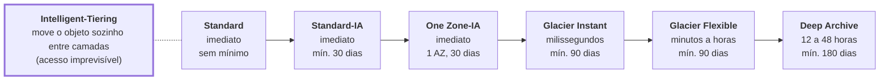

Todas têm 11 noves de durabilidade. Regras de lifecycle movem objetos da esquerda para a direita.

| Classe | Acesso | Recuperação | Permanência mínima | Quando usar |
|---|---|---|---|---|
| S3 Express One Zone | Muito frequente | Milissegundos de um dígito | Nenhuma | Alto desempenho em uma única AZ |
| S3 Standard | Frequente | Imediata | Nenhuma | Dado ativo, sites, aplicações |
| S3 Intelligent-Tiering | Desconhecido ou variável | Imediata | Nenhuma | Padrão de acesso imprevisível. Move o objeto de camada sozinho, por uma pequena taxa de monitoramento |
| S3 Standard-IA | Infrequente | Imediata | 30 dias | Backups e dados acessados raramente, mas que precisam estar à mão. Cobra taxa por recuperação |
| S3 One Zone-IA | Infrequente | Imediata | 30 dias | Dado infrequente e recriável. Fica em uma AZ só, cerca de 20% mais barato que Standard-IA |
| S3 Glacier Instant Retrieval | Raro, cerca de 1 vez por trimestre | Milissegundos | 90 dias | Arquivo que precisa de acesso imediato quando pedido, como imagens médicas |
| S3 Glacier Flexible Retrieval | Raro, 1 a 2 vezes por ano | Minutos a horas (1 a 5 min expedited, 3 a 5 h standard, 5 a 12 h bulk) | 90 dias | Arquivo e backup que tolera espera |
| S3 Glacier Deep Archive | Raríssimo | 12 horas (standard) a 48 horas (bulk) | 180 dias | Retenção regulatória de 7 a 10 anos. É a classe mais barata |
| S3 on Outposts | Local | Imediata | Nenhuma | Objetos no seu data center, em Outposts |

> [!WARNING]
> **Pegadinha:** "padrão de acesso desconhecido ou que muda" é **Intelligent-Tiering**. "Mais barato de todos" e "pode esperar 12 horas" é **Deep Archive**. "Arquivo com acesso em milissegundos" é **Glacier Instant Retrieval**. "Infrequente e pode perder, pois dá para recriar" é **One Zone-IA**.

### Recursos do S3

| Recurso | Para que serve |
|---|---|
| Versionamento | Guarda todas as versões de um objeto. Protege contra exclusão e sobrescrita acidental |
| Lifecycle policies | Move objetos entre classes ou os expira automaticamente com o tempo |
| Replicação (CRR e SRR) | Copia objetos para outro bucket em outra Region (CRR) ou na mesma (SRR). Exige versionamento |
| Bucket policy | Policy baseada em recurso que controla o acesso ao bucket |
| Block Public Access | Trava no nível da conta ou do bucket contra exposição pública |
| Criptografia | SSE-S3 por padrão; SSE-KMS; SSE-C; lado do cliente |
| Hospedagem de site estático | Serve HTML, CSS e JS direto do bucket |
| Transfer Acceleration | Acelera uploads de longe usando as edge locations |
| Object Lock | Modelo WORM: impede apagar ou alterar por um período |
| Presigned URL | Link temporário para um objeto privado |
| S3 Storage Lens | Visão de uso e atividade de armazenamento na organização |
| Event notifications | Dispara Lambda, SQS ou SNS quando um objeto chega |

**Cobrança do S3:** volume armazenado por GB, número de requisições, recuperação nas classes frias, e transferência de dados para fora. Enviar dados para dentro é gratuito.

### Armazenamento em bloco

| Característica | Amazon EBS | Instance store |
|---|---|---|
| Persistência | O dado sobrevive a parar e iniciar a instância | Efêmero: o dado se perde ao parar, terminar ou falhar o host |
| Localização | Volume de rede na mesma AZ da instância | Disco físico do próprio host |
| Desempenho | Alto e configurável | Altíssimo, com latência mínima |
| Backup | Snapshots incrementais guardados no S3 | Não tem |
| Uso | Disco de SO, bancos de dados | Cache, buffers, dados temporários |

**Tipos de volume EBS:**

| Tipo | Mídia | Uso |
|---|---|---|
| gp3 e gp2 (General Purpose SSD) | SSD | Padrão para quase tudo: boot, desenvolvimento, aplicações comuns |
| io2 e io1 (Provisioned IOPS SSD) | SSD | Bancos de dados críticos que exigem IOPS alto e constante |
| st1 (Throughput Optimized HDD) | HDD | Big data, logs, leitura sequencial em volume. Não serve como boot |
| sc1 (Cold HDD) | HDD | Dado raramente acessado, menor custo. Não serve como boot |

Pontos sobre EBS:

- Um volume fica **preso a uma AZ**. Para mover de AZ ou Region, usa-se snapshot.
- Em geral um volume é ligado a uma instância por vez.
- Snapshots são incrementais e podem ser copiados entre Regions.
- É cobrado pelo **tamanho provisionado**, mesmo que vazio.
- **Amazon Data Lifecycle Manager** automatiza a criação e a retenção de snapshots.

### Armazenamento de arquivos

| Serviço | Protocolo | Sistema | Pista no enunciado |
|---|---|---|---|
| Amazon EFS | NFS | Linux | "sistema de arquivos compartilhado entre várias instâncias Linux", "cresce e encolhe sozinho", "várias AZs" |
| Amazon FSx for Windows File Server | SMB | Windows | "Windows", "Active Directory", "SMB" |
| Amazon FSx for Lustre | Lustre | Linux | "HPC", "machine learning", "alto desempenho", integra com S3 |
| Amazon FSx for NetApp ONTAP | NFS, SMB, iSCSI | Ambos | "migrar NetApp sem mudar a aplicação" |
| Amazon FSx for OpenZFS | NFS | Linux | "migrar ZFS" |

Pontos sobre EFS:

- Elástico: paga pelo que armazena, sem provisionar tamanho.
- Regional: pode ser montado por milhares de instâncias em várias AZs ao mesmo tempo.
- Classes: Standard, Infrequent Access e Archive, com lifecycle entre elas. Há também a opção One Zone.
- Custa mais por GB que EBS e S3.

> [!WARNING]
> **Pegadinha:** EBS é de **uma instância, em uma AZ**. EFS é de **muitas instâncias, em várias AZs**. Linux pede **EFS**; Windows pede **FSx for Windows**. Dado que precisa sobreviver ao desligamento nunca vai em instance store.

### Híbrido, transferência e backup

**AWS Storage Gateway** conecta aplicações locais ao armazenamento na AWS usando protocolos padrão. Tem três tipos:

| Tipo | Protocolo local | Onde o dado fica | Uso |
|---|---|---|---|
| S3 File Gateway | NFS, SMB | Objetos no S3 | Compartilhamento de arquivos local com dado na nuvem |
| Volume Gateway | iSCSI | Volumes com backup em snapshots EBS. Modo cached (principal no S3) ou stored (principal local) | Discos de bloco locais com backup na nuvem |
| Tape Gateway | iSCSI VTL | Fitas virtuais no S3 e no Glacier | Substituir fitas físicas sem mudar o software de backup |

| Serviço | O que faz |
|---|---|
| AWS Backup | Centraliza e automatiza políticas de backup de EBS, RDS, DynamoDB, EFS, FSx, S3 e outros, inclusive entre contas e Regions |
| AWS DataSync | Copia grandes volumes de arquivos pela rede entre o local e a AWS |
| AWS Snow Family | Transferência física offline ([seção 3](#3-adoção-da-nuvem-e-migração)) |
| AWS Elastic Disaster Recovery | Replica servidores para recuperação rápida na AWS |

---

## 16. Rede: VPC, gateways e firewalls

A **VPC** é a sua rede privada e isolada dentro de uma Region. Você define a faixa de IPs, divide em sub-redes e controla rotas e firewalls.

O desenho mostra o padrão de três camadas em duas AZs: web em sub-rede pública, aplicação e banco em sub-rede privada.

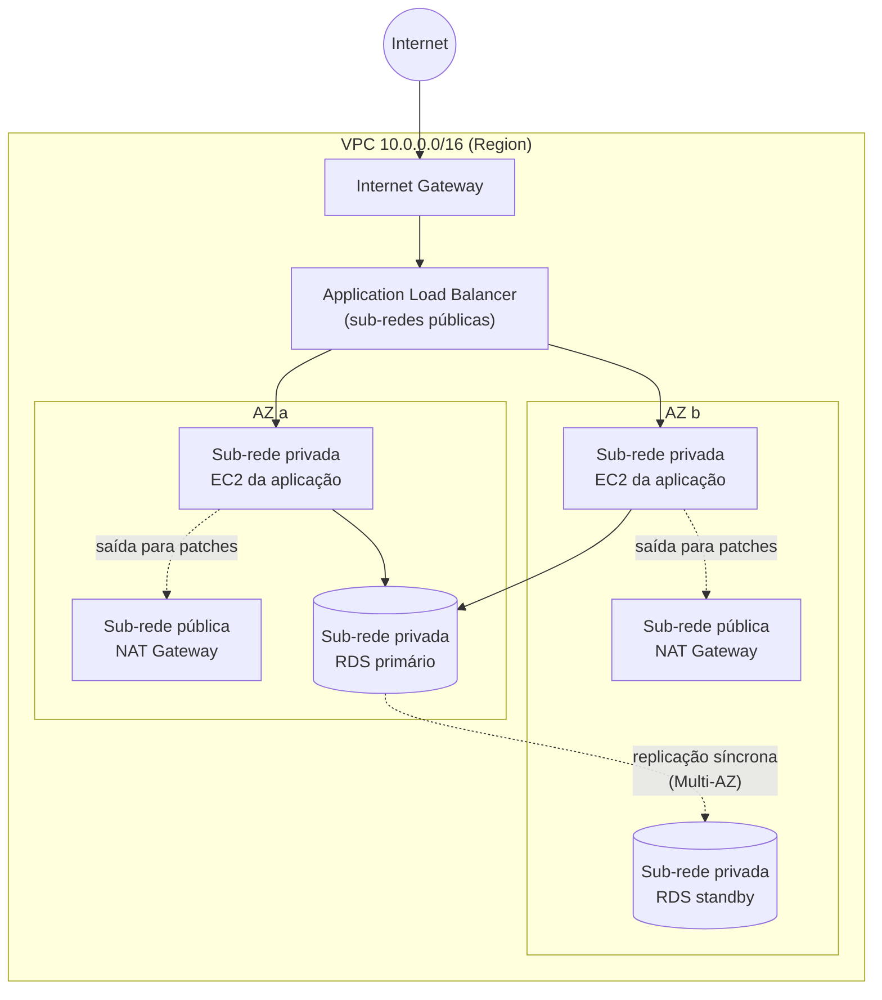

### Modelagem da VPC

| Peça | Escopo | O que faz |
|---|---|---|
| VPC | Region | Rede isolada com um bloco CIDR, por exemplo `10.0.0.0/16`. Toda conta já tem uma VPC padrão por Region |
| Sub-rede | Uma AZ | Fatia da VPC. Para alta disponibilidade, criam-se sub-redes em mais de uma AZ |
| Sub-rede pública | Uma AZ | Tem rota para o Internet Gateway. Recebe load balancers, bastion hosts, NAT Gateway |
| Sub-rede privada | Uma AZ | Sem rota direta para a internet. Recebe bancos de dados e servidores de aplicação |
| Tabela de rotas | Sub-rede | Define para onde vai o tráfego de cada destino |
| Elastic IP | Region | IPv4 público fixo |
| VPC Flow Logs | VPC, sub-rede ou interface | Registra metadados do tráfego aceito e rejeitado |

### Tipos de gateway

Quase tudo que conecta redes na AWS se chama *gateway*. A prova explora isso.

| Gateway | Liga o quê | Detalhes cobrados |
|---|---|---|
| Internet Gateway (IGW) | VPC e internet, nos dois sentidos | Um por VPC. Gratuito, escala sozinho. É o que torna uma sub-rede pública |
| NAT Gateway | Sub-rede privada para a internet, só de saída | Fica em sub-rede pública. Gerenciado e pago. Uso típico: baixar atualizações |
| Egress-only Internet Gateway | Mesma ideia do NAT, para IPv6 | Só saída |
| Virtual Private Gateway (VGW) | Lado AWS de uma VPN ou do Direct Connect, preso a uma VPC | Par do Customer Gateway |
| Customer Gateway (CGW) | Lado do cliente da VPN | Representa o roteador local |
| Transit Gateway (TGW) | Muitas VPCs e redes locais em um hub central | Substitui a malha de peerings |
| Direct Connect Gateway | Um Direct Connect a VPCs em várias Regions | Aparece pouco |
| VPC endpoint tipo Gateway | VPC ao S3 e ao DynamoDB sem passar pela internet | Gratuito. Só esses dois serviços |
| VPC endpoint tipo Interface (PrivateLink) | VPC aos demais serviços AWS, de forma privada | Pago. Usa uma interface de rede com IP privado |
| Storage Gateway | Armazenamento local ao S3, EBS e Glacier | É serviço de storage híbrido, não de rede ([seção 15](#15-armazenamento)) |
| API Gateway | Clientes às suas APIs | É serviço de aplicação, não de rede ([seção 12](#12-outros-serviços-de-computação)) |
| Gateway Load Balancer | Tráfego a appliances de terceiros | É load balancer ([seção 14](#14-escalamento-e-load-balancers)) |

> [!WARNING]
> **Pegadinha:** "instância em sub-rede privada precisa baixar patches" é **NAT Gateway**. "Acessar o S3 de dentro da VPC sem internet" é **VPC endpoint tipo Gateway**. Internet Gateway permite entrada e saída; NAT só saída.

### Security Group x Network ACL

| Característica | Security Group | Network ACL (NACL) |
|---|---|---|
| Onde atua | Na instância (interface de rede) | Na sub-rede |
| Estado | **Stateful:** a resposta de um tráfego permitido volta automaticamente | **Stateless:** entrada e saída precisam de regra cada uma |
| Tipos de regra | Só permissão (allow) | Permissão e negação (allow e deny) |
| Avaliação | Todas as regras são consideradas juntas | Regras numeradas, avaliadas em ordem, a primeira que casa decide |
| Padrão ao criar | Nega toda a entrada, permite toda a saída | A NACL padrão da VPC permite tudo. Uma NACL criada por você nega tudo |
| Aplicação | Só nas instâncias associadas | Em tudo que está na sub-rede |
| Pode referenciar | IPs e outros Security Groups | Só IPs |
| Responsável | Cliente | Cliente |

> [!WARNING]
> **Pegadinha:** "bloquear um IP específico" é **NACL**, porque Security Group não tem regra de negação. "Firewall no nível da instância" é **Security Group**. "Firewall no nível da sub-rede" é **NACL**. Stateful é o Security Group.

---

## 17. Conectividade e entrega de conteúdo

A pergunta é sempre **o que está sendo ligado a quê**: VPC a VPC, VPC a serviço AWS, ou AWS ao data center local.

### VPC a VPC

| Serviço | Como funciona | Quando usar |
|---|---|---|
| VPC Peering | Ligação privada um a um entre duas VPCs, inclusive de contas e Regions diferentes. **Não é transitivo**: se A fala com B e B com C, A não fala com C | Poucas VPCs |
| AWS Transit Gateway | Hub central em que VPCs, VPNs e Direct Connect se conectam. Roteamento transitivo | Muitas VPCs, topologia hub-and-spoke |
| AWS PrivateLink | Expõe um serviço específico de forma privada para outras VPCs, sem abrir a rede inteira | Consumir ou oferecer um serviço sem peering |

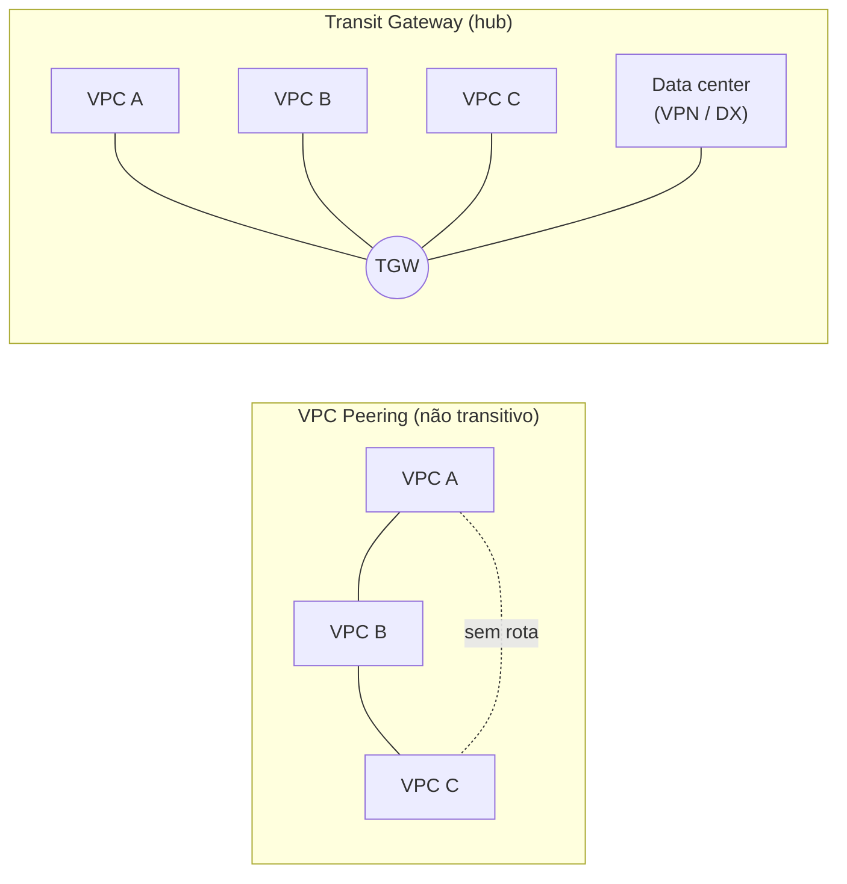

### VPC a serviços AWS, sem internet

| Serviço | Alcança |
|---|---|
| VPC endpoint tipo Gateway | S3 e DynamoDB. Gratuito |
| VPC endpoint tipo Interface (PrivateLink) | A maioria dos outros serviços AWS e serviços de parceiros |

### AWS ao ambiente on-premises

| Serviço | Meio | Criptografia | Tempo para ativar | Pista no enunciado |
|---|---|---|---|---|
| AWS Site-to-Site VPN | Túnel IPsec sobre a internet pública | Sim, por padrão | Minutos | "rápido de configurar", "baixo custo", "conexão criptografada pela internet" |
| AWS Direct Connect (DX) | Fibra dedicada e privada, fora da internet | Não por padrão | Semanas a meses | "conexão dedicada", "desempenho consistente", "alta largura de banda", "não passa pela internet" |
| AWS Client VPN | VPN gerenciada para usuários individuais (notebooks) | Sim | Minutos | "funcionários remotos acessando a VPC" |
| Direct Connect com VPN por cima | Fibra dedicada com túnel IPsec | Sim | Semanas | "dedicado e criptografado" |

Uma Site-to-Site VPN usa um **Virtual Private Gateway** (ou Transit Gateway) no lado AWS e um **Customer Gateway** no lado do cliente. Um desenho comum é Direct Connect como principal e VPN como contingência.

> [!WARNING]
> **Pegadinha:** Direct Connect é **privado, mas não é criptografado** por padrão. VPN é **criptografada, mas passa pela internet** e tem desempenho variável. "Precisa estar funcionando hoje" elimina Direct Connect.

### DNS, CDN e aceleração

| Serviço | O que é | Pista no enunciado |
|---|---|---|
| Amazon Route 53 | DNS gerenciado e altamente disponível, registro de domínios e health checks | "registrar domínio", "traduzir nome em IP", "rotear usuários para a Region mais próxima" |
| Amazon CloudFront | CDN: guarda cópia do conteúdo nas edge locations. Estático e dinâmico. Integra com S3, ALB, WAF, Shield e ACM | "reduzir latência para usuários globais", "cache", "distribuir vídeo e imagens" |
| AWS Global Accelerator | Dois IPs estáticos anycast que levam o tráfego pela rede global da AWS até o endpoint saudável mais próximo. Não faz cache | "IP estático global", "TCP ou UDP", "failover rápido entre Regions", jogos, VoIP |
| S3 Transfer Acceleration | Usa as edge locations para acelerar uploads para um bucket | "uploads lentos de usuários distantes para o S3" |

**Políticas de roteamento do Route 53:**

| Política | O que faz |
|---|---|
| Simple | Um registro, um destino |
| Weighted | Divide o tráfego por peso, por exemplo 90% e 10%. Útil para testes |
| Latency | Envia para a Region com menor latência para o usuário |
| Failover | Ativo-passivo: muda para o secundário se o health check falhar |
| Geolocation | Decide pelo país ou continente do usuário. Útil para conteúdo localizado e restrições legais |
| Geoproximity | Decide pela distância, com ajuste de viés |
| Multivalue answer | Devolve vários IPs saudáveis |

> [!WARNING]
> **Pegadinha:** CloudFront **faz cache** de conteúdo (HTTP). Global Accelerator **não faz cache**; ele otimiza o caminho de rede e dá IP fixo. Route 53 é DNS: decide para onde o nome aponta, mas o tráfego não passa por ele.

- **Route 53 faz:** resolução DNS, registro de domínios, roteamento (latência, failover, geolocalização) e health checks. Não filtra tráfego web (WAF), não protege contra DDoS (Shield) e não coleta métricas (CloudWatch).
- **Origin Access Control (OAC):** faz o CloudFront acessar o bucket S3 com requisições autenticadas, para que os usuários só cheguem aos arquivos pelo CloudFront e nunca direto pelo bucket. É a resposta para "restringir o acesso ao conteúdo do S3 servido pelo CloudFront". Substitui o antigo Origin Access Identity (OAI).

### Nomes parecidos: a família Connect

Só dois serviços ligam o data center à AWS: **Site-to-Site VPN** e **Direct Connect**. Os outros têm nome parecido e fazem outra coisa.

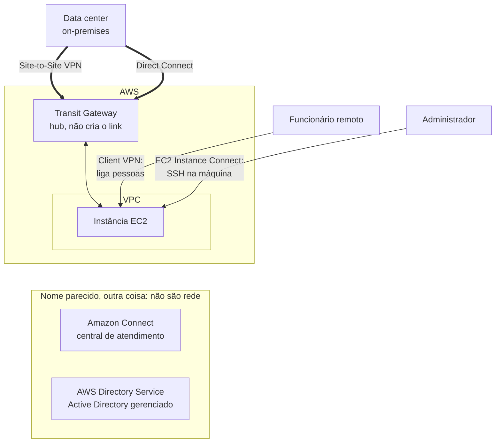

Amazon Connect e Directory Service ficam num grupo à parte de propósito: não são serviços de rede. O Transit Gateway só chega ao data center por cima de uma VPN ou de um Direct Connect.

| Serviço | O que faz | Liga o on-premises à AWS? |
|---|---|---|
| AWS Site-to-Site VPN | Túnel IPsec criptografado, pela internet, entre o data center e a AWS | **Sim** |
| AWS Direct Connect | Fibra dedicada e privada até a AWS | **Sim** |
| AWS Transit Gateway | Hub que roteia entre VPCs e redes locais | Não sozinho: precisa de uma VPN ou de um Direct Connect por baixo |
| AWS Client VPN | VPN para usuários individuais, em notebooks | Liga pessoas, não o data center |
| EC2 Instance Connect | SSH na instância pelo console ou CLI, com chave temporária | Não: é acesso a uma máquina |
| Amazon Connect | Central de atendimento na nuvem: telefone e chat | Não: não é serviço de rede |
| AWS Directory Service | Microsoft Active Directory gerenciado | Não: é diretório de usuários |
| Amazon AppFlow | Integração de dados entre SaaS e AWS | Não |

> [!WARNING]
> **Pegadinha:** em "conectar o ambiente on-premises à AWS (escolha dois)", marque **Site-to-Site VPN e Direct Connect**. Transit Gateway só é a resposta quando a pergunta fala em hub central para muitas VPCs e redes.

---

## 18. Bancos de dados e cache

A AWS tem um banco para cada modelo de dados (*purpose-built*). A prova dá o tipo de dado ou o padrão de acesso e pede o serviço.

### Mapa por tipo

| Tipo | Serviço | Por que usar | Pista no enunciado |
|---|---|---|---|
| Relacional gerenciado | Amazon RDS | SQL, transações ACID, joins, schema fixo. Engines: MySQL, PostgreSQL, MariaDB, Oracle, SQL Server, Db2 | "banco relacional gerenciado", "migrar MySQL sem administrar servidor" |
| Relacional nativo de nuvem | Amazon Aurora | Compatível com MySQL e PostgreSQL. Até 5x a vazão do MySQL e 3x a do PostgreSQL. 6 cópias em 3 AZs, armazenamento que cresce sozinho | "alto desempenho relacional", "compatível com MySQL ou PostgreSQL", "alta disponibilidade" |
| Chave-valor (NoSQL) | Amazon DynamoDB | Serverless, latência de milissegundos de um dígito em qualquer escala, schema flexível | "NoSQL", "serverless", "escala massiva", "carrinho de compras", "sessões", "jogos" |
| Documento | Amazon DocumentDB | Compatível com MongoDB. Documentos JSON | "MongoDB", "catálogo", "perfis de usuário" |
| Em memória | Amazon ElastiCache, Amazon MemoryDB | Latência de microssegundos | "cache", "sessões", "placar em tempo real" |
| Grafo | Amazon Neptune | Dados altamente conectados | "rede social", "recomendação", "detecção de fraude", "grafo de conhecimento" |
| Colunar largo | Amazon Keyspaces | Compatível com Apache Cassandra | "Cassandra" |
| Série temporal | Amazon Timestream | Dados com carimbo de tempo | "IoT", "métricas ao longo do tempo", "telemetria" |
| Ledger | Amazon QLDB | Registro imutável e verificável por criptografia, com autoridade central | "histórico imutável", "auditoria de transações financeiras" |
| Data warehouse | Amazon Redshift | Análise (OLAP) em petabytes, armazenamento colunar | "data warehouse", "relatórios analíticos", "BI" ([seção 19](#19-analytics-e-serviços-de-dados)) |

> [!NOTE]
> O **QLDB** foi descontinuado em julho de 2025, mas ainda pode aparecer em material de estudo. Banco em EC2 continua sendo opção quando se precisa de controle total do SO ou de uma engine que o RDS não oferece, ao custo de administrar tudo.

### Amazon RDS em detalhe

O que a AWS faz por você: provisionamento, patches do SO e da engine, backups automáticos, detecção de falha e recuperação.

| Recurso | Finalidade | Como funciona |
|---|---|---|
| Multi-AZ | Alta disponibilidade e failover | Réplica **síncrona** em espera em outra AZ. Failover automático. A réplica em espera não atende leitura no modelo clássico |
| Read Replicas | Escala de leitura e desempenho | Réplicas **assíncronas** que atendem consultas. Podem ficar em outra Region |
| Backups automáticos | Recuperação pontual | Retenção de até 35 dias, restauração para um instante específico |
| Snapshots manuais | Backup sob demanda | Ficam até você apagar |
| Criptografia | Segurança | Em repouso com KMS, em trânsito com TLS |

> [!WARNING]
> **Pegadinha:** Multi-AZ é para **disponibilidade** (desastre). Read Replica é para **desempenho de leitura**. A prova troca os dois o tempo todo.

### Aurora

- **Aurora Serverless:** ajusta a capacidade sozinho. Bom para carga intermitente ou imprevisível.
- **Aurora Global Database:** replicação entre Regions com leitura local de baixa latência e recuperação de desastre.
- Até 15 réplicas de leitura.
- Custa mais que o RDS comum e entrega mais desempenho e disponibilidade.

### DynamoDB

- Totalmente gerenciado e serverless. Não há instância para escolher.
- Dados replicados em 3 AZs por padrão.
- Modos de capacidade: **on-demand** (paga por requisição) ou **provisionado** (define leituras e escritas, com auto scaling).
- **Global Tables:** multi-Region, ativo-ativo.
- **DAX (DynamoDB Accelerator):** cache em memória específico do DynamoDB, com latência de microssegundos.
- Backups sob demanda e recuperação pontual.

### Licenças de banco de dados

| Modelo | Como funciona | Onde aparece |
|---|---|---|
| License Included | A licença já está no preço por hora | RDS para SQL Server e Oracle (algumas edições) |
| BYOL (Bring Your Own License) | Você usa a licença que já comprou | RDS para Oracle e Db2; bancos em EC2 e Dedicated Hosts |
| Código aberto | Sem custo de licença | MySQL, PostgreSQL, MariaDB, Aurora |

- Sair de engines comerciais para Aurora ou PostgreSQL é uma forma clássica de reduzir custo de licença. O par **DMS e SCT** faz essa migração.
- **AWS License Manager** acompanha o consumo de licenças.

### Cache

Cache guarda em memória o resultado de consultas frequentes, o que reduz a latência e tira carga do banco.

| Serviço | Tipo | Vantagem | Quando usar |
|---|---|---|---|
| ElastiCache for Redis ou Valkey | Em memória, com estruturas de dados ricas | Persistência, replicação, Multi-AZ com failover, pub/sub, conjuntos ordenados | Sessões, placares, cache que precisa de alta disponibilidade |
| ElastiCache for Memcached | Em memória, simples | Multithread, fácil de escalar horizontalmente, sem persistência | Cache simples de objetos |
| Amazon MemoryDB | Banco em memória durável, compatível com Redis | Durabilidade Multi-AZ, serve como banco principal | Quando se quer velocidade de memória com durabilidade |
| DynamoDB Accelerator (DAX) | Cache na frente do DynamoDB | Sem mudar a lógica da aplicação | Só para DynamoDB |
| Amazon CloudFront | Cache de conteúdo na borda | Perto do usuário | Conteúdo web, estático ou dinâmico |

> [!WARNING]
> **Pegadinha:** "reduzir carga de leitura do banco relacional" pode ser Read Replica ou ElastiCache. Se o enunciado fala em "em memória" ou "microssegundos", é **ElastiCache**. Se fala em DynamoDB, é **DAX**. Redshift é análise (**OLAP**); RDS e Aurora são transação (**OLTP**).

---

## 19. Analytics e serviços de dados

O fluxo é **coletar → armazenar → transformar → consultar → visualizar**. Cada serviço ocupa uma etapa.

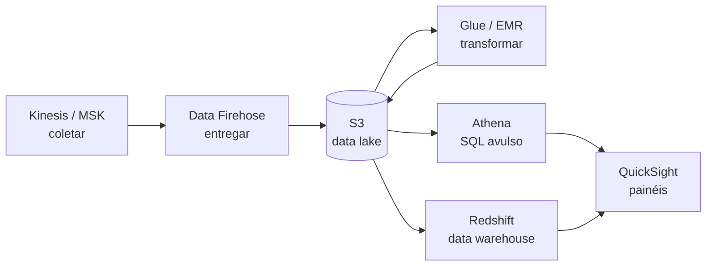

| Serviço | Etapa | O que é | Pista no enunciado |
|---|---|---|---|
| Amazon Kinesis Data Streams | Coletar | Ingestão de dados de streaming em tempo real, com retenção e vários consumidores | "tempo real", "clickstream", "telemetria", "milhares de fontes" |
| Amazon Data Firehose (antigo Kinesis Data Firehose) | Coletar e entregar | Carrega streaming em S3, Redshift e OpenSearch, quase em tempo real, sem código | "entregar streaming no S3", "jeito mais simples de carregar" |
| Amazon MSK | Coletar | Apache Kafka gerenciado | "Kafka" |
| Amazon S3 | Armazenar | Base do data lake | "data lake" |
| AWS Lake Formation | Armazenar e governar | Monta e protege um data lake em dias, com permissões centralizadas | "montar data lake rapidamente", "controle de acesso fino" |
| AWS Glue | Transformar | ETL serverless e catálogo de dados (Glue Data Catalog), com crawlers que descobrem o schema | "ETL", "preparar dados", "catálogo de metadados" |
| Amazon EMR | Processar | Hadoop, Spark, Hive e Presto gerenciados em cluster | "big data", "Spark", "Hadoop" |
| Amazon Athena | Consultar | SQL serverless direto sobre arquivos no S3. Paga por dado escaneado | "consultar o S3 com SQL", "sem infraestrutura", "análise de logs" |
| Amazon Redshift | Consultar | Data warehouse colunar em escala de petabytes. Redshift Spectrum consulta o S3 | "data warehouse", "OLAP", "consultas analíticas complexas" |
| Amazon OpenSearch Service | Buscar | Busca textual e análise de logs, com dashboards | "busca", "análise de logs", "Elasticsearch" |
| Amazon QuickSight | Visualizar | BI serverless: painéis, relatórios, perguntas em linguagem natural | "dashboards", "business intelligence", "visualizar dados" |
| Amazon Managed Service for Apache Flink | Processar | Análise de streaming em tempo real com Flink | "analisar streaming em tempo real" |
| AWS Data Exchange | Obter | Assinar conjuntos de dados de terceiros | "dados de terceiros" |

> [!NOTE]
> **Nomes novos x nomes da prova:** o Kinesis Data Firehose virou **Amazon Data Firehose** em 2024, e o QuickSight foi incorporado à marca **Amazon Quick** em 2025. A prova e os simulados ainda usam os nomes antigos.

> [!WARNING]
> **Pegadinha, em uma linha cada:**
> - SQL direto sobre o S3: **Athena** (serverless) ou **Redshift Spectrum** (a partir do Redshift, sem carregar os dados).
> - Data warehouse: **Redshift**.
> - ETL: **Glue**. Não é tempo real; streaming em tempo real é **Kinesis**.
> - Hadoop e Spark: **EMR**.
> - Streaming em tempo real: **Kinesis**.
> - Painéis: **QuickSight**.
> - Kinesis é streaming de dados; SQS é fila de mensagens entre componentes. Não são intercambiáveis nas alternativas.

---

## 20. Serviços de IA e machine learning

São três níveis: **serviços de IA prontos** (API, sem saber ML), **plataforma de ML** (SageMaker) e **IA generativa** (Bedrock e Amazon Q). A prova dá a tarefa e pede o serviço.

### Serviços de IA prontos

| Serviço | Entrada | Saída | Pista no enunciado |
|---|---|---|---|
| Amazon Rekognition | Imagem e vídeo | Objetos, rostos, texto na imagem, moderação de conteúdo | "reconhecimento facial", "detectar objetos em fotos", "conteúdo impróprio" |
| Amazon Textract | Documento escaneado, PDF | Texto, tabelas e campos de formulário extraídos | "extrair dados de formulários", "OCR", "notas fiscais" |
| Amazon Comprehend | Texto | Sentimento, entidades, idioma, tópicos, PII | "análise de sentimento", "avaliações de clientes", "NLP" |
| Amazon Transcribe | Áudio | Texto (fala para texto) | "legendas", "transcrever chamadas" |
| Amazon Polly | Texto | Áudio (texto para fala) | "voz natural", "ler artigos em voz alta" |
| Amazon Translate | Texto | Texto em outro idioma | "tradução", "localizar conteúdo" |
| Amazon Lex | Voz ou texto do usuário | Conversa com intenção identificada | "chatbot", "assistente de voz", "mesma tecnologia da Alexa" |
| Amazon Kendra | Documentos da empresa | Busca inteligente com perguntas em linguagem natural | "busca corporativa", "achar respostas em documentos internos" |
| Amazon Personalize | Histórico de interações | Recomendações personalizadas | "recomendação de produtos" |
| Amazon Forecast | Séries históricas | Previsão de demanda | "prever vendas" |
| Amazon Fraud Detector | Eventos de transação | Pontuação de risco de fraude | "fraude em pagamentos online" |

### Plataforma e IA generativa

| Serviço | O que é | Pista no enunciado |
|---|---|---|
| Amazon SageMaker AI | Plataforma para construir, treinar e implantar modelos próprios de ML | "cientistas de dados", "treinar modelo customizado", "ciclo completo de ML" |
| Amazon Bedrock | Acesso por API a modelos de fundação de vários fornecedores, sem gerenciar infraestrutura | "IA generativa", "modelos de fundação", "construir aplicação com LLM" |
| Amazon Q Business | Assistente generativo ligado aos dados da empresa | "assistente para funcionários", "responder com base em dados internos" |
| Amazon Q Developer | Assistente generativo para escrever e revisar código (sucessor do CodeWhisperer) | "sugestão de código", "assistente no IDE" |

> [!WARNING]
> **Pegadinha:** **Transcribe** é fala → texto; **Polly** é texto → fala. **Textract** tira texto de documento; **Rekognition** analisa imagem e vídeo; **Comprehend** entende o significado do texto. **Lex** conversa; Polly só fala. Se o cliente quer treinar o próprio modelo, é **SageMaker**; se quer algo pronto por API, é um dos serviços de IA.

---

## 21. Mensageria, e-mail e integração

Estes serviços existem para **desacoplar** componentes: se um falha ou fica lento, o outro continua. A prova separa fila, publicação e assinatura, eventos, streaming e comunicação com clientes.

### Integração entre componentes

| Serviço | Modelo | O que é | Pista no enunciado |
|---|---|---|---|
| Amazon SQS | Fila (pull) | Um produtor grava, um consumidor busca e apaga. A mensagem fica guardada até ser processada, por até 14 dias | "desacoplar", "fila", "processar depois", "absorver pico", "não perder pedidos se o backend cair" |
| Amazon SNS | Publicação e assinatura (push) | Uma mensagem em um tópico vai para todos os assinantes: e-mail, SMS, push, HTTP, Lambda, SQS | "notificar", "enviar para vários destinos", "fan-out", "alerta por e-mail ou SMS" |
| Amazon EventBridge | Barramento de eventos | Roteia eventos de serviços AWS, de SaaS e das suas aplicações por regras. Também agenda tarefas | "reagir a eventos", "orientado a eventos", "agendar", "integrar com SaaS" |
| AWS Step Functions | Orquestração | Coordena vários passos e serviços em um fluxo visual, com tratamento de erro | "workflow", "orquestrar várias funções Lambda", "sequência de etapas" |
| Amazon MQ | Broker gerenciado | ActiveMQ e RabbitMQ gerenciados, com protocolos padrão (JMS, AMQP, MQTT) | "migrar aplicação que já usa broker sem reescrever", "RabbitMQ", "ActiveMQ" |
| Amazon MSK | Streaming | Apache Kafka gerenciado. É o "Kafka da AWS" | "Kafka" |
| Amazon Kinesis | Streaming | Ingestão e análise de dados em tempo real ([seção 19](#19-analytics-e-serviços-de-dados)) | "streaming em tempo real" |
| Amazon AppFlow | Integração SaaS | Transfere dados entre SaaS (Salesforce, Slack) e a AWS sem código | "sincronizar dados do Salesforce" |

**Tipos de fila do SQS:**

| Tipo | Ordem | Entrega | Vazão |
|---|---|---|---|
| Standard | Melhor esforço | Pelo menos uma vez, pode duplicar | Praticamente ilimitada |
| FIFO | Garantida | Exatamente uma vez | Limitada |

**Fan-out** é o padrão SNS na frente de várias filas SQS: uma publicação alimenta vários consumidores independentes.

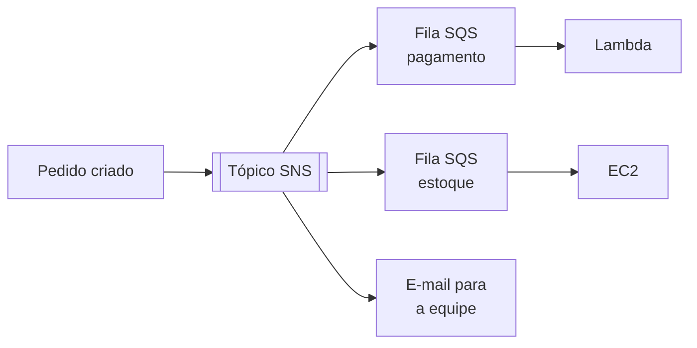

### Comunicação com clientes

| Serviço | O que é | Pista no enunciado |
|---|---|---|
| Amazon SES | Envio e recebimento de e-mail em escala: transacional e marketing | "enviar e-mails em massa", "e-mail de confirmação de pedido" |
| Amazon SNS | Notificações simples por SMS, e-mail e push | "alerta", "notificação" |
| Amazon Pinpoint | Campanhas de marketing multicanal com segmentação e métricas | "campanha direcionada", "engajamento de usuários", "segmentar público" |
| AWS End User Messaging | SMS, push e voz para aplicações | "enviar SMS pela aplicação" |
| Amazon Connect | Central de atendimento (contact center) na nuvem | "call center", "atendimento ao cliente" |

> [!NOTE]
> A AWS encerra o suporte ao **Amazon Pinpoint** em 30 de outubro de 2026, e os canais de SMS e push passaram para o **AWS End User Messaging**. Simulados ainda citam o Pinpoint como resposta para campanha de marketing.

> [!WARNING]
> **Pegadinha:**
> - **SQS** guarda a mensagem até alguém buscar (pull, um consumidor). **SNS** empurra na hora para todos (push, vários assinantes) e não guarda.
> - **SES** é e-mail em volume para clientes. SNS manda e-mail só como notificação simples.
> - **Amazon MQ** é para migrar o que já usa broker padrão. Para aplicação nova na nuvem, a AWS recomenda SQS e SNS.
> - **EventBridge** reage a eventos; **Step Functions** coordena passos em ordem.

---

## 22. Monitoramento e observabilidade

Cada ferramenta olha para uma coisa diferente: desempenho, ações, configuração, saúde da AWS ou boas práticas.

| Serviço | Olha para | Pista no enunciado |
|---|---|---|
| Amazon CloudWatch | Desempenho e saúde dos seus recursos e aplicações | "métricas", "alarme de CPU", "dashboard", "centralizar logs" |
| AWS CloudTrail | Ações: chamadas de API na conta | "quem fez", "auditoria" |
| AWS Config | Configuração dos recursos ao longo do tempo | "o que mudou", "conformidade de configuração" |
| AWS X-Ray | Rastreamento de requisições entre microsserviços | "rastrear requisição de ponta a ponta", "achar gargalo", "depurar aplicação distribuída" |
| AWS Health Dashboard | Saúde dos serviços da AWS e eventos que afetam a sua conta | "manutenção programada", "incidente da AWS que afeta meus recursos" |
| AWS Trusted Advisor | Aderência a boas práticas | "recomendações", "limites de serviço", "recursos ociosos" |
| AWS Compute Optimizer | Dimensionamento de EC2, EBS, Lambda e Auto Scaling | "instância superdimensionada", "rightsizing" |
| AWS Systems Manager | Operação da frota: patches, comandos, inventário, acesso por sessão | "aplicar patches em centenas de instâncias", "acessar instância sem SSH" |
| Amazon Managed Grafana e Managed Service for Prometheus | Painéis e métricas de código aberto, gerenciados | "Grafana", "Prometheus", "métricas de contêineres" |

### CloudWatch por dentro

| Componente | O que faz |
|---|---|
| Metrics | Séries numéricas dos serviços: CPU, rede, requisições. Métricas customizadas são possíveis |
| Alarms | Dispara ação quando uma métrica cruza um limite: notificar via SNS, acionar Auto Scaling, parar ou reiniciar uma instância EC2 |
| Logs | Coleta, guarda e consulta logs de aplicações e serviços. Logs Insights faz as consultas |
| Dashboards | Painéis customizados, inclusive entre Regions e contas |
| Events (hoje EventBridge) | Reage a mudanças de estado e agenda tarefas |
| Billing alarms | Alarme sobre o valor estimado da fatura |

Detalhes cobrados:

- Métricas básicas do EC2 vêm a cada **5 minutos**, sem custo. O monitoramento detalhado, a cada **1 minuto**, é pago.
- **Memória e uso de disco não são métricas padrão** do EC2. Exigem o **CloudWatch Agent**.
- CloudWatch é regional, mas os dashboards podem juntar várias Regions.

### Trusted Advisor

Categorias de verificação: **otimização de custos, desempenho, segurança, tolerância a falhas, limites de serviço e excelência operacional**.

- No suporte Basic, só um conjunto básico de verificações (segurança essencial e limites de serviço).
- O conjunto completo e o acesso por API exigem Business Support+, Enterprise ou Unified Operations.
- Exemplos de achado: bucket S3 aberto, Security Group com porta liberada para o mundo, root sem MFA, instância ociosa, Elastic IP sem uso, volume EBS sem snapshot.

### AWS Health Dashboard

- **Service health:** estado público de todos os serviços em todas as Regions.
- **Your account health:** visão personalizada, com eventos e manutenções que afetam os seus recursos, e orientação de correção.
- A **AWS Health API** exige plano de suporte pago a partir do Business Support+.

> [!WARNING]
> **Pegadinha:** CloudWatch monitora **desempenho**; CloudTrail registra **ações**; Config registra **configuração**; X-Ray rastreia **requisições**. "A AWS está fora do ar?" é **Health Dashboard**, não CloudWatch. "Alertar quando a fatura passar de um valor" pode ser billing alarm do CloudWatch ou AWS Budgets; **Budgets** é a resposta preferida quando as duas aparecem.

### CloudWatch x CloudTrail

Os dois não competem: o CloudWatch acompanha o **comportamento** dos recursos, o CloudTrail registra as **ações** feitas na conta. O mesmo incidente aparece nos dois, cada um com uma parte da história.

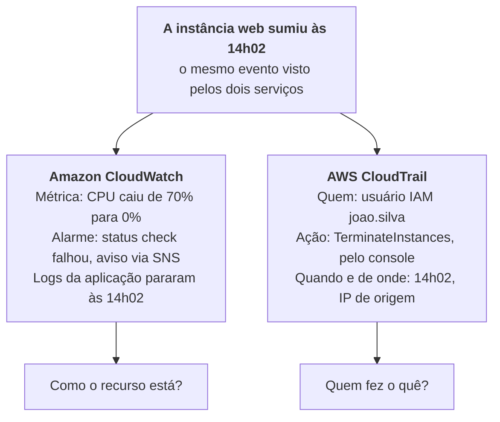

| Aspecto | Amazon CloudWatch | AWS CloudTrail |
|---|---|---|
| Pergunta que responde | Como o recurso está se comportando? | Quem fez o quê, quando e de onde? |
| O que registra | Métricas, logs de aplicação, alarmes e eventos | Chamadas de API feitas pelo console, CLI ou SDK |
| Foco | Desempenho e operação | Auditoria, segurança e governança |
| Age sozinho? | Sim: alarmes notificam via SNS, acionam Auto Scaling e param ou reiniciam instâncias | Não: só registra. O CloudTrail Insights aponta atividade de API incomum |
| Retenção padrão | Métricas por 15 meses; logs pelo prazo que você definir | Event history de 90 dias; para mais, uma trail grava no S3 |
| Pista no enunciado | "CPU", "latência", "alarme", "dashboard", "logs da aplicação" | "auditoria", "quem apagou", "rastrear ações do usuário", "chamadas de API" |

- O AWS Config completa o trio: registra como a configuração estava e mudou ([seção 10](#10-investigação-rastro-e-conformidade)).
- Os dois se integram: uma trail do CloudTrail pode enviar os eventos para o CloudWatch Logs e disparar um alarme, por exemplo quando alguém usa o root.

> [!WARNING]
> **Pegadinha:** a palavra "log" não decide a questão. Log de **chamada de API** é CloudTrail; log de **aplicação ou de sistema** é CloudWatch Logs. "Disparar uma ação quando a métrica passar do limite" é sempre **CloudWatch**.

---

## 23. Custos: preços e ferramentas

São 12% da prova, e a maior parte é saber qual ferramenta responde a qual pergunta sobre dinheiro.

### Princípios de preço da AWS

1. **Pague pelo uso** (pay-as-you-go), sem contrato longo obrigatório.
2. **Pague menos ao se comprometer** (Reserved Instances, Savings Plans).
3. **Pague menos ao usar mais** (faixas de volume, como no S3 e na transferência de dados).

Os três motores de custo são **computação, armazenamento e transferência de dados para fora**.

### Transferência de dados

| Tráfego | Custo |
|---|---|
| Entrada de dados na AWS | Gratuita |
| Saída para a internet | Paga por GB |
| Entre Regions | Paga |
| Entre AZs na mesma Region | Paga, em valor menor |
| Dentro da mesma AZ por IP privado | Gratuita |

### Free Tier

| Modelo | Como funciona |
|---|---|
| Sempre gratuito (always free) | Não expira. Exemplos: 1 milhão de requisições Lambda por mês, 25 GB no DynamoDB |
| 12 meses gratuitos | A partir da criação da conta. Exemplos: 750 horas por mês de EC2 t2.micro ou t3.micro, 5 GB no S3 Standard |
| Testes de curto prazo (trials) | Começam ao ativar o serviço. Exemplos: Inspector, SageMaker |

> [!NOTE]
> Esse é o modelo clássico, que a prova e os simulados cobram. Contas criadas a partir de julho de 2025 entram em um modelo novo, baseado em créditos e com um plano gratuito de até 6 meses. Se aparecer, a lógica é a mesma: experimentar sem custo dentro de limites.

### Ferramentas de custo e suas diferenças

| Ferramenta | Pergunta que responde | Olha para | Detalhes cobrados |
|---|---|---|---|
| AWS Pricing Calculator | Quanto vai custar o que ainda não construí? | Futuro, estimativa | Gratuito, não exige conta. Monta estimativas por arquitetura |
| AWS Cost Explorer | Para onde foi meu dinheiro, e para onde vai? | Passado e previsão | Gráficos e filtros por serviço, conta e tag. Histórico dos últimos 12 meses (não 15: isso é a retenção de métricas do CloudWatch) e previsão de gastos. Recomenda Reserved Instances e Savings Plans |
| AWS Budgets | Estou passando do orçamento? | Limites e alertas | Orçamentos de custo, uso, cobertura e utilização de RI e Savings Plans. Alerta por valor real ou previsto. Pode executar ações automáticas |
| AWS Cost and Usage Report (CUR) | Qual o detalhe máximo do meu gasto? | Dados brutos | O relatório mais granular, por hora e por recurso. Entregue no S3, analisável com Athena, Redshift e QuickSight |
| AWS Cost Anomaly Detection | Tem gasto fora do padrão? | Anomalias | Machine learning que detecta e avisa sobre gastos incomuns |
| Cost allocation tags | Quem gastou o quê? | Atribuição | Tags ativadas para faturamento separam custo por projeto, equipe ou ambiente |
| AWS Billing Conductor | Como mostro o custo internamente ou para clientes? | Rateio | Personaliza a apresentação de preços para showback e chargeback |
| AWS Compute Optimizer | Meus recursos estão do tamanho certo? | Rightsizing | Recomenda tipo e tamanho com base em métricas de uso |
| AWS Trusted Advisor | Tem recurso ocioso ou desperdiçado? | Boas práticas | Verificações de otimização de custos |
| Painel de Billing (Bills) | Qual é a minha fatura deste mês? | Fatura | Valores por serviço, pagamentos, créditos |
| Migration Evaluator | Vale a pena migrar? | TCO | Caso de negócio para migração |

> [!WARNING]
> **Pegadinha:**
> - Estimar antes de construir: **Pricing Calculator**.
> - Analisar e visualizar o que já gastou, e prever: **Cost Explorer**.
> - Alertar quando passar de um limite: **Budgets**.
> - Relatório mais detalhado: **Cost and Usage Report**.
> - Separar custo por departamento: **cost allocation tags**, ou contas separadas no Organizations.
> - Cost Explorer **mostra**; Budgets **avisa**. É o par que a prova mais troca.

### Cost Explorer x Cost and Usage Report

Os dois partem dos mesmos dados de cobrança. O Cost Explorer entrega a análise pronta no console; o Cost and Usage Report (CUR) entrega o dado bruto para você analisar com outra ferramenta.

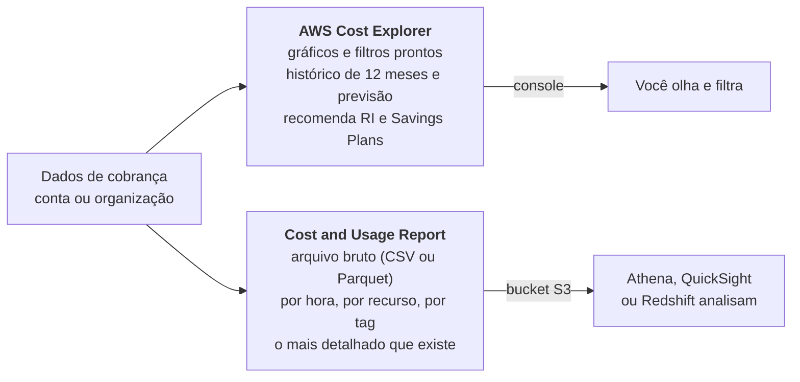

| Aspecto | AWS Cost Explorer | AWS Cost and Usage Report |
|---|---|---|
| Formato | Interface com gráficos e filtros no console | Arquivos CSV ou Parquet entregues em um bucket S3 |
| Granularidade | Mensal ou diária (horária opcional) | Por hora e por recurso, com tags, descontos e preços |
| Previsão | Sim | Não |
| Recomendações | Reserved Instances e Savings Plans | Não |
| Precisa de outra ferramenta? | Não | Sim: Athena, QuickSight ou Redshift |
| Pista no enunciado | "visualizar", "analisar tendência", "prever gastos" | "mais detalhado", "granular", "por recurso", "exportar dados de cobrança" |

No console mais novo, o CUR fica dentro de **Data Exports**. A prova usa o nome Cost and Usage Report.

> [!WARNING]
> **Pegadinha:** "o relatório mais detalhado de custo e uso" é **CUR**, mesmo que o Cost Explorer também gere relatórios. Nenhum dos dois manda alerta quando o gasto passa do limite: isso é **AWS Budgets**. "Quantos meses de histórico o Cost Explorer mostra?" são **12 meses**; 15 meses é a retenção do CloudWatch.

### Outras formas de reduzir custo

- Reserved Instances e Savings Plans para carga estável; Spot para carga interrompível.
- Rightsizing e desligar o que está ocioso.
- Auto Scaling para acompanhar a demanda.
- Classes de armazenamento e lifecycle no S3.
- Faturamento consolidado no Organizations para descontos por volume.
- Serviços gerenciados e serverless, que reduzem o custo operacional.
- Capacidade reservada também existe em RDS, Redshift, ElastiCache, DynamoDB e OpenSearch.

### AWS Marketplace

Catálogo digital de software de terceiros que roda na AWS: AMIs, SaaS, contêineres, modelos de ML e dados. A cobrança vem na própria fatura da AWS, com opções de pagamento por uso, assinatura e BYOL.

---

## 24. Planos de suporte

A AWS tem quatro planos de suporte: **Basic** (gratuito), **Business Support+**, **Enterprise Support** e **Unified Operations**. Cada plano acima inclui tudo do anterior.

A lógica cobrada é sempre a mesma: quanto mais crítico o ambiente, mais rápido o tempo de resposta e mais próximo o acompanhamento da AWS.

### Comparativo dos planos

Fonte: página de comparação de planos da AWS, consultada em 7 de outubro de 2026.

| Item | Basic | Business Support+ | Enterprise Support | Unified Operations |
|---|---|---|---|---|
| Indicado para | Experimentar | Mínimo recomendado para produção | Cargas críticas para o negócio, com orientação especializada | Cargas de missão crítica, com especialistas na sua aplicação |
| Preço mínimo mensal | Gratuito | US$ 29 | US$ 5.000 | US$ 50.000 |
| Suporte técnico | Não tem. Só atendimento de conta e cobrança | 24/7 por telefone, web, chat e e-mail | 24/7 | 24/7 |
| Sistema crítico fora do ar | — | < 30 min | < 15 min | < 5 min |
| Sistema de produção fora do ar | — | < 1 h | < 1 h | < 1 h |
| Produção com problema | — | < 4 h | < 4 h | < 4 h |
| Sistema com problema | — | < 12 h | < 12 h | < 12 h |
| Orientação geral | — | < 24 h | < 24 h | < 24 h |
| Technical Account Manager (TAM) designado | Não | Não | Sim | Sim, com engenheiros especialistas de domínio |
| Trusted Advisor | Verificações básicas | Conjunto completo | Completo, com Trusted Advisor Priority | Completo, com Trusted Advisor Priority |
| AWS Health API e AWS Support API | Não | Sim | Sim | Sim |
| Suporte a software de terceiros | Não | Sim | Sim | Sim |
| Revisões Well-Architected e de segurança | Não | Orientação contextual | Revisões consultivas | Revisões contínuas |
| AWS Security Incident Response | Não | Taxa adicional | Incluído | Incluído |
| AWS Incident Detection and Response | Não | Não | Taxa adicional | Incluído |
| Monitoramento 24/7 da carga | Não | Não | Não | Sim |
| Cobrança e conta | Atendimento 24/7 | Suporte de cobrança 24/7 | Concierge de cobrança | Especialista sênior designado |

**O que todos os clientes têm, inclusive no Basic:** atendimento ao cliente 24/7 para conta e cobrança, documentação, whitepapers, AWS re:Post, verificações básicas do Trusted Advisor e o AWS Health Dashboard.

### O que decorar

- **TAM designado:** só Enterprise Support e Unified Operations.
- **Suporte técnico 24/7** por telefone, chat e e-mail: a partir do Business Support+. O Basic só tem atendimento de conta e cobrança.
- **Trusted Advisor completo, AWS Health API e Support API:** a partir do Business Support+.
- **Sistema crítico fora do ar:** menos de 30 minutos no Business Support+, 15 no Enterprise e 5 no Unified Operations.
- **Plano pago mais barato:** Business Support+, a partir de US$ 29 por mês.
- **Security Incident Response incluído:** a partir do Enterprise Support.
- **Monitoramento 24/7 da carga e engenheiros especialistas de domínio:** só Unified Operations.
- **Mudar de plano de suporte** é tarefa do root.

> [!WARNING]
> **Pegadinha:** "TAM" separa Enterprise e Unified Operations do Business Support+. "Crítico para o negócio" e "15 minutos" apontam para **Enterprise**; "missão crítica" e "5 minutos", para **Unified Operations**. "Produção" com o menor custo é **Business Support+**. Basic não tem suporte técnico.

> [!NOTE]
> **Na prova:** o Business Support+ já inclui **Architecture Support**, uma orientação contextual sobre como os serviços se encaixam no seu caso, e permite comprar Infrastructure Event Management à parte. Well-Architected Reviews, concierge de cobrança e TAM são do Enterprise. Algumas questões ainda chamam o plano de "Business", sem o +: é o mesmo nível.

### Outros recursos de ajuda

| Recurso | O que é |
|---|---|
| AWS re:Post | Comunidade de perguntas e respostas |
| AWS Knowledge Center | Respostas para as dúvidas mais frequentes dos clientes |
| Documentação e whitepapers | Referência técnica oficial |
| AWS Prescriptive Guidance | Estratégias e padrões para migração e modernização |
| AWS Solutions Library e Architecture Center | Coleção de recursos técnicos: arquiteturas de referência, guias e boas práticas por domínio. Resposta para "recursos técnicos para construir melhor na AWS" |
| AWS Skill Builder | Treinamento online |
| AWS Partner Network (APN) | Parceiros de consultoria (implementam e migram) e de tecnologia (vendem software e hardware) |
| AWS Professional Services | Consultores da própria AWS, para grandes projetos |
| AWS Managed Services (AMS) | A AWS opera a sua infraestrutura por você |
| AWS Activate | Créditos e apoio para startups |
| AWS Trust & Safety | Canal para reportar abuso de recursos AWS |
| AWS Support Center | Onde se abrem e acompanham os chamados |

---

## 25. Outros serviços que aparecem

São serviços com uma ou duas questões cada. Basta reconhecer o nome e o uso.

### Formas de acessar e implantar

| Recurso | O que é |
|---|---|
| AWS Management Console | Interface web |
| AWS CLI | Linha de comando, boa para scripts |
| AWS SDKs | Bibliotecas para chamar a AWS a partir do código (Java, Python, JavaScript e outras) |
| AWS CloudShell | Terminal no navegador, já autenticado |
| Infraestrutura como código (IaC) | Descrever a infraestrutura em arquivo, com versão e repetição garantidas |

### Infraestrutura como código e gestão

| Serviço | O que é | Pista no enunciado |
|---|---|---|
| AWS CloudFormation | IaC com templates JSON ou YAML. Cria e atualiza pilhas (stacks) de recursos de forma repetível. O serviço é gratuito | "provisionar a mesma infraestrutura em várias Regions", "template", "repetível" |
| AWS CDK | Define infraestrutura em linguagem de programação e gera CloudFormation | "infraestrutura em Python ou TypeScript" |
| AWS Systems Manager | Operação centralizada: Patch Manager, Run Command, Session Manager, Parameter Store | "gerenciar frota", "patches" |
| AWS Service Catalog | Portfólio de produtos aprovados para autoatendimento | "só recursos aprovados pela TI" |
| AWS Config | Histórico e conformidade de configuração | [Seção 10](#10-investigação-rastro-e-conformidade) |
| AWS Control Tower e Organizations | Governança multi-contas | [Seção 7](#7-organização-multi-contas) |
| AWS Resource Groups e Tag Editor | Agrupar e etiquetar recursos | "organizar recursos por projeto" |
| AWS Launch Wizard | Implantação guiada de aplicações corporativas, como SAP e SQL Server | "implantar SAP seguindo boas práticas" |

### Ferramentas de desenvolvedor

| Serviço | O que é |
|---|---|
| AWS CodeCommit | Repositórios Git privados |
| AWS CodeBuild | Compila e testa o código. Serverless |
| AWS CodeDeploy | Automatiza a implantação em EC2, Lambda, ECS e servidores locais |
| AWS CodePipeline | Orquestra o fluxo de CI/CD de ponta a ponta |
| AWS CodeArtifact | Repositório de pacotes (Maven, npm, pip) |
| AWS Cloud9 | IDE no navegador |
| AWS X-Ray | Rastreamento e depuração de aplicações distribuídas |
| AWS AppConfig | Gerencia configuração e feature flags |

> [!NOTE]
> **CodeCommit** e **Cloud9** não aceitam novos clientes desde julho de 2024, mas continuam no guia da prova e nos simulados. Reconheça o nome e o uso.

### Família Code: uma etapa cada

Cada serviço Code cuida de uma etapa do caminho entre o commit e a produção. O CodePipeline não faz nenhuma delas: ele só dispara as outras na ordem.

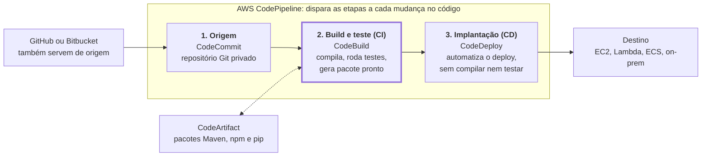

CI = integração contínua (CodeBuild). CD = entrega contínua (CodeDeploy). Cloud9 (IDE no navegador) e X-Ray (depuração) não são etapas do pipeline.

| Serviço | Etapa | Pista no enunciado |
|---|---|---|
| CodeCommit | Origem: repositório Git privado | "hospedar repositório Git" |
| CodeBuild | Build e teste: compila, roda testes e gera pacotes prontos para implantar. É o serviço de integração contínua (CI), gerenciado e pago por minuto de build | "compilar código", "rodar testes", "integração contínua" |
| CodeDeploy | Implantação: automatiza o deploy em EC2, Fargate, Lambda e servidores locais | "automatizar a implantação" |
| CodePipeline | Orquestra o fluxo inteiro de CI/CD a cada mudança de código, usando os outros por baixo | "pipeline", "automatizar build, teste e deploy a cada commit" |
| CodeArtifact | Repositório de pacotes de software (Maven, npm, pip) | "armazenar e compartilhar pacotes" |

> [!WARNING]
> **Pegadinha:** o CodePipeline não compila: ele chama o CodeBuild. O CodeDeploy não testa: só implanta. "Compila, testa e gera pacote pronto para implantar" é sempre **CodeBuild**.

### Frontend, web e mobile

| Serviço | O que é |
|---|---|
| AWS Amplify | Construir e hospedar aplicações web e mobile full stack |
| AWS AppSync | APIs GraphQL gerenciadas, com dados em tempo real |
| AWS Device Farm | Testar aplicativos em celulares e navegadores reais |
| Amazon API Gateway | Publicar e proteger APIs |

### Computação de usuário final

| Serviço | O que é | Pista no enunciado |
|---|---|---|
| Amazon WorkSpaces | Desktop virtual completo (Windows ou Linux) na nuvem | "desktop virtual", "funcionários remotos", "VDI" |
| Amazon AppStream 2.0 | Streaming de aplicações de desktop para o navegador, sem o desktop inteiro | "entregar um aplicativo específico" |
| Amazon WorkSpaces Secure Browser | Navegador seguro para acessar sites e SaaS internos | "acesso seguro a aplicações web internas" |

### IoT

| Serviço | O que é |
|---|---|
| AWS IoT Core | Conecta milhões de dispositivos à nuvem com segurança |
| AWS IoT Greengrass | Leva computação e lógica da AWS para o dispositivo na borda |

### Negócios e outros

| Serviço | O que é |
|---|---|
| Amazon Connect | Central de atendimento na nuvem |
| Amazon SES | E-mail em escala |
| AWS Elastic Disaster Recovery | Recuperação de desastre de servidores |
| AWS Ground Station, robótica, blockchain, jogos e mídia | Fora do escopo da prova. Quando aparecem, costumam ser distratores |

### Estratégias de recuperação de desastre

Da mais barata e lenta para a mais cara e rápida:

| Estratégia | O que fica ligado | Recuperação |
|---|---|---|
| 1. Backup and restore | Só backups | Horas |
| 2. Pilot light | O núcleo mínimo (banco replicado); o resto sobe no desastre | Dezenas de minutos |
| 3. Warm standby | Cópia reduzida e funcional do ambiente | Minutos |
| 4. Multi-site ativo-ativo | Ambiente completo em duas Regions | Quase instantânea |

**RTO** é quanto tempo se aceita ficar fora do ar. **RPO** é quanto dado se aceita perder, medido em tempo.

---

## 26. Pegadinhas: pares que a prova troca

Leia esta seção por último, na véspera. Cada linha é um par em que as duas alternativas parecem certas.

### Segurança e auditoria

| Par | Como separar |
|---|---|
| CloudTrail x CloudWatch x Config | Ações de API x desempenho e logs x estado da configuração |
| GuardDuty x Inspector x Macie | Ameaça ativa na conta x vulnerabilidade de software x dado sensível no S3 |
| GuardDuty x Detective | Detecta x investiga a causa raiz |
| Shield x WAF | DDoS (camadas 3 e 4) x ataques web (camada 7) |
| WAF x Network Firewall x Firewall Manager | Aplicação web x VPC inteira x gestão central das regras |
| Security Group x NACL | Instância, stateful, só allow x sub-rede, stateless, allow e deny |
| KMS x CloudHSM | Multi-inquilino gerenciado x hardware dedicado |
| Secrets Manager x Parameter Store | Rotação automática, pago x configuração simples, gratuito |
| Artifact x Audit Manager | Relatórios de conformidade da AWS x evidências da sua conta |
| IAM x Cognito x IAM Identity Center | Acesso à conta AWS x login de usuários do seu app x login único de funcionários |
| Usuário IAM x Role | Credencial fixa x credencial temporária assumida |
| SCP x policy IAM | Teto da conta, não concede x concede permissão à identidade |
| Organizations x Control Tower | Agrupa contas e aplica SCP x monta o ambiente multi-contas pronto |
| Security Hub x Trusted Advisor | Agrega achados de segurança x recomenda boas práticas em 6 categorias |

### Computação e rede

| Par | Como separar |
|---|---|
| Reserved Instances x Savings Plans | Preso a tipo de instância x compromisso em dólar por hora, mais flexível |
| Spot x On-Demand | Interrompível e até 90% mais barato x sem interrupção e sem compromisso |
| Dedicated Host x Dedicated Instance | Servidor físico visível, BYOL por núcleo x só isolamento de hardware |
| Elastic Beanstalk x CloudFormation | Sobe uma aplicação web x provisiona qualquer infraestrutura por template |
| Lambda x Fargate x EC2 | Função curta por evento x contêiner sem servidor x servidor completo |
| ECS x EKS | Orquestrador da AWS x Kubernetes |
| ALB x NLB x GWLB | HTTP camada 7 x TCP/UDP camada 4 com IP fixo x appliances de terceiros |
| Auto Scaling x ELB | Muda a quantidade de instâncias x distribui tráfego entre elas |
| Internet Gateway x NAT Gateway | Entrada e saída da sub-rede pública x só saída da sub-rede privada |
| VPC Peering x Transit Gateway | Um a um, não transitivo x hub para muitas VPCs |
| VPN x Direct Connect | Internet, criptografada, rápida de montar x fibra dedicada, estável, demora |
| Endpoint Gateway x Endpoint Interface | S3 e DynamoDB, gratuito x demais serviços, via PrivateLink |
| CloudFront x Global Accelerator | Cache de conteúdo na borda x IP fixo e rota otimizada, sem cache |
| Region x AZ x edge location | Área geográfica x data centers isolados x ponto de cache |
| Local Zone x Outposts x Wavelength | Perto de uma cidade x dentro do seu data center x dentro da rede 5G |

### Armazenamento e dados

| Par | Como separar |
|---|---|
| S3 x EBS x EFS | Objeto x bloco para uma instância x arquivo compartilhado |
| EBS x instance store | Persistente x efêmero |
| EFS x FSx for Windows | Linux, NFS x Windows, SMB |
| Standard-IA x One Zone-IA | Várias AZs x uma AZ, para dado recriável |
| Glacier Instant x Flexible x Deep Archive | Milissegundos x minutos a horas x 12 a 48 horas |
| Intelligent-Tiering x Lifecycle | Padrão de acesso desconhecido x regra definida por você |
| Storage Gateway x DataSync x Snow | Acesso híbrido contínuo x cópia online x cópia offline |
| RDS Multi-AZ x Read Replica | Disponibilidade x desempenho de leitura |
| RDS x Aurora x DynamoDB | Relacional de engine conhecida x relacional de alto desempenho x NoSQL serverless |
| RDS x Redshift | Transações (OLTP) x análise (OLAP) |
| Athena x Redshift | SQL avulso sobre o S3 x data warehouse dedicado |
| ElastiCache x DAX | Cache geral x cache só do DynamoDB |
| DMS x SCT | Move os dados x converte o schema |
| Glue x EMR | ETL serverless x cluster Hadoop e Spark |

### Integração, IA e operação

| Par | Como separar |
|---|---|
| SQS x SNS | Fila, pull, guarda a mensagem x tópico, push, vários assinantes |
| SQS x Kinesis | Mensagens entre componentes x streaming de dados em tempo real |
| SQS x Amazon MQ | Nativo de nuvem x broker padrão para migração |
| SNS x SES | Notificação x e-mail em escala |
| EventBridge x Step Functions | Roteia eventos x orquestra passos |
| Transcribe x Polly | Fala para texto x texto para fala |
| Textract x Rekognition x Comprehend | Texto de documentos x imagem e vídeo x significado do texto |
| Lex x Kendra | Chatbot x busca corporativa |
| SageMaker x Bedrock | Treinar modelo próprio x usar modelo de fundação pronto |
| WorkSpaces x AppStream 2.0 | Desktop inteiro x só o aplicativo |

### Custos e suporte

| Par | Como separar |
|---|---|
| Pricing Calculator x Cost Explorer | Estimar antes x analisar depois |
| Cost Explorer x Budgets | Visualiza e prevê x alerta ao passar do limite |
| Cost Explorer x Cost and Usage Report | Gráficos prontos x dado bruto mais detalhado |
| Compute Optimizer x Trusted Advisor | Rightsizing com base em métricas x verificações gerais de boas práticas |
| Business Support+ x Enterprise Support | 30 minutos e sem TAM x 15 minutos e TAM designado |
| CapEx x OpEx | Investimento adiantado x custo variável pelo uso |
| Escalabilidade x elasticidade | Conseguir crescer x crescer e encolher sozinho |
| Alta disponibilidade x tolerância a falhas | Recupera rápido x não percebe a falha |

### Palavras-gatilho

| Se o enunciado diz | Pense em |
|---|---|
| "Menor esforço operacional", "sem gerenciar servidores" | Serverless e gerenciado: Lambda, Fargate, DynamoDB, S3, Aurora Serverless |
| "Desacoplar" | SQS, SNS, EventBridge |
| "Auditoria", "quem fez" | CloudTrail |
| "Menor privilégio" | Policies IAM |
| "Credenciais temporárias" | Roles e STS |
| "Padrão de acesso desconhecido" | S3 Intelligent-Tiering |
| "Tolera interrupção" | Spot |
| "Carga estável por 1 ou 3 anos" | Reserved Instances ou Savings Plans |
| "Latência global de conteúdo" | CloudFront |
| "Conexão dedicada e privada" | Direct Connect |
| "Residência de dados", "exigência legal" | Escolha de Region |
| "Alta disponibilidade" | Várias AZs |
| "Recuperação de desastre" | Várias Regions |
| "Repetível", "template" | CloudFormation |
| "Relatório de conformidade da AWS" | Artifact |
| "Dados pessoais no S3" | Macie |
| "Lift and shift" | Rehost, Application Migration Service |

---

## 27. Revisão do simulado

Os erros do primeiro simulado (70%), com a resposta certa, o motivo de a alternativa errada enganar e a seção onde o assunto está.

| Tema da questão | Resposta certa | Por que a outra opção engana | Seção |
|---|---|---|---|
| Fase do CAF que expande pilotos até a escala desejada | Scale | Launch só coloca os pilotos em produção | [3](#3-adoção-da-nuvem-e-migração) |
| Fase do CAF que demonstra valor incremental e coleta insights | Launch | Scale vem depois, quando o piloto já deu certo | [3](#3-adoção-da-nuvem-e-migração) |
| Conectar o on-premises à AWS (escolha dois) | Site-to-Site VPN e Direct Connect | Amazon Connect é call center; Transit Gateway é hub e precisa de um link | [17](#17-conectividade-e-entrega-de-conteúdo) |
| Desconto em qualquer Region, família, tamanho, SO e tenancy | Savings Plans (Compute) | Reserved Instances ficam presas a família e Region | [11](#11-amazon-ec2) |
| Coleção de recursos técnicos para construir na AWS | AWS Architecture Center | Trusted Advisor verifica a sua conta, não ensina arquitetura | [24](#24-planos-de-suporte) |
| Hub central para VPCs e redes locais | Transit Gateway | Client VPN liga usuários; peering é um a um | [17](#17-conectividade-e-entrega-de-conteúdo) |
| Portfólio de recursos pré-aprovados com acesso restrito | Service Catalog | RAM compartilha recursos entre contas, sem catálogo | [7](#7-organização-multi-contas) e [25](#25-outros-serviços-que-aparecem) |
| Recurso incluído no Business Support+ | Architecture Support | Well-Architected Reviews, concierge e TAM são do Enterprise | [24](#24-planos-de-suporte) |
| Plano mais barato com Support API | Business Support+ ("Business" em questões antigas) | Basic não tem a API | [24](#24-planos-de-suporte) |
| Aplicação serverless com banco chave-valor (escolha dois) | Lambda e DynamoDB | RDS é relacional; ECR só guarda imagens | [12](#12-outros-serviços-de-computação) e [18](#18-bancos-de-dados-e-cache) |
| Consultar dados direto no S3 (escolha dois) | Athena e Redshift Spectrum | ElastiCache é cache em memória | [19](#19-analytics-e-serviços-de-dados) |
| Integração contínua que compila, testa e empacota | CodeBuild | CodeDeploy só implanta; CodePipeline orquestra | [25](#25-outros-serviços-que-aparecem) |
| Coletar e processar streams em tempo real | Kinesis Data Streams | Glue é ETL em lote | [19](#19-analytics-e-serviços-de-dados) |
| Meses de histórico no Cost Explorer | 12 meses | 15 meses é a retenção de métricas do CloudWatch | [23](#23-custos-preços-e-ferramentas) |
| Estado em que só o EBS é cobrado | Stopped | Terminated apaga o volume raiz e para de cobrar | [11](#11-amazon-ec2) |
| Recursos do Route 53 (escolha dois) | Resolução DNS e registro de domínio | Filtrar tráfego é WAF; DDoS é Shield | [17](#17-conectividade-e-entrega-de-conteúdo) |
| Automatizar avaliação de vulnerabilidades | Amazon Inspector | Shield é DDoS; Config avalia configuração | [9](#9-camadas-de-proteção) |
| Restringir acesso ao S3 servido pelo CloudFront | Origin Access Control | SCP é do Organizations; SNI e sticky sessions são do load balancer | [17](#17-conectividade-e-entrega-de-conteúdo) |
| Onde fazer upload de certificados SSL (escolha dois) | ACM e IAM | KMS guarda chaves, não certificados | [8](#8-criptografia-chaves-e-segredos) |

> [!TIP]
> **Dica para "escolha dois":** elimine primeiro as alternativas de outra categoria (call center, cache, registro de imagem, IDE). Quase sempre sobram exatamente as duas certas.

---

## Fontes

- [Guia oficial do exame AWS Certified Cloud Practitioner (CLF-C02)](https://docs.aws.amazon.com/aws-certification/latest/cloud-practitioner-02/cloud-practitioner-02.html)
- [Comparação de planos do AWS Support](https://aws.amazon.com/premiumsupport/plans/): planos atuais, tempos de resposta e recursos.
- [Documentação do AWS Support](https://docs.aws.amazon.com/awssupport/latest/user/aws-support-plans.html): planos que dão acesso à Support API e ao Trusted Advisor completo.
- [AWS Well-Architected Framework](https://docs.aws.amazon.com/wellarchitected/latest/framework/welcome.html) e [AWS Cloud Adoption Framework](https://docs.aws.amazon.com/whitepapers/latest/overview-aws-cloud-adoption-framework/welcome.html).
- O restante vem do conteúdo consolidado do guia da CLF-C02 e da documentação dos serviços. Preços, descontos e limites numéricos são aproximados e mudam; a prova cobra a ordem de grandeza e a comparação, não o número exato.
